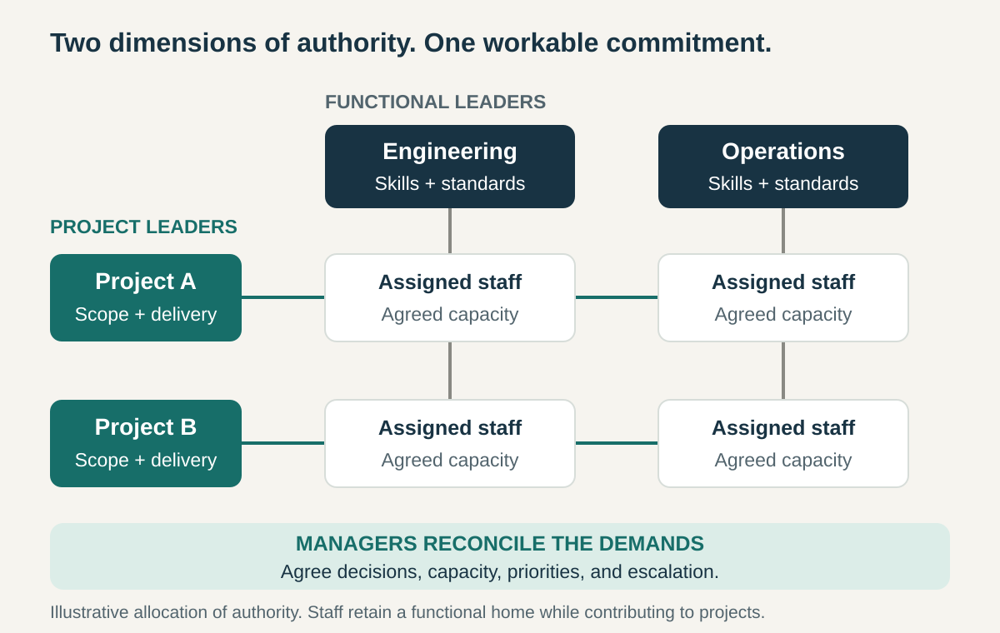

**Core question:** How can two important dimensions both shape decisions without leaving people trapped between competing demands?

## What it is for

A hypothetical engineering consultancy runs several major projects. Each needs specialist engineers, a delivery schedule, and a coherent result for its client. The specialists also need professional supervision, consistent methods, and development beyond the current assignment.

Giving all authority to projects risks fragmenting that expertise. Keeping it entirely in functional departments can make project commitments difficult to enforce.

Matrix Organization gives both dimensions an explicit place in management. Functions sustain capability while projects direct its application to particular outcomes.

The same principle can operate across products and countries, or other genuinely interdependent dimensions. It addresses a continuing need to reconcile different responsibilities throughout an organization or a substantial part of it.

## The core idea

**Distribute formal authority across intersecting organizational dimensions, and define how their leaders make decisions and resolve conflicts together.**

A person may report to a functional manager for capability and career development while working under a project manager responsible for delivery. In a product–geography matrix, product leaders and regional leaders have distinct responsibilities that intersect in local business decisions.

The two sides need not have equal authority over every matter. A workable matrix specifies which decisions each owns, which require agreement, and who resolves a deadlock. Galbraith describes how international organizations combine business, country, and functional dimensions, often producing mixed arrangements. [Galbraith, _The Evolution of Enterprise Organization Designs_, 2012](https://jaygalbraith.com/wp-content/uploads/2024/03/EvolEnterpriseOrgDesign.pdf)

A cross-functional working group can coordinate contributions without establishing this distribution of authority. The important distinction is whether both dimensions have a recognized role in directing the work and its resources.

## How it works

**Choose dimensions that deserve authority.** Each must represent a persistent need: professional capability, project delivery, product coherence, or adaptation to a market. Adding reporting lines without a clear purpose adds negotiation overhead.

**Divide decisions explicitly.** In the consultancy illustration, a functional manager maintains engineering methods and proposes suitable staff. A project manager defines required deliverables and sequences agreed work. Staffing commitments, significant changes, and exceptions have a defined joint process. This is one possible division of authority; different matrices allocate it differently.

**Make one credible capacity agreement.** Suppose an engineer is committed three days a week to Project A and two to Project B. An urgent request for another day needs a change in priorities, staffing, or dates. It cannot become a third promise layered over the existing five days.

**Resolve conflicts between managers.** The leaders concerned first negotiate within their mandates. A named sponsor or forum settles disagreements they cannot resolve. Employees need a clear route to surface conflicting instructions.

**Align evaluation and information.** Managers use common plans, visible commitments, and relevant input from both dimensions. Otherwise, someone can satisfy the project while being penalized by the function, or the reverse.

## Why it works

The matrix brings different forms of knowledge and responsibility into decisions. A functional leader sees capability needs and technical consequences across projects. A project leader sees the client commitment and how contributions fit together.

Shared authority can allow specialist capability to serve several outcomes without recreating an entire department for each one. It also gives cross-functional delivery an organizational voice.

The benefit comes with a continuing cost: leaders must reconcile priorities and resource commitments. PMI’s account describes the importance of authority, accountability, and negotiation in making the arrangement work. [PMI, _The Matrix Organization_](https://www.pmi.org/learning/library/matrix-organization-structure-reason-evolution-1837)

The design is useful when that reconciliation improves decisions enough to justify the effort. Extra conversations alone do not establish that it is working.

## Examples

### NASA Goddard: staffing a mission through specialist organizations

In an interview about developing the MAP mission, which launched in 2001, project manager Elizabeth Citrin described Goddard’s matrix arrangement. A project could request specialists from its engineering organizations. Her predecessor, Richard Day, instead invested time in selecting particular people to build a team that could work well together. Citrin credited that early effort with smoother collaboration. [NASA, _ASK_, issue 1, interview with Elizabeth Citrin, pages 25–27 of the PDF](https://appel.nasa.gov/wp-content/uploads/2013/09/ASK_1.pdf); [NASA’s MAP/WMAP mission history](https://science.nasa.gov/mission/wmap/wmap-overview/)

The distinction is concrete: staffing meant connecting people from continuing specialist homes to a mission’s delivery needs. Selecting the right mix required more than asking for a number of engineers.

Citrin also recalled difficulty combining two line organizations’ approaches to ground systems. Higher management supported a trial that eventually brought them together. This is a participant’s account of historical practice, illustrating the negotiation and leadership the arrangement required.

### ABB: reconsidering a product–region matrix

ABB’s 2019 strategy presentation depicted its existing arrangement through divisions, regions, and corporate functions. Its proposed replacement gave businesses fuller operational ownership, including products, functions, and territories. The comparison shows a matrix extending beyond individual project teams to the enterprise’s organizing dimensions. [ABB, _Strategy Update_, February 2019, slides 29–30](https://global.abb/content/dam/abb/global/group/investors/documents/ir-events/2019/group_strategy_update_presentation-20191.pdf)

By June 2020, ABB reported that it had discontinued its longstanding matrix and shifted more responsibility into its businesses. [ABB, _Our Way Forward_, June 2020](https://resources.news.e.abb.com/attachments/published/63578/en-US/4ED8267499FF/ABB_Our_Way_forward.pdf)

The lesson is about design choice. ABB’s leadership chose to concentrate authority after operating with several intersecting dimensions. Its statements document the transition and intended benefits; they do not demonstrate that matrices universally fail or that the change alone caused later performance. This is a historical comparison, not ABB’s current organization chart.

## Useful when

- **Two dimensions genuinely matter.** Ignoring either would weaken important decisions about capability, delivery, products, or markets.
- **Specialists must serve several outcomes.** Separate dedicated departments would be difficult to sustain.
- **Leaders can negotiate commitments.** They have shared information, usable decision rights, and a reliable escalation route.
- **The coordination cost is acceptable.** The work warrants the time needed to reconcile demands and maintain working relationships.

## Common mistakes and limits

**Making employees settle managerial conflicts.** Two leaders can each give reasonable instructions that cannot both be fulfilled. Managers must resolve the competing commitments instead of relying on personal endurance.

**Giving everyone authority over everything.** Shared governance needs boundaries. Clarify whose decision a technical standard, staffing allocation, deadline, or local-market requirement actually is.

**Promising the same capacity repeatedly.** Assignments across projects must add up to an achievable workload. A matrix does not create additional specialist time.

**Treating dotted lines as sufficient.** A chart cannot specify response times, agreement rights, or escalation thresholds. Those arrangements need to be understood and used in real decisions.

**Rewarding only one dimension.** People may follow whichever manager controls appraisal or advancement. Evaluation needs to recognize the contributions and constraints that the organization expects them to balance.

**Adding dimensions indefinitely.** Every additional axis creates more relationships to reconcile. If one dimension can be served through advice, standards, or a service agreement, formal shared authority may be unnecessary.

A functional organization may fit when specialist coordination dominates. A divisional structure may fit when a business can own most of its important decisions. Matrix arrangements deserve review when negotiation routinely consumes more effort than the choices it improves.

## Related patterns

- [[functional-organization|Functional Organization]] supplies a continuing home for specialist capability; a matrix adds another dimension of authority.
- [[divisional-organization|Divisional Organization]] concentrates more responsibility within a business unit and offers an alternative when its boundaries contain the important dependencies.
- [[teamwork-clarify-decision-rights|Clarify Decision Rights]] makes the intersecting mandates operational by specifying participation, authority, and limits for particular choices.
