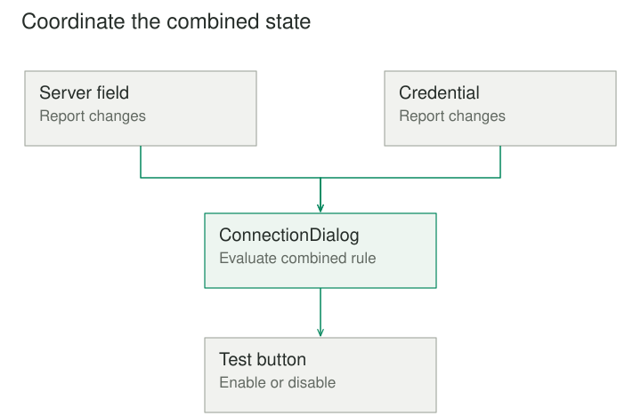

## Purpose and problem

A settings dialog contains a server selector, an authentication checkbox, a credential field, a test button, and a status message. Every control updates several others directly. Selecting a server changes authentication options; editing credentials enables testing; running a test disables inputs. A simple dialog has become a web of peer references.

## Core idea

Mediator moves those collaboration rules into a coordinator. Controls report meaningful events to the mediator, and the mediator decides how the other controls should respond. Each control can focus on its own behavior instead of understanding the whole dialog.



## How it works

A component still owns what it does internally. A credential field can validate its text format and display its own value. The mediator owns rules that arise from the combination of components: whether a valid server and valid credentials make the test button available, for example.

This changes the dependency structure. Instead of every participating object knowing several peers, each knows an appropriate communication boundary. The mediator can know the participants because coordination is its explicit responsibility.

The arrangement can reduce many peer relationships to a more inspectable collaboration hub. It does not eliminate coupling altogether. It concentrates coupling to a particular interaction model, which can be a good trade when that model has a coherent scope.

## Worked example

### A dialog whose rules can be read together

Suppose the user selects a server that requires authentication. The server selector emits a selection event. The dialog mediator enables the credential field, marks the test result as out of date, and recalculates whether the test button should be enabled.

When credentials change, the field reports the change. The mediator clears a previous result and applies the same readiness rule. The field does not need a direct reference to the server selector, test button, or status message.

Before the mediator, readiness logic is copied across controls and can disagree. Afterward, the collaboration rule has one owner. A test can supply controlled participant objects and verify the sequence of interactions for a meaningful event.

The mediator should not become responsible for every detail of input formatting or rendering. Moving all code into one object would replace tangled coupling with an oversized controller. The useful boundary separates a participant's own behavior from rules about participants working together.

### A small implementation

A control reports a change to the dialog mediator rather than directly changing its peers. The mediator reads the combined state and owns the rule for enabling the test button. This is synchronous local UI coordination.

```python
class Field:
    def __init__(self, mediator):
        self.mediator = mediator
        self.value = ""

    def set_value(self, value):
        self.value = value
        self.mediator.changed()


class TestButton:
    def __init__(self):
        self.enabled = False


class ConnectionDialog:
    def __init__(self):
        self.server = Field(self)
        self.credential = Field(self)
        self.test_button = TestButton()

    def changed(self):
        self.test_button.enabled = bool(
            self.server.value.strip() and self.credential.value.strip()
        )


dialog = ConnectionDialog()
dialog.server.set_value("staging")
print(dialog.test_button.enabled)
dialog.credential.set_value("test credential")
print(dialog.test_button.enabled)
# False
# True
```

The fields know only how to notify their mediator. They do not hold references to the button or each other. The mediator coordinates availability; a real credential field and server selector still need their own validation. Centralizing their collaboration should not move every local behavior into the mediator.

### Coordinating a local workflow

A desktop import tool has a file chooser, a parser, a progress view, and a results view. The chooser should not directly start manipulating progress widgets or construct result rows. An ImportMediator receives a file-selected event, starts the parsing operation, updates progress, and supplies the completed result to the results view.

This allows the chooser and views to remain reusable. A different screen can provide another coordinator with a different interaction policy without changing their basic behavior.

Asynchronous work introduces an important complication. A user can select another file while parsing the first. The mediator needs an operation identity or cancellation policy so a late result from the old import does not overwrite the new one. Centralizing coordination makes that rule easier to locate, but does not supply it automatically.

Failures should also have an explicit route. A parse failure may reset progress and display a diagnostic, while a canceled operation may simply return the interface to readiness. Treating every completion event alike can produce misleading state.

## When to use it

- Many components know too much about one another.
- Interaction rules change independently from component behavior.

Consider a simpler design when a few direct relationships are already clear, or when the coordinator would absorb unrelated domain logic.

## Tradeoffs and common mistakes

Mediator is useful when components have a shared interaction purpose and direct references have become difficult to maintain. It can improve reuse and make collaboration rules easier to test independently from rendering or low-level component behavior.

The main risk is growth. A mediator that handles every event from an entire application can accumulate unrelated policies, dependencies, and state. Several scoped mediators, each associated with a coherent workflow or screen, may be clearer than one universal coordinator.

Event vocabulary matters. Events such as server_changed or import_completed express participant meaning. A generic notify(sender, string) mechanism can be convenient but may produce fragile string comparisons and unclear contracts. Types or deliberate event structures can make the interaction protocol easier to inspect.

Feedback loops need care as well. If setting a field causes another change event, the mediator can re-enter its own rules. Distinguishing user-originated edits from programmatic updates, applying idempotent updates, or handling an explicit transaction of changes may be necessary.

## Related patterns

[[observer|Observer]] provides a subscription mechanism for notifications. A mediator can subscribe to participants using Observer, but the subscription mechanism does not itself contain the collaboration policy. Mediator supplies the decision about how one participant's event affects others.

[[facade|Facade]] gives external clients a focused interface to a subsystem. Mediator manages interactions among components within a collaboration. An object can expose a facade-like start operation and also mediate internal events, but those roles should remain understandable.

[[command|Command]] can represent the actions a mediator requests, especially when they need queuing or history. Representing an action and choosing how participants coordinate around it are separate responsibilities.

## Sources

Mediator is one of the 23 patterns in Gamma, Helm, Johnson, and Vlissides, [*Design Patterns: Elements of Reusable Object-Oriented Software*](https://www.informit.com/store/design-patterns-elements-of-reusable-object-oriented-9780201633610). The examples, code, and illustrations here are original educational explanations.
