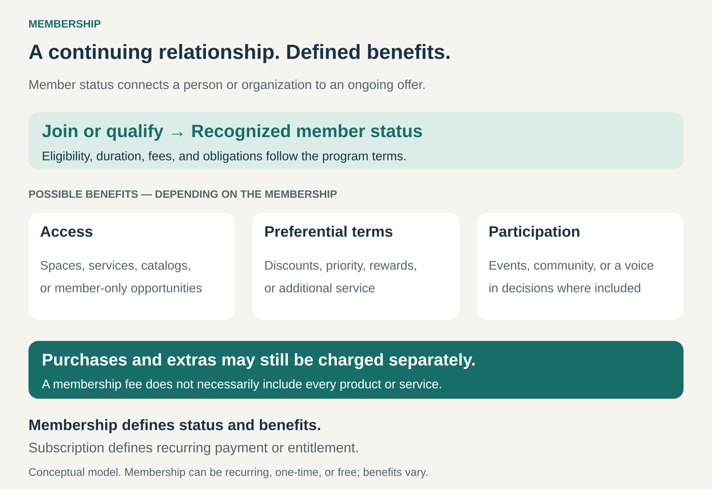

## What it is for

Create an ongoing relationship in which recognized members receive defined benefits, privileges, or opportunities to participate. Membership helps businesses organize continuing value around a group of customers rather than around isolated purchases.

A customer regularly shops with the same retailer, uses related services, or participates in a professional community. A membership can connect those activities through one relationship: access, preferential terms, useful services, and sometimes a voice in the organization.

The customer joins a program with stated rights and conditions. The business takes responsibility for making that status worthwhile.

Membership may involve recurring dues, a one-time fee, earned eligibility, or free enrollment.

## The core idea

Give membership status a practical consequence.

Depending on the offer, members might receive:

- **Access:** facilities, services, content, events, or opportunities.
- **Preferential terms:** discounts, rewards, priority, or additional support.
- **Participation:** introductions, community activities, or defined governance rights.

These benefits can be combined, but none is compulsory. A shopping membership does not need a social community. A professional association may derive much of its value from relationships and participation.

The distinction from Subscription is useful:

**Membership defines status and benefits. Subscription structures recurring payment or entitlement.**

Many offers are both. An annual shopping membership uses subscription-style billing to maintain member privileges. A lifetime membership can provide continuing status after one payment.

The name alone proves little. A membership needs to change what someone can receive, access, or participate in.

## How the relationship works

The customer joins or qualifies, receives member status, and becomes eligible for the program’s benefits.

Those benefits can apply across many subsequent interactions. Someone might use delivery privileges on one occasion, attend an event on another, and receive a member price later.

The membership fee does not necessarily pay for the underlying purchases. Members may still buy goods, reserve services, or pay for optional extras.

Eligibility, duration, sharing rules, and cancellation conditions define the boundaries. The organization must also explain which benefits are included and which depend on additional spending or availability.

## Why it works

Membership gives customers a reason to maintain a relationship over time.

A useful set of benefits can reduce repeated purchasing friction, make services easier to discover, and create a familiar place to return. Where participation matters, relationships with other members can contribute additional value.

For the business, membership can generate fee income and support repeat transactions. It also creates opportunities to understand recurring needs and improve the offer around them.

The value can differ between members. One person may care primarily about delivery, another about prices, and another about events or specialist support.

That flexibility can make the overall offer attractive, but it complicates the economics. The organization must fund the benefits people actually use while keeping the package understandable.

A large membership count does not establish a strong relationship. Continuing engagement and delivered value matter.

## Famous examples

### Costco: membership alongside merchandise purchases

Costco offers annual memberships, including Gold Star, Business, and Executive options. Its US Executive membership adds a reward on qualifying purchases and other benefits, subject to conditions and exclusions. [Costco’s membership options](https://www.costco.com/f/-/join-costco), [Costco’s company profile](https://investor.costco.com/company-profile/).

Members still pay for the merchandise they purchase. The fee establishes a continuing relationship with the retailer and access to the relevant membership benefits.

The model therefore has two connected revenue streams: membership fees and purchases.

Its customer value depends on the actual shopping experience and purchases made. The fee alone does not guarantee that every member receives the same savings or benefit.

### Amazon Prime: several benefits within one membership

Amazon Prime combines eligible delivery benefits, shopping offers, and entertainment access within a continuing membership. Amazon’s US explanation includes member shopping events and benefits extending into selected partner services. Conditions apply to individual benefits. [Amazon’s explanation of Prime benefits](https://www.aboutamazon.com/news/retail/prime-membership-shopping-benefits).

The offer connects activities that might otherwise involve separate decisions and payments.

A member can find the package useful without using every component. Someone may join primarily for delivery and later use entertainment or shopping benefits.

This illustrates Membership combined with Bundling and recurring billing. It also creates a communication task: customers need to understand what is included, what costs extra, and which benefits apply to them.

### REI Co-op: lifetime status and participation

REI offers a lifetime membership for a one-time $30 fee. Benefits include member offers, rewards on eligible purchases, and the ability to vote for the board of directors. REI also states that membership benefits can change over time. [REI’s membership explanation](https://www.rei.com/membership).

This separates continuing membership from recurring dues.

It also adds participation to commercial benefits. Members have a defined role in the cooperative, alongside their relationship as customers.

That governance element belongs to REI’s particular structure. Buying a membership elsewhere does not automatically confer voting rights, ownership, or a financial interest in the organization.

## The economics

Membership can earn money directly through fees and indirectly through related purchases or services.

The business must compare those revenues with the cost of providing benefits: discounts, rewards, delivery, support, facilities, events, administration, and any partner payments.

Usage matters. Heavy users may receive substantial value while costing more to serve. Light users may cost little but become dissatisfied if they see no reason to remain.

One-time lifetime memberships require a different funding logic from annual dues. Continuing transactions or other income may need to support benefits long after the initial fee has been collected.

For customers, value depends on benefits they realistically use. Adding together advertised retail values can exaggerate the benefit if the customer would never have purchased those services separately.

A membership is strongest when its continuing usefulness is clear without requiring unnecessary additional spending.

## Useful when

This pattern is especially useful when:

- **The relationship naturally repeats:** customers return to related products, services, or activities.
- **Benefits extend across transactions:** membership status can improve several interactions.
- **Customers share a recognizable interest or need:** the organization can design a coherent offer.
- **Continuing participation adds value:** relationships, learning, or collective activity support the proposition.
- **The benefits are economically sustainable:** fees and related income can fund actual usage.

It is less useful when customers need only an occasional transaction, the benefits are difficult to explain, or the fee mainly creates an obstacle to buying.

## Common mistakes and limits

**Calling a customer list a membership.** Registration has limited value unless it creates meaningful benefits or participation.

**Making the offer difficult to understand.** Numerous exclusions, activation steps, and unfamiliar benefits can leave members unsure what they receive.

**Confusing belonging with a marketing label.** Community requires opportunities for interaction and contribution. It does not appear automatically when customers are called members.

**Counting benefits instead of relevance.** A short set of frequently useful benefits can matter more than a long list of marginal ones.

**Ignoring availability and service quality.** Priority access has little practical value if appointments, inventory, or support remain inaccessible.

**Depending on forgotten renewals.** Low cancellation activity can conceal weak customer value. A sustainable relationship needs reasons to continue that members can recognize.

**Assuming membership means ownership.** Governance or ownership rights must come from the organization’s actual structure and terms.

## Related patterns

- [[subscription|Subscription:]] can maintain membership through recurring payments, while membership itself need not require recurring dues.
- [[bundling|Bundling:]] combines benefits into one offer; membership can make that bundle available through continuing status.
- [[shared-access|Shared Access:]] can provide the facilities or resources members use, with separate rules for allocating capacity.
- **Loyalty Programs:** reward or recognize customer behavior. Membership can include those mechanisms while also providing access, services, or participation.
