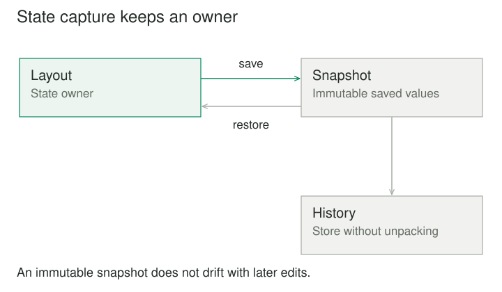

## Purpose and problem

A layout editor needs undo. Its history manager begins by copying the editor's coordinates, selection, and display settings directly. When the editor later introduces a constraint model, old snapshots omit it. Restoring positions produces a state that the editor itself would never create through its public operations.

## Core idea

Memento lets the object that owns the state define how that state is captured and restored. A caretaker manages saved snapshots without needing to understand their internal representation. Encapsulation is preserved because restoration knowledge stays with the state owner.



## How it works

The originator is the object whose state is saved. It creates a memento containing the information needed for restoration and knows how to apply it. The caretaker stores mementos, chooses when to capture them, and requests restoration.

The memento is ideally opaque to the caretaker. The caretaker may know a label, creation time, or operation association without being able to manipulate internal state fields. Depending on the language, that opacity can be enforced by types or maintained as an interface convention.

The key distinction is between managing history and defining valid state. A history manager should not need to track every new internal field introduced by the originator. The originator should not need to own the user interface for browsing history.

## Worked example

### Restoring a layout coherently

Suppose a diagram model includes object positions, grouping relationships, alignment constraints, and selected items. Before an edit, the model creates a memento that captures the relevant logical state. The history manager stores it and later asks the model to restore it when the user requests undo.

Restoration reestablishes a coherent relationship among positions, groups, and constraints. The caretaker does not assign fields individually. The model can also invalidate derived rendering caches instead of copying those caches into every snapshot.

The boundary should be deliberate. Does undo restore selection? Does it restore the current viewport? Some editors treat content changes and navigation changes separately. Memento does not prescribe the product decision; it gives the model a place to implement the chosen semantics.

Shared references need attention. If a memento points to a mutable position list that the live model continues editing, the snapshot changes along with the model. Immutable state, defensive copying, or another persistence mechanism is needed to preserve the promised earlier state.

### A small implementation

The layout owns snapshot creation and restoration. History stores the returned value without unpacking it. Python naming conventions provide an encapsulation boundary here, rather than a security barrier against inspecting the snapshot.

```python
from dataclasses import dataclass


@dataclass(frozen=True)
class _Snapshot:
    positions: tuple[tuple[str, int], ...]


class Layout:
    def __init__(self):
        self.positions = {"title": 10, "body": 40}

    def save(self):
        return _Snapshot(tuple(self.positions.items()))

    def restore(self, snapshot):
        self.positions = dict(snapshot.positions)


layout = Layout()
history = [layout.save()]
layout.positions["title"] = 90
layout.restore(history.pop())
print(layout.positions["title"])
# 10
```

The snapshot contains immutable values, so later edits do not modify the saved state. Restoration creates a new dictionary. In a richer layout, the originator would capture and validate all state needed for coherent restoration, including constraints. An in-memory snapshot of one object does not reverse external effects.

### A tentative configuration change

A simulation tool allows a user to adjust several parameters and preview the result. Before opening the settings dialog, the simulation configuration creates a memento. Accepting keeps the new configuration; canceling asks the originator to restore the saved configuration.

This can be clearer than teaching the dialog how to reverse every setter. The dialog cares about a tentative edit session, while the configuration object understands its invariants and derived values.

The preview may have external effects, however. If it wrote a file or sent a request, restoring the configuration does not reverse those actions. The system must avoid such effects during preview, isolate them, or provide an appropriate cleanup or compensation policy.

That limitation is fundamental. Memento restores state within a defined boundary. It does not turn back time for the whole application or the outside world. A snapshot of a request object cannot unsend a message.

## When to use it

- An object needs snapshots or rollback of its own state.
- History management should remain separate from state representation.

Consider a simpler design when restoration is expected to reverse external effects, or when snapshots are too expensive or incompatible without a defined policy.

## Tradeoffs and common mistakes

Saving the entire state before every operation can be simple and robust for small models. For large documents, it can consume substantial memory. Structural sharing with immutable values, incremental snapshots, or a history based partly on commands may provide better tradeoffs.

These optimizations need to preserve the restoration contract. A differential snapshot depends on earlier state and may become unusable if its base is removed. History pruning therefore requires a policy that understands dependencies among stored states.

Persistent mementos introduce schema evolution. A snapshot written by one application version may not fit a later version's invariants. Version markers, migration, or a documented decision to keep mementos only in memory can make the scope clear.

Concurrency also complicates restoration. If another actor edits the same model after a snapshot, blindly restoring it can erase that actor's work. A local undo stack is not automatically a collaborative editing algorithm. Version checks or conflict-aware operations may be needed.

## Related patterns

[[command|Command]] represents an operation and may store a memento to reverse its effect. Memento represents restorable state. A command history and a snapshot history can coexist, with each carrying the information appropriate to the operation.

[[prototype|Prototype]] copies a representative object to create a new object. A memento captures state for restoring an existing originator. Both may involve copying, but their purpose, identity, and access boundaries differ.

[[state|State]] organizes state-dependent behavior through explicit state objects. A memento can capture which state was active along with other model data, but saving a state is distinct from designing behavior for it.

## Sources

Memento is one of the 23 patterns in Gamma, Helm, Johnson, and Vlissides, [*Design Patterns: Elements of Reusable Object-Oriented Software*](https://www.informit.com/store/design-patterns-elements-of-reusable-object-oriented-9780201633610). The examples, code, and illustrations here are original educational explanations.
