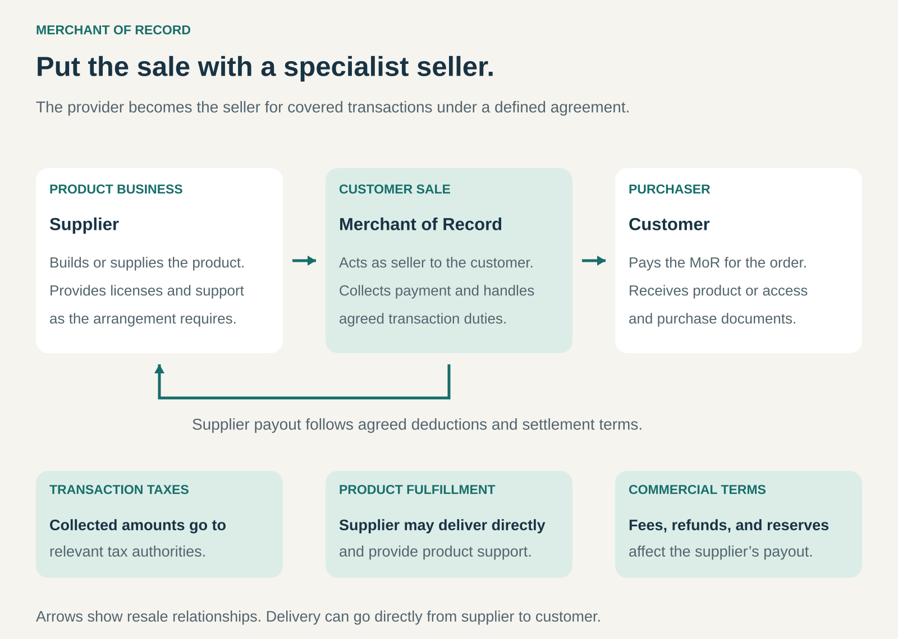

## What it is for

A software company wants to sell internationally. A retailer receives orders from countries with unfamiliar taxes, payment methods, and purchasing requirements.

The product is ready. Completing and administering each sale creates another layer of work.

A Merchant of Record provider becomes the seller for covered customer transactions and handles the agreed responsibilities surrounding those sales.

It is useful when a business wants specialist infrastructure for selling, collecting payment, administering transaction taxes, and managing purchase-related issues.

## The core idea

**Put the customer sale with a specialist seller while continuing to supply the product.**

Merchant of Record, often shortened to _MoR_, describes a role. The business pattern is providing that role as a service to other businesses.

The arrangement commonly involves a reseller relationship:

- **The supplier** develops or sources the product and provides agreed fulfillment and support.
- **The Merchant of Record** sells to the customer and administers the covered transaction.
- **The customer** purchases through that seller, even when shopping within the supplier’s branded experience.

The provider commonly handles payment acceptance, applicable sales tax or VAT, purchase documentation, refunds, and payment disputes within its service scope.

The important distinction is the seller role. Payment processing alone does not transfer that role to the processor.

Software arrangements make the separation particularly visible. Paddle explains that the customer purchases from Paddle while the developer remains the product’s licensor and provides product-related support. [Paddle: procurement and reseller relationship](https://www.paddle.com/about/procurement)

## How it works

**Establish the commercial arrangement.** The provider approves eligible products, markets, and business activities. The agreement defines selling rights, fees, responsibilities, settlement, and treatment of refunds and disputes.

**Connect the purchase experience.** The supplier integrates the provider’s checkout, invoicing, or commerce infrastructure. The customer needs clear information about the seller and where to obtain billing help.

**Complete the customer sale.** The MoR accepts the order under the applicable purchase terms, collects payment, and produces the relevant purchase documents.

**Administer transaction obligations.** The provider calculates, collects, reports, and remits applicable transaction taxes within the covered arrangement. Other services may include local payment methods, fraud screening, subscription billing, and cross-border order administration.

**Deliver the product.** The supplier may activate software access, issue a license, or ship goods directly. Becoming the seller does not necessarily mean physically holding inventory.

**Settle with the supplier.** The provider pays the amount due after taxes, fees, refunds, and other contractual adjustments. Settlement schedules and reserves affect when money becomes available.

The division of work needs to remain clear after checkout. Billing questions, product faults, subscription changes, and returns can involve different teams.

## Why it works

The provider concentrates capabilities that would otherwise be distributed across many suppliers: payment relationships, transaction-tax administration, purchase support, and commerce systems.

Those capabilities can serve multiple businesses. A supplier gains access to an established operating structure while paying through the commercial arrangement.

The model can also simplify international expansion. A small product team may be able to reach supported markets without building a separate transaction operation for each one.

For the provider, fees or reseller margins fund that infrastructure and the responsibilities it undertakes.

The supplier gains operational simplicity but accepts another party in the commercial relationship. Product eligibility, customer-facing purchase terms, settlement, and some transaction decisions become subject to the provider’s framework.

The value depends on that exchange being worthwhile for both parties.

## Famous examples

### Paddle — selling software while developers supply the product

Paddle acts as a reseller and Merchant of Record for software businesses. Its documentation explains that this seller role allows it to take responsibility for collecting and paying applicable VAT and sales tax on covered transactions.

A concrete example is n8n Cloud. n8n’s help center identifies Paddle as its Merchant of Record and directs transaction-tax corrections through Paddle’s billing support process.

The customer uses n8n’s product, while Paddle supplies the seller-side transaction infrastructure.

This illustrates the separation between the product relationship and the purchase relationship. The developer remains central to the customer’s experience even though another company administers the sale. [Paddle: transaction-tax responsibilities](https://www.paddle.com/help/start/intro-to-paddle/how-paddle-is-able-to-take-on-your-vat-and-tax-responsibilities), [n8n: Paddle’s billing role](https://support.n8n.io/article/how-do-i-get-a-refund-for-incorrectly-charged-vat)

### FastSpring — separating purchase terms from software-use terms

FastSpring describes its model as purchasing products or services from the supplier and reselling them to the end customer.

Its documentation distinguishes FastSpring’s terms for the purchase transaction from the supplier’s end-user license agreement governing use of the product.

That distinction makes the mechanism tangible. A software publisher can remain responsible for what its application does and how it is licensed, while FastSpring handles the covered sale and associated transaction services.

FastSpring subsequently settles with the supplier according to its payout arrangements, including applicable deductions.

The example shows why a MoR service is more than an embedded payment form: it changes the contractual structure behind the purchase. [FastSpring: terms and reseller relationship](https://developer.fastspring.com/docs/about-terms-conditions-and-eulas), [FastSpring: payouts](https://developer.fastspring.com/docs/receive-payouts)

### Global-e through Shopify Managed Markets — the model applied to physical goods

Shopify Managed Markets uses Global-e as Merchant of Record for eligible cross-border orders.

Customers shop through the retailer’s branded experience, while the service supplies agreed international transaction capabilities, including tax administration and customs-related services.

Shopify explicitly distinguishes this from using its international-selling tools while remaining your own Merchant of Record.

Physical fulfillment can still be performed by the retailer. The provider’s seller role and the movement of the goods are separate parts of the arrangement.

This example extends the pattern beyond software. It also demonstrates the importance of scope: eligibility depends on the business, products, destinations, and supported order processes. [Shopify: Managed Markets overview](https://help.shopify.com/en/manual/international/managed-markets/overview)

## The economics

Consider a hypothetical transaction with a €100 product price before tax, €20 of applicable VAT, and an agreed €6 provider fee.

| Transaction movement                                        |  Amount |
| ----------------------------------------------------------- | ------: |
| Customer payment                                            |    €120 |
| VAT reserved for remittance                                 |    −€20 |
| Provider’s agreed fee                                       |     −€6 |
| **Amount payable to the supplier before other adjustments** | **€94** |

These figures are illustrative, not a quotation from a provider.

The €20 tax amount is not available as commercial margin. The supplier’s €94 is also not profit: product delivery, support, acquisition, and other business costs still need to be covered.

The provider’s €6 must fund payment costs, transaction administration, support, infrastructure, and the risks it bears under the agreement.

Cash timing adds another distinction. If the agreement temporarily holds €10 as a reserve, the immediate supplier payout would be €84. That holdback is not necessarily an additional fee; release depends on the settlement terms.

Refunds and disputes can create further deductions. Paddle, for example, explains that chargeback amounts and associated fees can be deducted from the supplier’s balance even though the dispute is raised against Paddle. [Paddle: chargeback handling](https://www.paddle.com/help/manage/risk-prevention/understanding-chargebacks-with-paddle)

The meaningful comparison is the full cost and operating burden of the MoR arrangement against maintaining an equivalent selling operation yourself.

## Useful when

- **Sales span several supported markets.** Transaction requirements would otherwise consume substantial internal effort.
- **The product business wants to specialize.** Its strongest capabilities lie in product development, delivery, or customer use.
- **Local payment and purchasing options matter.** Customers expect familiar currencies, methods, and documents.
- **Billing creates recurring work.** Subscriptions, renewals, refunds, and purchase support benefit from established infrastructure.
- **The commercial scope is clear.** Both parties understand covered products, destinations, obligations, and deductions.
- **The fee is justified by the service.** Operational savings and selling capabilities outweigh the additional cost and constraints.

## Common mistakes and limits

**Treating every payment provider as a MoR.** The agreement must establish who actually occupies the seller role.

**Assuming every obligation transfers.** Product quality, intellectual property, fulfillment, data responsibilities, and the supplier’s own taxes can remain with the supplier. The contract and applicable rules determine the allocation.

**Confusing responsibility with protection from every loss.** A provider may administer refunds or disputes while charging their financial consequences back to the supplier.

**Ignoring settlement terms.** Reserves, payout timing, currency conversion, and adjustments can materially affect available cash.

**Assuming every market or product is supported.** Coverage and eligibility have boundaries.

**Confusing Merchant of Record with Importer of Record.** Physical-goods arrangements identify the importing party separately; the MoR does not automatically occupy both roles. [Global-e: terms of sale](https://www.global-e.com/tos)

## Related patterns

- [[managed-service|Managed Service:]] Specialist administration is part of the offer; the seller role gives this pattern its particular structure.
- [[revenue-sharing|Revenue Sharing:]] Provider compensation may depend on transaction value or a reseller margin.
- [[licensing|Licensing:]] The supplier’s product-use license can coexist with the MoR’s customer purchase terms.
- [[white-label|White Label:]] The service can sit within a supplier’s branded experience while identifying the responsible seller appropriately.
