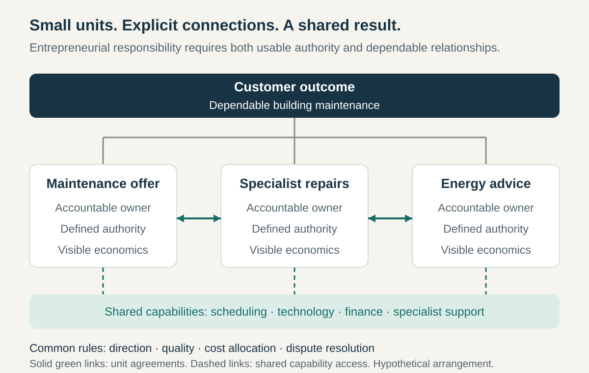

**Core question:** How can a large organization let small units act entrepreneurially while keeping their work connected and accountable?

## What it is for

Imagine a hypothetical home-services company. A local team sees demand for maintaining small apartment buildings, but changing its offer requires approval from separate sales, scheduling, purchasing, and operations departments. Nobody close to the customer can assemble the whole proposition.

Microenterprise Network gives small units responsibility for a defined offering or contribution, together with meaningful operating choices and visible economics. Units connect to one another and to shared capabilities rather than recreating every function themselves.

The pattern applies across an enterprise or a substantial business. Its purpose is to bring decisions closer to users without losing the resources and coordination a larger organization provides.

## The core idea

**Organize work into small units with entrepreneurial responsibility, and coordinate their contributions through explicit agreements within a shared organizational framework.**

Each unit needs a recognizable customer or recipient, a contribution it owns, and authority to influence its results. Some units serve external customers; others supply capabilities used by fellow units. Their economics must remain connected to value delivered outside the organization.

This is more than renaming teams or making divisions smaller. Responsibility includes choices about the offer, resources, delivery, or partnerships, within defined limits. A unit need not be a separately incorporated company, and entrepreneurial responsibility does not automatically give employees legal ownership or unlimited freedom.

The network also needs common direction, dependable information, and ways to resolve conflicts. Agreements can be internal operating commitments; calling them contracts does not establish that the parties are legally independent.

## How it works

**Define a viable unit.** Give it a clear offering or contribution, an accountable leader, and people able to make relevant operating decisions. Define its external or internal customer. Avoid creating tiny units whose results depend almost entirely on choices made elsewhere.

**Match authority to responsibility.** Specify which decisions the unit can make about staffing, spending, suppliers, pricing, or service design. Authority will differ by activity. Central leadership retains defined commitments such as enterprise strategy, capital allocation, and common standards.

**Make the economics understandable.** Show revenue or credited contributions, costs, shared-service charges, and the basis for internal prices. Where results are shared, explain the allocation. A unit cannot manage responsibly if another unit can change its costs without a visible rule or review process.

**Agree the connections.** Units coordinating an offer need commitments about scope, quality, capacity, timing, and who handles problems. Joint work may need a shared outcome and reward arrangement rather than a chain of unrelated internal sales. Agreements should identify who can revise them and how disagreements are resolved.

**Keep common capabilities usable.** Shared technology, finance, facilities, or specialist expertise need clear access arrangements. Mandatory providers require accountable service commitments. Local autonomy means little when an essential dependency can indefinitely block the work.

**Review and reshape the network.** Make customer feedback and operating results visible. Provide routes to resolve cross-unit conflicts, fund promising opportunities, change unit boundaries, and end arrangements that no longer work. Retain responsibility for customers when a unit changes or closes.

In the home-services illustration, a building-maintenance unit owns the customer offer. It agrees capacity with a specialist repair unit and books scheduling support from a common service. A recurring conflict over emergency work triggers a review of the joint commitment, rather than repeated informal favors.

## Why it works

Small units can connect customer feedback to decisions without passing every issue through several departmental layers. Responsibility for an offer or contribution gives people a reason to understand its usefulness, cost, and dependencies together.

Visible economics can expose arrangements that a larger budget conceals. Explicit agreements make dependencies discussable: the issue becomes what each party needs to deliver a shared result, rather than which department can obtain senior attention.

The network preserves access to capabilities that would be difficult for each unit to sustain independently. These benefits depend on credible information, workable boundaries, and cooperation. Negotiating every minor interaction can consume the time saved by decentralizing decisions.

## Examples

### Haier: microenterprises collaborating around user needs

In an April 2023 interview, Haier Smart Home CEO Huagang Li described microenterprises with decision-making, employment, and resource-distribution rights. He emphasized that they collaborate through ecosystem micro-communities rather than operating as isolated businesses. [Huagang Li, _Haier’s self-evolving organization_, interview, 26 April 2023](https://www.mckinsey.com/capabilities/people-and-organization/our-insights/a-business-of-its-times-haiers-self-evolving-organization)

His kitchen example explains the coordination problem. Users wanted connected appliances and a kitchen that fitted the home’s overall design. Separate refrigerator, oven, or range-hood offerings could not, by themselves, meet that broader need. The micro-community arrangement connected contributions across teams and industry boundaries.

The example combines local entrepreneurial authority with collaboration around a wider user outcome. It also shows why maximizing each unit’s standalone sales is an incomplete organizing principle. This is a dated management account of the model and its rationale, rather than independent evidence that every unit has identical authority or that the arrangement caused Haier’s performance.

### Kyocera: a related small-unit accounting network

Kyocera’s official account, consulted in October 2026, describes Amoeba Management as dividing the organization into small profit-and-loss units linked to their markets. Each can buy and sell with other amoebas and uses monthly plans and an Hourly Efficiency report. Its account of unit leadership assigns responsibilities for planning, operating results, labor, and purchasing. [Kyocera, _Market-oriented divisional accounting_](https://global.kyocera.com/inamori/about/manager/amoeba/amoeba01.html) and [Inamori Library, _Amoeba Management_](https://global.kyocera.com/inamori/library/floor/second/detail02.html)

The arrangement connects local management with an internal exchange system. Unit members can see operating results, making the relationship between their decisions and the unit’s economics more visible than an undifferentiated departmental budget would.

Kyocera also describes unit plans as following the direction and goals of the whole company. Its system therefore illustrates a related mechanism of accountable small units within a common framework. It should not be treated as identical to Haier’s model: these sources do not establish the same employment rights, reward arrangements, or freedom to form units. Nor do they establish that internal trading always improves the customer’s outcome.

## Useful when

- **Customer opportunities stall between departments.** Nobody close to the need can assemble an offer and make meaningful decisions.
- **Contributions can be bounded sensibly.** Units can own identifiable work without negotiating every detail of everyday delivery.
- **Shared capabilities remain valuable.** Small units need access to expertise, infrastructure, or reach they cannot reproduce alone.
- **The organization can make economics credible.** Costs, commitments, customer results, and internal allocations can be understood and challenged.

## Common mistakes and limits

**Delegating targets without authority.** A unit cannot be entrepreneurial while every useful decision requires central permission. Match the mandate to choices it can actually make.

**Confusing internal revenue with customer value.** Transfer prices can move apparent profit between units without improving the organization’s overall result. Assess the complete offer and total cost.

**Turning every relationship into bargaining.** Excessive negotiation, invoicing, and dispute handling can overwhelm small units. Standardize recurring commitments and reserve negotiation for consequential choices.

**Ignoring common obligations.** Brand, quality, shared infrastructure, and long-term capability still need owners. Local results should not reward shifting these costs onto others.

**Assuming everyone benefits equally.** Units differ in bargaining power, resources, and dependence on essential providers. Transparent rules and fair conflict resolution matter alongside autonomy.

A tightly coupled operation may need unified scheduling and authority. A small organization may gain little from separate unit accounts. Where boundaries or outcomes cannot be made intelligible, a simpler functional or divisional arrangement may work better.

## Related patterns

- [[divisional-organization|Divisional Organization]] locates business responsibility in distinct units; a microenterprise network emphasizes smaller entrepreneurial mandates and explicit horizontal relationships.
- [[shared-services|Shared Services]] supplies common capabilities through accountable service commitments instead of duplicating them in every unit.
- [[teamwork-optimize-the-whole|Optimize the Whole]] counters internal trading and performance targets that benefit one unit while damaging the customer outcome.
