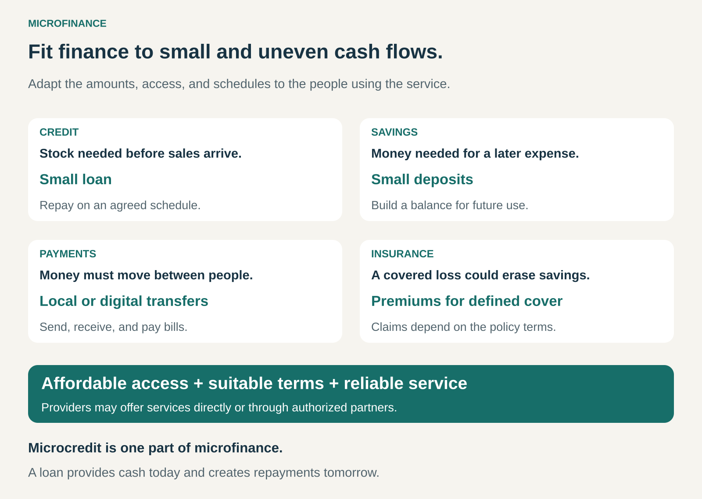

## What it is for

A market trader may need a small amount of money to replenish stock. A farmer may earn most of the year’s income at harvest. A household may want to save regularly without meeting a bank’s minimum balance requirements.

These are ordinary financial needs, but conventional banking can be poorly suited to serving them. Small transactions, irregular earnings, limited collateral, and distant branches can make access difficult.

Microfinance adapts financial services to people with low incomes and small enterprises that established financial institutions have underserved. It can help them manage money, finance productive activity, and prepare for unexpected expenses.

## The core idea

Design financial services around customers whose balances, transactions, and income patterns do not fit conventional banking assumptions.

That can mean smaller amounts, accessible locations, different ways of assessing repayment capacity, and schedules that reflect when customers actually receive money.

**Microcredit is one part of microfinance.** The broader approach includes savings, payments, and insurance as well as loans. Financial inclusion is the wider goal of enabling people and businesses to access and use suitable, affordable financial services. [CGAP: Financial inclusion and microfinance](https://www.cgap.org/about/financial-inclusion)

As a business-model pattern, Microfinance combines a particular customer focus with a delivery model designed to make serving those customers viable. Providers can include banks, cooperatives, nonprofit institutions, and specialist financial businesses.

## How it works

The starting point is the customer’s financial life: how money arrives, where it goes, and what makes access difficult.

For credit, a provider assesses whether a customer can repay an appropriate amount. Depending on the model, it may use business cash flows, local knowledge, transaction records, or group relationships alongside—or instead of—conventional collateral.

For savings, the challenge may be accepting small deposits conveniently and allowing customers to access their money when needed. For payments, it may be reducing travel and transaction costs. Insurance can help manage specified risks through defined coverage.

Providers may offer these services themselves or work through appropriately authorized partners. Not every microfinance institution offers every service.

The design challenge is to make small transactions practical for both parties while keeping the service understandable and suitable for the customer.

## Why it works

**It changes the economics of reaching customers.** Local officers, shared meeting points, agents, and digital channels can reduce the distance between customers and financial services. Different models balance convenience, operating cost, and personal support.

**It uses information that conventional processes may overlook.** Someone without a formal salary or substantial assets may still operate a dependable business. Understanding that business can reveal repayment capacity that a standard application misses.

**It matches financial timing to real activity.** A trader restocking weekly and a farmer waiting for harvest need different repayment arrangements. The same loan amount can be manageable under one schedule and difficult under another.

**It gives customers more ways to manage money.** Credit brings future spending power forward. Savings build resources over time. Payments move money, while insurance addresses defined risks. The appropriate tool depends on the need.

## Famous examples

### Grameen Bank: bringing banking closer to borrowers

Grameen Bank in Bangladesh is one of the best-known microfinance institutions. Its approach includes lending without conventional collateral and conducting much of its banking activity through village-level borrower meetings. Its services also include savings products. [Grameen Bank’s description of its model](https://grameenbank.org.bd/)

The important innovation concerns access and delivery as much as loan size. Customers can interact with banking services close to where they live, through an operating model built around their circumstances.

Grameen illustrates one influential approach. Microfinance does not universally require borrower groups, weekly meetings, or collateral-free lending.

### BRAC: adapting repayments to seasonal income

BRAC’s microfinance work in Bangladesh shows why repayment design matters.

In its account of a seasonal lending program, BRAC describes customers who needed to invest before receiving income several months later. The product allowed a single repayment at the end of a six-month term instead of the usual weekly or monthly instalments. [BRAC: Introducing seasonal loans](https://www.brac.net/stay-informed/the-good-feed/putting-farmers-first-introducing-seasonal-loans-from-brac-microfinance/)

This addresses a specific mismatch: a farmer can have a plausible future source of repayment while lacking cash for frequent instalments before harvest.

The timing change does not remove agricultural risk. It makes the payment schedule better aligned with the activity being financed.

### Bank Rakyat Indonesia: combining lending with savings

Indonesia’s Bank Rakyat Indonesia, or BRI, illustrates microfinance within a large banking institution.

Its Kupedes lending product serves businesses across sectors and offers repayment arrangements including monthly and seasonal schedules. Its Simpedes savings product supports deposits, withdrawals, and payment access through BRI’s network. [BRI: Kupedes](https://bri.co.id/en/kupedes), [BRI: Simpedes](https://bri.co.id/en/simpedes)

The combination matters. A customer’s financial needs extend beyond obtaining another loan: receiving money, accumulating savings, and paying expenses can be equally important.

BRI also demonstrates that microfinance can form part of a broader commercial banking model.

## The economics

Small loans can be expensive to administer relative to their size. Assessing an application, visiting a customer, processing payments, and handling difficulties all require resources, even when little money is lent.

This helps explain why microcredit interest rates can exceed those on larger bank loans. Operating costs, funding costs, and credit losses must be covered—or supported by an explicit subsidy. Higher costs explain a pricing challenge; they do not establish that every price is reasonable. [CGAP research on microcredit interest rates](https://www.cgap.org/research/publication/microcredit-interest-rates-and-their-determinants-2004-2011)

For a lender, repayment of principal replenishes lending capital. Interest and fees contribute toward costs and any surplus. The total amount repaid is not all revenue or profit.

For customers, affordability depends on the full cost and the schedule. Business sales alone do not show repayment capacity: operating expenses, household needs, existing debts, and income fluctuations also matter.

## What the evidence supports

Microfinance should be judged by what it helps customers do.

A major 2015 synthesis of six randomized evaluations found some positive effects from expanded microcredit access, including changes in business activity and financial choices, but little evidence of transformative effects for the average borrower. Effects varied, and the authors emphasized limitations in the studies’ precision and scope. [Banerjee, Karlan, and Zinman: Six randomized evaluations of microcredit](https://www.povertyactionlab.org/sites/default/files/research-paper/AEJ%20Banerjee%20Intro.pdf)

Those findings concern particular credit products and settings. They do not settle the value of every savings, payment, insurance, or lending service.

The practical implication is to assess customer outcomes directly. More accounts, larger loan books, and high repayment rates do not automatically demonstrate improved livelihoods.

## Useful when

Microfinance is particularly useful when:

- Customers have financial needs that conventional products serve poorly.
- Small businesses need manageable amounts of working capital.
- Income is irregular or seasonal, requiring suitable payment schedules.
- Distance, transaction size, or account requirements obstruct access.
- Savings, payments, or insurance could address a need more effectively than additional borrowing.

Credit is less suitable when a customer lacks a credible repayment source or needs help covering a persistent shortfall that borrowing would deepen. Grants, social support, or other assistance may better address those circumstances.

## Common mistakes and limits

**Reducing microfinance to small loans.** A savings account or affordable payment service may solve the customer’s problem without creating debt.

**Assuming a small loan is a small burden.** What matters is the obligation relative to the customer’s resources and income volatility.

**Treating repayment as proof of benefit.** Borrowers may repay by cutting essential spending, selling assets, or borrowing elsewhere. High collection rates can coexist with serious hardship. [CGAP: Over-indebtedness in microcredit](https://www.cgap.org/research/publication/too-much-microcredit-survey-of-evidence-on-over-indebtedness)

**Applying one schedule to everyone.** Frequent instalments can suit some activities while creating pressure for customers whose income arrives later.

**Confusing group support with unlimited responsibility.** Group arrangements differ. Their repayment obligations and consequences need to be clear; social pressure can also impose costs.

**Assuming every customer should become an entrepreneur.** Financial services can help households manage everyday life as well as support businesses. Credit cannot create demand for a product, repair infrastructure, or guarantee a profitable livelihood.

## Related patterns

[[bottom-of-the-pyramid|Bottom of the Pyramid]] — Both focus on customers often overlooked by established businesses. Microfinance applies that focus specifically to financial services and their delivery.

[[blended-value|Blended Value]] — A provider may pursue financial sustainability alongside social outcomes. Both require measurement; a successful institution does not automatically mean successful customers.

[[crowdfunding|Crowdfunding]] — Crowdfunded lending can supply capital for microloans. Crowdfunding describes how funding is assembled; microfinance describes the customers and financial services being served.
