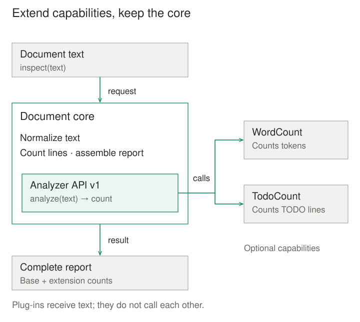
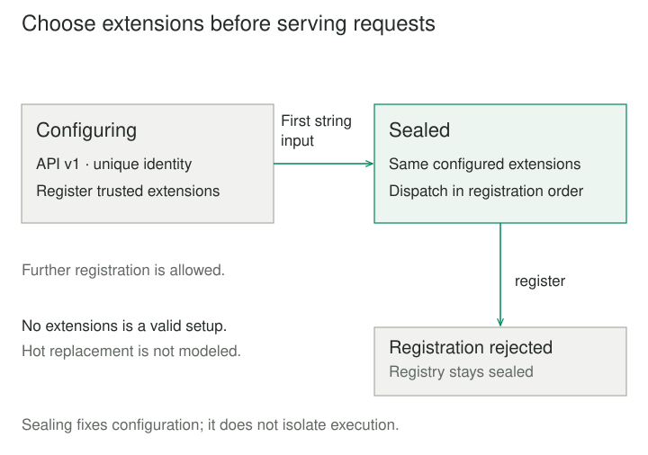

## Purpose and problem

A document tool opens text, normalizes line endings, and produces a basic report. One team needs word counts; another needs counts of unfinished TODO notes. Every addition currently changes the central processing function. Customers who need only the basic report still receive every specialized feature and its dependencies.

The product needs a dependable common workflow while allowing different capabilities to evolve and be selected separately. Copying the application for each customer would duplicate its basic behavior. Adding more conditionals would keep every variation inside the same change boundary.

## Core idea

**Microkernel** keeps the functionality needed to operate the system in a stable core and moves specialized capabilities into plug-ins. The core exposes extension contracts and coordinates the selected extensions. A useful mental model is **one product foundation with explicit places to extend it**. Richards and Ford call this application architecture **plug-in architecture**. [Microkernel architecture style](https://www.oreilly.com/library/view/fundamentals-of-software/9781492043447/ch12.html).

The name also appears in operating-system design. An OS microkernel minimizes privileged mechanisms, with higher-level services built outside it. This article concerns an application architecture; its plug-ins do not acquire OS-style protection merely by being separate modules. [OS microkernel meaning](https://sel4.systems/About/FAQ.html).



## How it works

### A useful core and a deliberate extension surface

The core owns common workflow, shared invariants, and the extension API. Each plug-in owns a specialized capability. In the document tool, normalization and report assembly belong to the core; recognizing words or TODO markers belongs to extensions. The core still returns a useful base report without them.

A registry associates extension identities with implementations. The contract specifies inputs, outputs, errors, compatibility, and any services the core makes available. A version number helps reject known incompatibility; it cannot prove that an implementation behaves correctly. Richards discusses registries, plug-in contracts, and versioning in his [architecture report](https://www.oreilly.com/content/software-architecture-patterns/).

### Configuration is distinct from execution

Someone must choose, validate, and activate extensions before dispatching work. Discovery might be explicit application wiring or installed-package metadata; Python's packaging guide describes [plug-in discovery mechanisms](https://packaging.python.org/en/latest/guides/creating-and-discovering-plugins/). Discovery alone establishes neither compatibility nor trust.

The example registers trusted objects during startup and seals its registry on the first string input. It executes extensions sequentially in registration order. Every extension sees the same immutable string. There is no live unloading, dependency resolver, or synchronization for concurrent reconfiguration.



## Worked example

### Add analysis without changing the document workflow

Before separation, the report function contains every optional analysis. Afterward, it normalizes once, computes the base line count, and invokes registered analyzers through one contract. Adding another count changes a plug-in and startup wiring, rather than the core's dispatch logic.

Save these three files together and run `python3 main.py`. They require Python 3.8 or later and its standard library. Inputs are strings; plug-ins return nonnegative integer counts. `Protocol` describes the expected interface for type checkers, while the explicit checks enforce selected runtime conditions. [Python typing](https://docs.python.org/3/library/typing.html#typing.Protocol).

**kernel.py — common behavior and extension management**

```python
from typing import Protocol


class Analyzer(Protocol):
    name: str
    api_version: int

    def analyze(self, text: str) -> int:
        ...


class DocumentKernel:
    def __init__(self):
        self._plugins = {}
        self._sealed = False

    def register(self, plugin: Analyzer):
        if self._sealed:
            raise RuntimeError("Registration is closed")
        if plugin.api_version != 1:
            raise ValueError("Incompatible analyzer API")
        if not isinstance(plugin.name, str) or not plugin.name.strip():
            raise ValueError("Analyzer name is required")
        if plugin.name in self._plugins:
            raise ValueError("Duplicate analyzer name")
        self._plugins[plugin.name] = plugin

    def inspect(self, text: str):
        if not isinstance(text, str):
            raise TypeError("Text must be a string")
        self._sealed = True
        normalized = text.replace("\r\n", "\n").replace("\r", "\n").strip()
        counts = {}
        for name, plugin in self._plugins.items():
            count = plugin.analyze(normalized)
            if type(count) is not int or count < 0:
                raise ValueError("Analyzer must return a nonnegative integer")
            counts[name] = count
        return {"lines": len(normalized.splitlines()), "extensions": counts}
```

**plugins.py — two independent capabilities**

```python
class WordCount:
    name = "words"
    api_version = 1

    def analyze(self, text: str) -> int:
        return len(text.split())


class TodoCount:
    name = "todos"
    api_version = 1

    def analyze(self, text: str) -> int:
        return sum(line.lstrip().startswith("TODO:") for line in text.splitlines())
```

**main.py — select capabilities at startup**

```python
from kernel import DocumentKernel
from plugins import TodoCount, WordCount


text = "Draft notes\r\nTODO: cite sources"
print(DocumentKernel().inspect(text))

app = DocumentKernel()
app.register(WordCount())
app.register(TodoCount())
print(app.inspect(text))
# {'lines': 2, 'extensions': {}}
# {'lines': 2, 'extensions': {'words': 5, 'todos': 1}}
```

The unextended core reports two lines. With both plug-ins, it additionally reports five whitespace-separated tokens and one line whose first non-whitespace characters are `TODO:`. These are example counting definitions, not linguistic word segmentation. Normalization trims surrounding whitespace; an empty document produces zero lines and zero extension counts.

An incompatible version or duplicate name fails during registration. After the first string input, further registration raises `RuntimeError`. A plug-in exception or invalid count aborts the request without returning a partial report; earlier plug-in side effects would not be rolled back. These analyzers use no files, network clients, or persistent state.

### A larger extension ecosystem

Eclipse demonstrates extension points across a product platform: plug-ins can contribute tools, libraries, or documentation, and can define further extension points. Its registry exposes versions, states, and dependencies. A real product may therefore need dependency and lifecycle management well beyond this small registry. [Eclipse architecture](https://help.eclipse.org/latest/topic/org.eclipse.platform.doc.isv/guide/arch.htm), [registry](https://help.eclipse.org/latest/topic/org.eclipse.pde.doc.user/guide/tools/views/plugin_registry.htm).

## When to use it

Microkernel fits a product with a relatively stable common workflow and independently varying features, customer customizations, or provider extensions. Repeated edits to central conditionals and unwanted dependencies in minimal installations are useful signals.

A few fixed choices may need only ordinary functions or Strategy. Configuration data is simpler when only values vary. A plug-in API earns its maintenance cost when it provides a useful boundary for separately developed or selected capabilities.

## Tradeoffs and common mistakes

**The extension API becomes a product commitment.** Changing shared types or semantics can break every plug-in. Compatibility tests need real core–extension combinations, not just version checks. Hidden imports between plug-ins can make supposedly optional features inseparable.

**A small core can still be wrongly chosen.** Putting every future decision behind a generic hook produces a framework before its variation is understood. Conversely, allowing plug-ins to modify arbitrary core internals makes stable contracts ineffective.

**Modularity does not contain failures.** In-process extensions share privileges and resources. An exception can fail a request; a non-terminating extension can block it. Untrusted extensions need an appropriate isolation design. Separate processes introduce protocol, timeout, and recovery decisions.

**Lifecycle and ordering remain design work.** Stateful extensions need explicit concurrency rules. Extensions that open resources need activation and cleanup ownership, including startup failures. Hot replacement must deal with in-flight work and state migration. The example intentionally supports none of those operations.

## Related patterns

[[ports-and-adapters|Ports and Adapters]] separates application conversations from external technologies. Microkernel emphasizes extending a product's capabilities; its extension contracts can use ports and adapters.

[[strategy|Strategy]] varies an algorithm behind a contract. It can implement one extension point, while Microkernel also addresses the core, extension selection, and compatibility across a product.

[[adapter|Adapter]] can translate a third-party extension into the core's expected contract, provided the underlying behavior satisfies it.

[[layers|Layers]] orders responsibilities by abstraction. A microkernel's core can contain internal layers while optional capabilities remain extensions.

## Sources

Buschmann, Meunier, Rohnert, Sommerlad, and Stal include Microkernel among the architectural patterns in [*Pattern-Oriented Software Architecture, Volume 1*](https://www.oreilly.com/library/view/pattern-oriented-software-architecture/9781118725269/9781118725269_c02.xhtml); the accessible preview establishes that catalog placement. [Richards and Ford](https://www.oreilly.com/library/view/fundamentals-of-software/9781492043447/ch12.html) describe the application core–plug-in form and alias. [Richards' report](https://www.oreilly.com/content/software-architecture-patterns/) explains registry and contract choices. The official Eclipse, Python, PyPA, and seL4 documentation linked above supports the implementation examples and distinctions.

The document tool, Python implementation, and illustrations are original teaching material. They demonstrate explicit startup configuration and synchronous dispatch, without dynamic package loading or fault isolation.
