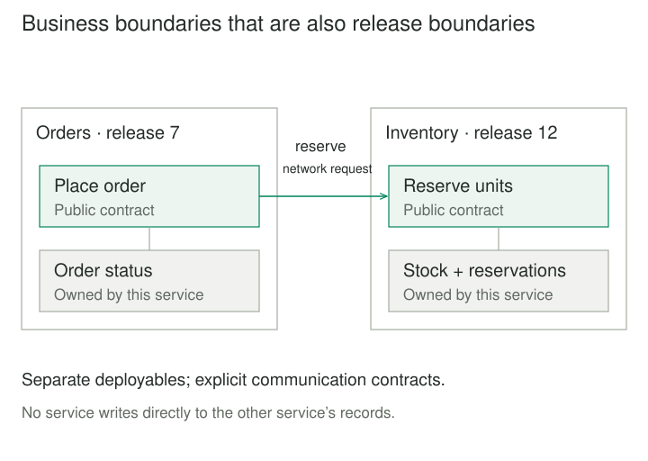
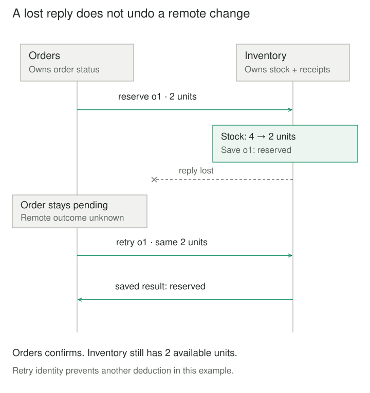

## Purpose and problem

An online shop releases checkout and stock management together. Inventory needs extra capacity during warehouse imports, while the checkout team wants to release a new ordering flow. Every deployment rebuilds both capabilities, and each team waits for the other's release checks.

Separating their deployment could help, but checkout still needs to reserve stock. A local function call would become a network interaction that can fail midway. The design must preserve useful business boundaries while accepting the operational and consistency costs of distribution.

## Core idea

**Microservices** divides an application into services that can be changed, tested, and deployed independently. Each service owns a cohesive business capability, its implementation, and access to its data. Other services use explicit communication contracts.

The mental model is **business boundaries that are also release boundaries**. James Lewis and Martin Fowler's influential [2014 description](https://martinfowler.com/articles/microservices.html) emphasizes separate processes, business capabilities, lightweight communication, and independent deployment. There is no universal line-count threshold for “micro.”

Microservice Architecture and Microservices Architecture name the same style here. A container, serverless function, or separate repository alone does not establish it. Microservices overlaps with service-oriented architecture; this article focuses on capability ownership and deployment independence, rather than treating every use of services as equivalent.



## How it works

### Own a capability and its contract

Choose boundaries around business work, such as placing orders or allocating inventory, rather than separating controllers from database access into network services. Chris Richardson's [architecture catalog](https://microservices.io/patterns/microservices.html) defines loosely coupled, independently deployable services and describes the tension between autonomy and simple, efficient interactions.

A service team owns its deployment pipeline, operational health, and compatibility obligations. Existing callers must keep working during a rollout. Additive contract changes often allow versions to coexist; removing a field or changing its meaning requires coordination. A shared repository is possible when services still build and release independently.

### Keep records behind their owner

Orders owns order status; Inventory owns available units and reservations. Orders cannot update Inventory's tables to skip the API. Richardson's [Database per Service](https://microservices.io/patterns/data/database-per-service.html) distinguishes logical ownership from physical hosting: private tables or schemas can share a database server, with permissions enforcing access.

A transaction inside Inventory does not automatically include Orders. Cross-service workflows need explicit states, recovery, and sometimes compensation. Asynchronous messages are an option, not a requirement; they introduce delivery, duplication, and ordering contracts of their own.

### Expect partial failure

A deadline bounds waiting, but a timeout cannot prove that the remote operation did nothing. Bound retries, preserve operation identities, and define which failures are safe to retry. Microsoft's [architecture guidance](https://learn.microsoft.com/en-us/azure/architecture/guide/architecture-styles/microservices) discusses runtime coupling, versioning, tracing, and fault handling: separate processes do not by themselves prevent a failing dependency from disrupting its callers.



## Worked example

### An order survives an uncertain reservation

Before separation, checkout changes order and stock records in one local transaction. After separation, Orders records a pending intent, asks Inventory to reserve units, and confirms only after receiving success. A definite shortage rejects the order; an ambiguous timeout leaves it pending.

Save these three files together and run `python3 demo.py` using Python 3.8 or later. This is a serial, in-memory simulation, not a deployed service pair. JSON round trips model value-based messages; the transport deliberately loses one reply after Inventory changes its state. No sockets or external packages are required.

**inventory.py — Inventory's owned state and reservation operation**

```python
class Inventory:
    def __init__(self, units):
        self.available = units
        self._results = {}

    def reserve(self, request):
        key, units = request["order_id"], request["units"]
        if not isinstance(key, str) or not key:
            raise ValueError("Order identity is required")
        if type(units) is not int or units <= 0:
            raise ValueError("Units must be a positive integer")
        if key in self._results:
            previous_units, result = self._results[key]
            if units != previous_units:
                raise ValueError("Identity reused with different units")
            return dict(result)
        status = "reserved" if units <= self.available else "rejected"
        if status == "reserved":
            self.available -= units
        result = {"status": status}
        self._results[key] = (units, result)
        return dict(result)
```

**orders.py — Orders knows the contract, not Inventory's implementation**

```python
class Orders:
    def __init__(self, reserve):
        self._reserve = reserve
        self._orders = {}

    def place(self, order_id, units):
        if not isinstance(order_id, str) or not order_id:
            raise ValueError("Order identity is required")
        if type(units) is not int or units <= 0:
            raise ValueError("Units must be a positive integer")
        order = self._orders.setdefault(
            order_id, {"units": units, "status": "pending"}
        )
        if units != order["units"]:
            raise ValueError("Identity reused with different units")
        if order["status"] == "pending":
            try:
                reply = self._reserve({"order_id": order_id, "units": units})
                order["status"] = {
                    "reserved": "confirmed", "rejected": "rejected"
                }[reply["status"]]
            except TimeoutError:
                pass  # Outcome unknown; retain the pending intent.
        return dict(order)
```

**demo.py — transport test double and observation**

```python
import json
from inventory import Inventory
from orders import Orders


inventory = Inventory(4)
lose_reply = True


def reserve(request):
    global lose_reply
    received = json.loads(json.dumps(request))
    reply = inventory.reserve(received)
    if lose_reply:
        lose_reply = False
        raise TimeoutError("Reply lost after reservation")
    return json.loads(json.dumps(reply))


orders = Orders(reserve)
for _ in range(3):
    order = orders.place("o1", 2)
    print(order["status"], inventory.available)
# pending 2
# confirmed 2
# confirmed 2
```

The inputs are a stable order identity and a count of units of one product. Output pairs show order status and remaining stock units. The first call reserves two of four units but loses its reply. The second retrieves the remembered result for `o1`; the third uses Orders' terminal state. No extra units are deducted. An oversized request returns `rejected`, while invalid units or identity reuse raise an error.

The harness observes stock only to explain the result; Orders never reads it. The operation identity is scoped to this single caller and product. AWS's [idempotent API guidance](https://aws.amazon.com/builders-library/making-retries-safe-with-idempotent-APIs/) explains why stable identities, equivalent responses, and atomic recording of effects matter. Production needs durable, concurrency-safe reservation records, caller-scoped keys, and a retention policy. Restarting this toy loses both services' state; it cannot guarantee recovery after a crash.

## When to use it

Consider this style when established capabilities need different release schedules, capacity, or operational ownership, and those benefits justify distributed workflows. A separately scaled image-processing service, for example, may run many workers while order processing keeps a smaller deployment.

Teams need automated deployment, monitoring, rollback, and incident ownership. Fowler's [prerequisites](https://martinfowler.com/bliki/MicroservicePrerequisites.html) explain why these capabilities matter before service counts grow. When boundaries are uncertain or one release remains adequate, a modular monolith usually makes changes and debugging simpler.

## Tradeoffs and common mistakes

**A distributed monolith.** Services that require coordinated releases or repeatedly call one another for tiny operations retain coupling while adding latency. Reconsider the boundary, not merely the protocol.

**Confusing isolation with independence.** A service can exhaust shared infrastructure or make callers wait. Set resource limits, deadlines, and recovery policies. Authenticate service identities and authorize operations; network placement alone supplies neither.

**Claiming global guarantees from local success.** The simulation's explicit retry converges only while remembered state survives and communication succeeds. It provides no global transaction, cancellation, ordering across different orders, or exactly-once transport. Production needs reconciliation for abandoned pending work and explicit policies for permanent failures.

**Ignoring operational cost.** More deployables mean more contracts, telemetry, credentials, and on-call responsibility. Independent deployment reduces some coordination, while contract evolution and cross-service diagnosis still require collaboration.

## Related patterns

[[modular-monolith|Modular Monolith]] keeps capability boundaries inside one deployment. Microservices makes selected boundaries independently deployable and introduces remote-failure semantics.

[[data-bounded-contexts|Bounded Contexts]] separates meanings and domain models. A context informs service boundaries but does not prescribe one service per context.

[[ports-and-adapters|Ports and Adapters]] separates application behavior from transport and storage. It can structure the internals of an individual service.

[[data-transactional-outbox|Transactional Outbox]] couples a local state update with durable intent to publish a message. It helps an asynchronous collaboration but does not make all services one transaction.

## Sources

Lewis and Fowler's [Microservices](https://martinfowler.com/articles/microservices.html) establishes the influential description and naming context. Richardson's [architecture catalog](https://microservices.io/patterns/microservices.html) and [data ownership pattern](https://microservices.io/patterns/data/database-per-service.html) describe service boundaries and their consequences. [Microsoft](https://learn.microsoft.com/en-us/azure/architecture/guide/architecture-styles/microservices) covers operational challenges; [Fowler](https://martinfowler.com/bliki/MicroservicePrerequisites.html) covers prerequisites. [Malcolm Featonby's AWS article](https://aws.amazon.com/builders-library/making-retries-safe-with-idempotent-APIs/) supports the retry contract.

The shop scenario, bounded Python simulation, and illustrations are original teaching material. They explain ownership and uncertainty without claiming production deployment or measured performance.
