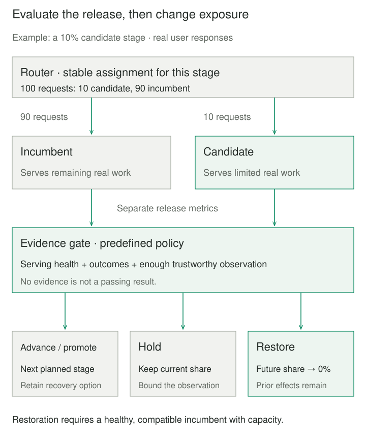

## Purpose and problem

A new ticket-routing service passes staging checks, but its production inputs, traffic peaks, and dependency behavior remain uncertain. Replacing every instance at once exposes all customers to any missed defect. Waiting for perfect confidence in a test environment may never resolve those uncertainties.

Canary Release puts a candidate in charge of a limited portion of real work, measures what happens, and uses that evidence to decide what comes next. Some users experience the candidate’s mistakes. The purpose is to bound exposure and improve release decisions while retaining a practical recovery path.

## Core idea

**Expose a little; evaluate; change exposure deliberately.** The candidate serves actual responses while the incumbent serves the remainder. A release controller advances, holds, or restores routing according to predefined evidence rules.

Canary Deployment and Canary Rollout describe this same staged release mechanism. A traffic-percentage schedule alone is insufficient: expansion needs evaluation and a way to stop. The existing model-serving name, Canary Rollout with Rollback, remains an alias of this article. Canary comparisons can use experimental techniques; claims about business lift require appropriate assignment and statistical design.



## How it works

Identify the complete release: application or model, preprocessing, configuration, and compatible dependencies. A router assigns work; a controller owns stages, observation limits, and decisions; monitoring attributes outcomes to the version that served them. Keep incumbent capacity and current-state compatibility available for restoration.

Choose a meaningful assignment unit, such as account or session, when a journey needs consistent behavior. Check representation across customer groups, geography, and load. Google’s SRE guidance emphasizes population, duration, and attributable metrics together. A few quiet requests cannot establish peak-load readiness, and aggregate endpoint metrics can dilute candidate failures.

Define serving errors, latency, saturation, and relevant business outcomes before release. Compare candidate evidence with both absolute limits and contemporaneous incumbent behavior where useful. Shared dependency failures and unequal infrastructure can contaminate that comparison. For models, successful responses still need quality evaluation against correctly matched, sufficiently mature labels.

Specify **hold** as well as pass and fail. Too little traffic, missing telemetry, or delayed outcomes should not silently approve expansion. Argo Rollouts documents inconclusive analysis pausing a rollout; actual controller behavior depends on configuration. A hold still exposes users unless routing changes separately, so assign an owner and a maximum observation period.

A known breach can justify restoration even when other evidence is incomplete. Recovery still assumes a healthy, adequately provisioned incumbent compatible with current inputs, protocols, and stored data. Returning traffic does not retract responses or repair committed effects. In-flight work, detection delay, and routing convergence can add exposure after a defect appears. Continue monitoring after full promotion and retire old capacity only after its recovery obligations close.

## Worked example

### A ticket-model serving failure

The candidate serves ten requests in the first window and none fail, so the controller advances. In the next window it serves twenty-five requests and three fail: 12%, above the 5% failure limit. The controller restores future traffic to the incumbent. It cannot retract the thirty-five candidate requests already served.

| Window | Candidate failures / requests | Decision |
| --- | --- | --- |
| 1 | 0/10 (0%) | Advance |
| 2 | 3/25 (12%) | Restore incumbent |

The following deterministic fixture generates those counts. Its separate prediction-quality gate can also stop a release; incomplete evidence can hold it.

The fictional example uses 100 distinct requests per window, with deterministic buckets 0–99. Buckets below the chosen percentage receive the candidate. The stages are 10%, 25%, 50%, and 100%; windows count requests, not seconds or unique people.

The candidate fails request positions 3, 13, 23, … from window 2 onward. Its other predictions are wrong at multiples of 20. Incumbent serving failures occur at positions 50 and 100. The policy restores routing above 5% candidate serving failures or 10% errors among labeled successful candidate predictions. Equality passes; otherwise at least ten candidate requests and complete nonempty quality labels are needed. These are teaching thresholds, not statistical confidence guarantees.

This complete Python 3.9+ program uses only the standard library and reproduces the explorer’s default gates.

```python
from dataclasses import dataclass


@dataclass(frozen=True)
class Window:
    n: int
    failed: int
    labeled: int
    wrong: int
    control_failed: int


def measure(index, share, scenario="serving", labels=True):
    if type(index) is not int or index < 1:
        raise ValueError("index must be a positive integer")
    if type(share) is not int or not 0 <= share <= 100:
        raise ValueError("share must be an integer percent from 0 to 100")
    if scenario not in ("serving", "quality", "healthy"):
        raise ValueError("unknown scenario")
    failed = labeled = wrong = 0
    for position in range(1, share + 1):
        if scenario == "serving" and index >= 2 and position % 10 == 3:
            failed += 1
            continue
        if labels:
            labeled += 1
            divisor = 5 if scenario == "quality" and index >= 2 else 20
            wrong += position % divisor == 0
    control_failed = sum(p % 50 == 0 for p in range(share + 1, 101))
    return Window(share, failed, labeled, wrong, control_failed)


def gate(w, minimum=10):
    if w.failed * 20 > w.n or w.wrong * 10 > w.labeled:
        return "ROLL BACK"
    if w.n < minimum or w.labeled != w.n - w.failed or not w.labeled:
        return "HOLD"
    return "PROMOTE" if w.n == 100 else "ADVANCE"


if __name__ == "__main__":
    exposed = 0
    for index, share in enumerate((10, 25, 50, 100), 1):
        window = measure(index, share)
        decision = gate(window)
        exposed += window.n
        print(f"{share}%: {window.failed}/{window.n} failed; {decision}")
        if decision != "ADVANCE":
            break
    print(f"candidate requests already served: {exposed}")
```

It prints `10%: 0/10 failed; ADVANCE`, `25%: 3/25 failed; ROLL BACK`, then `candidate requests already served: 35`. In window 2, candidate failures are **3/25 = 12%**, while the combined endpoint rate is **5/100 = 5%**. The latter hides the breach. Serving failures supply no prediction: the candidate’s quality denominator is 22 successful labeled responses, with one wrong prediction.


### Quality, missing evidence, and a documented service

In the quality-regression fixture, all responses succeed, but five of 25 second-window predictions are wrong: 20%, exceeding 10%. Missing labels instead hold the initial stage. The healthy fixture promotes after 185 candidate requests across 400 total requests. The preserved explorer also models one extra rollback-lag window; it does not add lag to a hold or promotion.

```patternverse-widget
{
  "src": "ml-canary-rollout-with-rollback.html",
  "title": "Canary rollout and rollback explorer",
  "height": 1200,
  "fallback": "The second fictional window breaches the candidate failure limit: 3/25 = 12%. Rollback stops future candidate traffic after 35 candidate requests. One extra window of recovery lag raises exposure to 60."
}
```

SageMaker AI documents a two-step canary shift, observation periods, and restoration when configured CloudWatch alarms trip. Those alarms are prerequisites; the service does not invent model-quality checks. Its schedule differs from this four-stage fixture.

## When to use it

Use this when prior checks pass but production behavior remains uncertain, traffic can be partitioned, and limited exposure plus restoration is acceptable. It applies to service, model, container, and preprocessing changes.

A simple replacement may suffice for low-risk changes. Stronger isolation is preferable when even limited mistakes are unacceptable. Low volume or outcomes delayed by weeks can leave quality unresolved despite healthy serving metrics.

## Tradeoffs and common mistakes

Two versions require capacity, routing, monitoring, and operator attention. Small allocations gather evidence slowly; larger ones expose more users. Repeatedly checking noisy metrics and many slices can create false alarms. Minimum counts alone do not establish statistical power.

Avoid treating missing metrics as success, assuming a fleet-wide average describes the candidate, or promoting after unrepresentative quiet traffic. Define observation windows, uncertainty handling, and acceptable exposure deliberately.

The Python model and explorer omit retries, in-flight work, shared-state repair, capacity limits, and statistical inference. Their deterministic buckets do not establish causal lift. The explorer ends a replay on hold; a live hold needs an explicit exposure deadline and recovery decision.

## Related patterns

[[blue-green-deployment|Blue-Green Deployment]] supplies two switchable environments. Canary Release adds limited serving exposure and evidence-based progression rather than requiring an immediate full cutover.

[[ml-shadow-deployment|Shadow Deployment]] observes copied requests while withholding candidate response authority; candidate side effects still need isolation.

[[feature-toggle|Feature Toggle]] can control cohort exposure inside one deployed application, rather than requiring separate fleets.

[[ml-continuous-model-evaluation|Continuous Model Evaluation]] tracks quality as outcomes arrive after predictions, including after a canary’s short operational window ends.

## Sources

- Danilo Sato, [Canary Release](https://martinfowler.com/bliki/CanaryRelease.html) (2014): established name, staged user exposure, and restoration. Sato is the author, not Fowler.
- Google SRE Workbook, [Canarying Releases](https://sre.google/workbook/canarying-releases/): population, duration, attributable metrics, and evaluation tradeoffs.
- Argo Rollouts, [Analysis](https://argo-rollouts.readthedocs.io/en/stable/features/analysis/): success, failure, and inconclusive outcomes.
- AWS, [SageMaker canary traffic shifting](https://docs.aws.amazon.com/sagemaker/latest/dg/deployment-guardrails-blue-green-canary.html) and [auto-rollback monitoring](https://docs.aws.amazon.com/sagemaker/latest/dg/deployment-guardrails-configuration.html): staged fleet traffic and alarm prerequisites.
- AWS Builders’ Library, [Ensuring rollback safety](https://aws.amazon.com/builders-library/ensuring-rollback-safety-during-deployments/): compatibility across forward and backward transitions.

The ticket-model fixtures, Python replay, retained explorer, and illustrations are original bounded teaching examples. No model is trained here.
