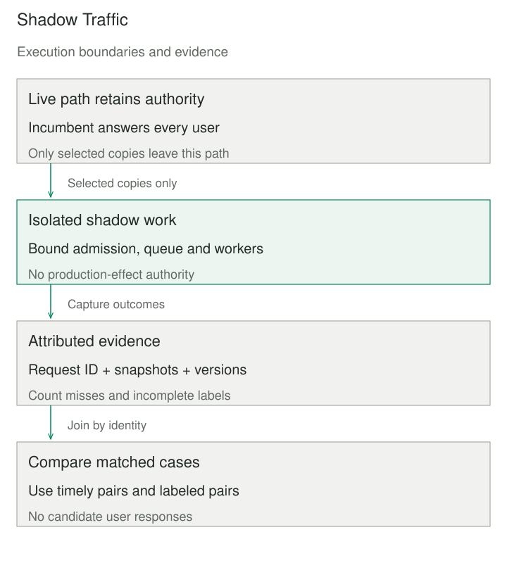

## Purpose and problem

A replacement ticket-routing service passes saved-input tests, but the team still needs to know whether its container handles today’s requests, whether it queues under bursts, and where its predictions differ from the incumbent. Sending customer responses from the new version would turn those questions into production exposure before the team has gathered evidence.

Shadow Traffic copies live work to a candidate while the established service continues answering users. It creates an observation path for production-shaped inputs. The difficult requirement is to obtain that evidence without allowing duplicated work, resource contention, or accidental side effects to harm the live path.

## Core idea

**Copy the request; retain one serving authority.** The incumbent supplies the user response. A separate branch sends selected copies to the candidate, whose result is logged, compared, or discarded according to the evaluation design.

Traffic Mirroring and Request Mirroring name the copying mechanism; Shadow Deployment and Shadow Testing emphasize the candidate and evaluation. Terminology alone does not establish isolation: hiding a response does not prevent its producer from sending an email, updating a database, or invoking a real tool.



## How it works

Place the copying point where it can preserve the relevant input and a correlation identity. Record release versions, timestamps, and feature snapshots when the candidate and incumbent might otherwise read different changing values. Compare like with like: an input captured before enrichment may not represent the payload the live model actually used.

Choose the copied fraction, admission limits, queue bounds, concurrency, and deadlines. Make candidate work independent of the user response deadline, and measure incumbent latency and shared dependencies during the experiment. Separate workers do not isolate a common database, feature store, network quota, or logging system. A stop control must disable copying without changing ordinary serving responsibility.

Use separate credentials, endpoints, and data stores where needed to prevent production mutations. Candidate code that calls external services may require sandboxed replacements or explicit write suppression. Redact or tokenize sensitive fields only when doing so preserves the behavior being evaluated, and set access and retention rules for captured payloads and outputs.

The mirror transport may not collect comparison results. Istio documents fire-and-forget mirroring that discards responses and changes Host/Authority headers; Envoy documents route-mirror policies. Instrumentation must record the outputs and errors needed for analysis rather than assuming proxy access logs form a labeled dataset.

Track distinct denominators: incoming work, selected copies, admitted work, completed candidate results, usable paired responses, and labeled pairs. Missing responses are evidence about reliability or coverage, not zero errors. Match outcomes by identity, not completion order. Disagreement does not establish which version is correct, and agreement can preserve a shared defect.

## Worked example

### Twelve requests and a deadline-biased comparison

The retained fictional fixture has twelve requests arriving every 25 milliseconds. Incumbent latency alternates between 20 and 25 ms, and all users receive its response. Two isolated candidate workers process copies FIFO; ties choose the lowest worker index. Their service times and binary predictions are fixed, with labels for R08 and R10 initially pending.

This complete Python 3 program reproduces that scheduling and paired evidence. Deadlines measure arrival-to-finish elapsed milliseconds, including queue wait. The queue is intentionally unbounded in this teaching replay; production admission needs separate bounds.

```python
SERVICE = (30, 40, 25, 35, 45, 50, 55, 60, 90, 120, 180, 240)
LIVE = (0, 1, 0, 0, 0, 1, 1, 1, 1, 0, 0, 0)
CANDIDATE = (0, 1, 1, 1, 0, 1, 0, 0, 1, 1, 0, 1)
TRUTH = (0, 1, 0, 1, 0, 1, 0, 0, 1, 1, 1, 0)


def replay(deadline_ms=150, workers=2, selected=None, complete_labels=False):
    if type(workers) is not int or workers < 1 or deadline_ms < 0:
        raise ValueError("positive worker count and nonnegative deadline required")
    selected = set(range(1, 13)) if selected is None else set(selected)
    if not selected <= set(range(1, 13)):
        raise ValueError("unknown request identity")
    free = [0] * workers
    rows = []
    for i, service in enumerate(SERVICE):
        if i + 1 not in selected:
            continue
        arrival = i * 25
        worker = min(range(workers), key=lambda w: (free[w], w))
        start = max(arrival, free[worker])
        free[worker] = start + service
        elapsed = free[worker] - arrival
        label = TRUTH[i] if complete_labels or i not in (7, 9) else None
        rows.append((i, elapsed, elapsed <= deadline_ms, label))
    timely = [r for r in rows if r[2]]
    pairs = [r for r in timely if r[3] is not None]
    return {
        "copies": len(rows), "timely": len(timely), "pairs": len(pairs),
        "disagreements": sum(LIVE[i] != CANDIDATE[i] for i, *_ in timely),
        "live_errors": sum(LIVE[i] != label for i, _, _, label in pairs),
        "candidate_errors": sum(CANDIDATE[i] != label for i, _, _, label in pairs),
        "worker_ms": sum(SERVICE[i] for i, *_ in rows),
        "rows": rows,
    }


if __name__ == "__main__":
    short = replay()
    long = replay(500)
    assert (short["timely"], short["pairs"], short["live_errors"],
            short["candidate_errors"]) == (10, 8, 2, 1)
    assert (long["timely"], long["pairs"], long["live_errors"],
            long["candidate_errors"]) == (12, 10, 3, 3)
    assert short["worker_ms"] == long["worker_ms"] == 970
    print("150 ms: 10 timely, 8 labeled pairs, errors 2 versus 1")
    print("500 ms: 12 timely, 10 labeled pairs, errors 3 versus 3")
```

Those two lines are the output. At 150 ms, five of ten timely pairs disagree; eight also have labels. Incumbent errors are 2/8 = 25%, while candidate errors are 1/8 = 12.5%. At 500 ms, each has 3/10 errors on the enlarged labeled subset. The apparent advantage vanishes because the comparison set changes, not because a different model was trained.

R12 arrives at 275 ms, starts at 355 ms, and finishes at 595 ms: 80 ms waiting plus 240 ms service equals 320 ms elapsed. R11 needs 225 ms. Both miss the short deadline. All eight routine requests qualify, while only two of four complex requests do, exposing a coverage difference hidden by one favorable quality rate.

The preserved explorer adds fixed odd-ID and three-ID subsets, worker counts, and label snapshots. Selecting R01, R05, and R09 schedules 165 worker-ms rather than 970; those three agree and are correct but say little about omitted cases. Missed deadlines do not cancel work in this model, so a shorter deadline does not reduce its scheduled service work.

```patternverse-widget
{
  "src": "ml-shadow-deployment.html",
  "title": "Shadow deployment evidence explorer",
  "height": 1200,
  "fallback": "Ten of twelve fictional shadow results meet the deadline; eight have labels. Their paired errors favor the candidate, but a longer deadline removes that advantage. All user responses still come from the incumbent."
}
```

The model assumes complete incumbent isolation and therefore holds its maximum latency at 25 ms. It sends no network requests and cannot demonstrate that isolation in a deployed system. SageMaker’s documented shadow variants provide a concrete production-response boundary; its documented model-quality workflow illustrates joining captured predictions with ground truth. 

## When to use it

Use this after offline checks when live input shapes, infrastructure compatibility, latency, or resource demand remain uncertain. It can evaluate service replacements, serving containers, preprocessing changes, and models before granting serving authority.

A saved-request replay may be simpler when input timing and live dependencies are unimportant. If candidate execution cannot be isolated from harmful effects, copying live requests is not an acceptable shortcut around that design problem.

## Tradeoffs and common mistakes

Budget duplicated computation, reads, payload transport, output storage, and analysis. Sampling reduces work but can miss rare inputs or bursts. A small mirror fraction does not demonstrate full-load capacity, and observed outcomes can reflect actions taken by the incumbent rather than the candidate.

Avoid claiming business lift from decisions the candidate never made. A shadow recommendation cannot reveal how users would respond to items they were never shown. Also avoid comparing candidate successes with the incumbent’s entire population: use matched IDs and report missing evidence by relevant slices.

Set stop and promotion criteria before looking at results. Promotion is a separate serving change with its own recovery plan. The replay omits crashes, retries, logging loss, shared contention, and statistical uncertainty; its zero candidate user responses are an assumption of the model’s response boundary, not proof that mirroring is harmless.

## Related patterns

[[ml-canary-rollout-with-rollback|Canary Release]] grants a limited share of actual serving responsibility. Shadow Traffic keeps that authority with the incumbent.

[[test-double|Test Double]] can replace effectful collaborators in the candidate, but those replacements may also limit how representative the shadow execution is.

[[ml-slice-based-evaluation|Slice-Based Evaluation]] reveals where deadline misses or missing labels remove important populations from comparison.

[[ml-continuous-model-evaluation|Continuous Model Evaluation]] tracks quality as outcomes arrive after predictions, beyond a short infrastructure experiment.

## Sources

- [Istio mirroring](https://istio.io/latest/docs/tasks/traffic-management/mirroring/): copied fractions, Host/Authority behavior, and discarded responses.
- [Envoy route mirroring](https://www.envoyproxy.io/docs/envoy/latest/start/sandboxes/route-mirror): route-level copying policies.
- AWS, [SageMaker shadow tests](https://docs.aws.amazon.com/sagemaker/latest/dg/shadow-tests.html): production-only user responses and optional shadow logging.
- AWS, [Model quality](https://docs.aws.amazon.com/sagemaker/latest/dg/model-monitor-model-quality.html): prediction/ground-truth joins; cited for the documented mechanism, not as a recommendation of service availability.

The fixture, replay, retained explorer, and illustration are original teaching material. No model is trained here.
