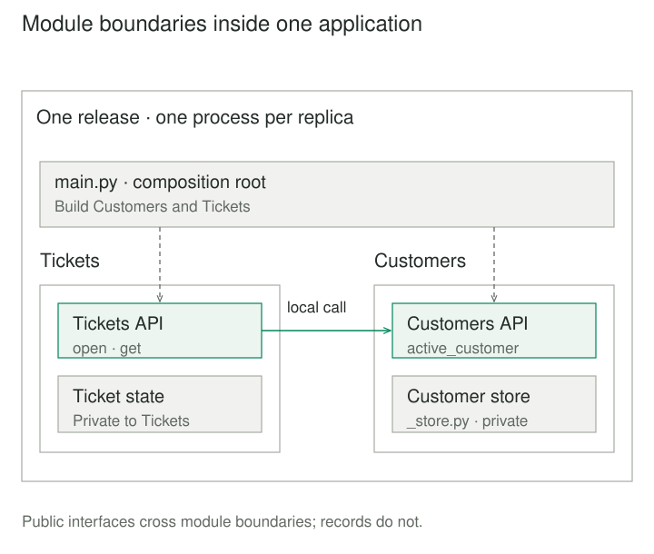
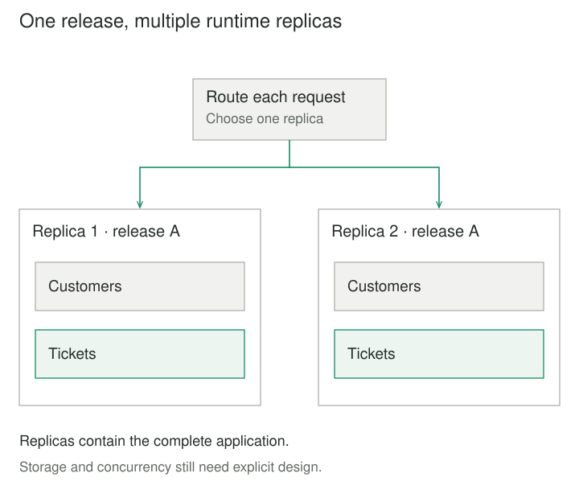

## Purpose and problem

A support application creates tickets for customers. Ticket code reads customer dictionaries directly, checks an internal flag, and stores references to those dictionaries. Renaming a customer field breaks ticket creation. Another caller forgets to check whether the customer is active.

The team wants clearer ownership and safer changes while keeping one application to build and release. Deploying separate services would add operational work before the team needs independent deployment. Merely moving the existing classes into folders would preserve the same dependencies.

## Core idea

**Modular Monolith** combines two choices: one deployable application, and deliberate module boundaries inside it. Modules own coherent capabilities, publish interfaces for other modules, and hide implementation decisions behind them. Calls can remain ordinary in-process calls.

The mental model is **separate responsibilities inside one release boundary**. Shopify's first-hand account describes moving toward defined component APIs and associated data ownership while retaining its monolith. [Deconstructing the Monolith](https://shopify.engineering/deconstructing-monolith-designing-software-maximizes-developer-productivity).

Monolithic describes deployment; modular describes internal structure. A monorepo describes source organization and can contain independently deployed applications. The Modular Monolith name does not require a particular framework, repository layout, or future migration to services.



## How it works

### Boundaries around capabilities

Choose modules around responsibilities that change together, such as customer management and ticket handling. Technical layers can exist inside each module. A public interface describes useful operations and their data and failure contracts; it should not expose every internal object.

Spring Modulith's [module model](https://docs.spring.io/spring-modulith/reference/fundamentals.html) separates provided interfaces, internal implementation, and required interfaces. This is a useful concrete example of the broader idea, rather than a requirement to use Spring.

Make permitted dependencies explicit. Prefer a direction that avoids circular knowledge between modules. Architecture checks should detect forbidden imports and references, while behavioral tests exercise contracts. Spring's [verification documentation](https://docs.spring.io/spring-modulith/reference/verification.html) demonstrates checks for cycles, internal-package access, and optionally allowed dependencies.

### Own data without assuming separate databases

A module owns the meaning of its records and the operations that change them. A shared physical database can still contain module-owned tables. Direct cross-module queries or shared ORM objects can bypass that ownership just as easily as importing private code.

Return stable values or explicit read models where callers need information. Cross-module reports may require deliberately designed queries or projections; hiding tables does not make those needs disappear. Define when copied information represents a snapshot and when a caller requires current state.

### One release can have several replicas

One deployment unit does not mean one machine forever. A monolithic application can scale by running complete replicas. Each replica still contains the application's modules; deployment and capacity decisions remain coordinated at that unit. [Microsoft's architecture guide](https://learn.microsoft.com/en-us/dotnet/architecture/modern-web-apps-azure/common-web-application-architectures).



## Worked example

### Let Customers own customer eligibility

Before separation, ticket creation understands a customer row's keys. Afterward, Tickets asks Customers for an active customer's public value. Customers owns eligibility and maps its private representation. Tickets owns its ticket records.

Save these four files under the paths shown, creating the `customers` and `tickets` directories. Run `python3 main.py` from their parent directory. The example uses Python 3.8 or later and its standard library.

**customers/_store.py — internal customer storage**

```python
class CustomerStore:
    def __init__(self):
        self._rows = {
            "c1": {"name": "Ada", "active": True},
            "c2": {"name": "Lin", "active": False},
        }

    def get(self, customer_id):
        return self._rows.get(customer_id)
```

**customers/__init__.py — the Customers API**

```python
from dataclasses import dataclass
from ._store import CustomerStore as _CustomerStore


class CustomerUnavailable(ValueError):
    pass


@dataclass(frozen=True)
class CustomerView:
    id: str
    display_name: str


class Customers:
    def __init__(self):
        self._store = _CustomerStore()

    def active_customer(self, customer_id):
        row = self._store.get(customer_id)
        if row is None or not row["active"]:
            raise CustomerUnavailable("Customer is missing or inactive")
        return CustomerView(customer_id, row["name"])
```

**tickets/__init__.py — the Tickets API and owned state**

```python
from dataclasses import dataclass
from customers import Customers


@dataclass(frozen=True)
class Ticket:
    id: int
    customer_id: str
    requester_name: str
    subject: str


class Tickets:
    def __init__(self, customers: Customers):
        self._customers = customers
        self._tickets = {}
        self._next_id = 1

    def open(self, customer_id, subject):
        if not subject.strip():
            raise ValueError("Subject is required")
        customer = self._customers.active_customer(customer_id)
        ticket = Ticket(self._next_id, customer.id, customer.display_name, subject.strip())
        self._tickets[ticket.id] = ticket
        self._next_id += 1
        return ticket

    def get(self, ticket_id):
        return self._tickets[ticket_id]
```

**main.py — compose and run one application**

```python
from customers import Customers
from tickets import Tickets


customers = Customers()
tickets = Tickets(customers)
ticket = tickets.open("c1", "Cannot sign in")
print(ticket.id, ticket.requester_name, ticket.subject, sep=" | ")
# 1 | Ada | Cannot sign in
```

Customer identifiers and subjects are text. Ticket identifiers count creations within this Tickets instance. A blank subject, inactive customer, or missing customer fails before a ticket is stored. The returned objects contain immutable strings and integers, rather than references to mutable customer rows.

The requester name is a creation-time snapshot. Renaming a customer later does not rewrite an existing ticket. If the internal `name` field becomes `full_name`, the store and mapper change inside Customers; Tickets still uses `display_name`.

The allowed business dependency is Tickets → Customers. Startup code knows both APIs. Python's [underscore convention](https://docs.python.org/3/tutorial/classes.html#private-variables) signals internal names but does not enforce access control. Import-boundary checks can catch violations; unrestricted reflection or dynamic imports require further policy. A package name alone supplies no boundary guarantee.

This is serial, in-memory code with a static customer directory. Real storage requires connection ownership, durable identifiers, and concurrency rules. Checking eligibility and recording a ticket are separate operations here; a real concurrent implementation must define what happens if eligibility changes between them.

## When to use it

This pattern fits an application with several meaningful capabilities whose teams benefit from separate ownership, while one release and operational model remain useful. Boundaries can evolve through local refactoring as the domain becomes clearer. Fowler's [Monolith First](https://martinfowler.com/bliki/MonolithFirst.html) discusses that opportunity and the difficulty of getting service boundaries right early.

A small program may need only a few functions. Independent release cadence, resource scaling, or fault containment can eventually justify stronger boundaries, but service extraction is a separate decision rather than the pattern's required destination.

## Tradeoffs and common mistakes

**Folders without constraints.** Shared entity objects, cyclic imports, and cross-module SQL can keep the application tightly coupled despite tidy directories. Test architectural rules and public behavior, including migration changes inside a module.

**Treating co-location as a transaction.** A cross-module operation is atomic only when its storage operations deliberately participate in a coordinated transaction. Local calls alone do not establish that. Events and external effects also need explicit consistency and failure policies.

**Shared runtime consequences.** Modules share process resources and failures. A blocking operation, memory leak, or exhausted connection pool can affect other capabilities. Keep resource limits, ownership, and authorization explicit; logical module boundaries are not security isolation.

**A contract for every detail.** Overly broad shared abstractions recreate coupling, while excessive wrappers slow simple changes. Keep interfaces focused on actual caller needs. Moving a module to a service later introduces network failure, compatibility, and data-ownership work that the current API cannot eliminate automatically.

## Related patterns

[[layers|Layers]] orders responsibilities by abstraction. A modular monolith can use layers inside business modules while retaining one deployment.

[[ports-and-adapters|Ports and Adapters]] separates application behavior from external technologies. A business module can apply it internally.

[[facade|Facade]] can expose a module's focused entry point. The wider architecture also needs dependency and data-ownership rules.

[[microkernel|Microkernel]] emphasizes a stable core and optional extensions. Modular Monolith organizes cohesive capabilities without requiring a plug-in registry or optional-module lifecycle.

## Sources

Kirsten Westeinde's [Shopify account](https://shopify.engineering/deconstructing-monolith-designing-software-maximizes-developer-productivity) documents its modular-monolith work. Official [Spring Modulith fundamentals](https://docs.spring.io/spring-modulith/reference/fundamentals.html) and [verification guidance](https://docs.spring.io/spring-modulith/reference/verification.html) illustrate explicit module contracts and structural checks. [Microsoft](https://learn.microsoft.com/en-us/dotnet/architecture/modern-web-apps-azure/common-web-application-architectures) explains deployment and replication; [Fowler](https://martinfowler.com/bliki/MonolithFirst.html) discusses evolution and boundary uncertainty.

The support scenario, Python code, and illustrations are original teaching material. They demonstrate module ownership and local calls, without production persistence, replica coordination, or measured performance claims.
