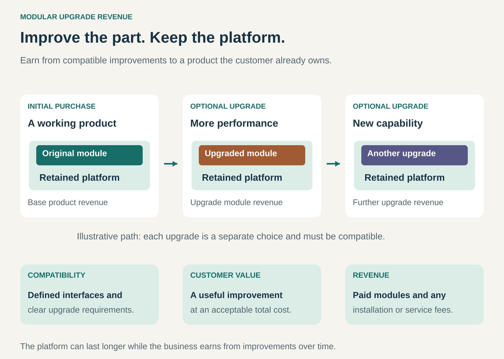

## What it is for

A customer’s product still works, but one part no longer meets their needs. The computer needs more processing power. The phone needs a better camera. The machine could produce more with an improved control unit.

Replacing the entire product would discard useful equipment and require another major purchase.

Modular Upgrade Revenue gives the customer a smaller, targeted purchase: a compatible improvement to something they already own.

It is useful when different parts of a product age at different speeds, and when customers will pay to improve particular capabilities while retaining the rest.

## The core idea

**Build a product that can evolve, then earn from worthwhile improvements over its life.**

The initial sale establishes an installed base. Later sales improve that base through replacement modules, upgrade kits, or additional functional units.

The customer retains a substantial part of the original product. The business earns from helping that product meet changing needs.

Three conditions make this a revenue pattern:

- **An enduring platform:** enough of the product remains useful to justify keeping it.
- **A compatible upgrade:** a defined part can be improved without replacing everything.
- **A paid improvement:** customers value the additional capability enough to purchase it.

Modular construction alone does not establish the model. A product might have replaceable parts solely for repair. Upgrade revenue requires commercially available improvements that customers actually want.

Purchases are usually optional and irregular. Repeat sales depend on useful innovation, compatibility, and customer demand.

## How it works

**Separate durable elements from changing ones.** A frame, enclosure, display, or mechanical assembly may remain useful longer than a processor, sensor, or control system. Product architecture allows selected elements to change independently.

**Define the interfaces.** Physical dimensions, connectors, power requirements, software, cooling, and control protocols determine what can work together. A module must function properly within the complete system.

**Develop an improvement for existing owners.** A new generation of technology becomes a product for the installed base as well as for new customers. The offer identifies the compatible models and the resulting benefit.

**Make installation practical.** Customers may install the upgrade themselves, use a dealer, or purchase an installation service. Instructions, required tools, configuration, and testing are part of the offer.

**Support the upgraded configuration.** The business maintains compatibility information, software support, troubleshooting, and appropriate warranty arrangements.

An upgrade may require several coordinated components. A faster mainboard might also need different memory or cooling. Clear bundles can make these dependencies manageable, provided the total cost still makes sense.

## Why it works

The customer can direct spending toward the capability that matters. Someone satisfied with a product’s enclosure, controls, and display may see little value in purchasing those elements again.

The business gains another way to serve existing customers. It already has an installed product, a known use case, and potentially an established relationship with the owner.

Upgrade paths can also strengthen the initial sale. A credible history of improvements can make customers more comfortable buying into the platform. That credibility comes from delivered products and explicit compatibility commitments.

The model can align product longevity with revenue. A business can earn while customers retain useful equipment.

There is still a commercial tradeoff. Some upgrade purchases will replace sales of complete new products. Others will retain customers who would otherwise postpone buying, choose a competitor, or leave the platform. The economics depend on that mix.

## Famous examples

### Framework — selling new capabilities into existing laptops

Framework sells mainboards, displays, and other components for its modular laptops. Existing owners can purchase compatible upgrades while retaining other parts of their machines.

Its Laptop 13 upgrade history includes successive processor generations and improvements to displays, webcams, speakers, and other components.

Compatibility has limits. Framework’s Laptop 13 Pro documentation distinguishes directly compatible parts from upgrades requiring bundled components, and identifies generation-specific cooling parts.

This makes the example useful commercially: the upgrade proposition is supported by products, installation resources, and explicit compatibility information. Owners can assess which improvements are possible and what else they require. [Framework: upgrade history and compatibility](https://frame.work/laptop13?tab=upgrades), [Framework Marketplace: mainboards](https://frame.work/marketplace/mainboards)

### Fairphone — a better camera for a phone already in use

When Fairphone introduced the Fairphone 3+ in 2020, it also sold the improved camera modules separately to existing Fairphone 3 owners.

Those customers could purchase a camera upgrade while keeping their existing phone. The new camera technology therefore served two markets: buyers of the newer complete device and owners improving an earlier one.

This is a historical example of upgrade revenue. The camera modules were paid hardware improvements, distinct from replacing a broken camera with an equivalent part or receiving a free software update.

It illustrates the value of maintaining compatibility across a product refresh. It does not imply that every later Fairphone model offers the same upgrade path. [Fairphone: 2020 camera-module launch](https://www.fairphone.com/wp-content/uploads/2021/03/FP3FP3.pdf)

### Prusa Research — an upgrade kit for an installed 3D printer

Prusa sells a kit that converts an existing Original Prusa MK4 printer into the MK4S configuration.

The package includes a revised cooling system, a high-flow nozzle, and associated components. Customers assemble the upgrade themselves using the supplied guidance.

Prusa also distinguishes kit variants according to the printer’s existing display hardware. That detail matters: even products bearing the same model name can contain revisions that affect installation.

The customer buys a defined improvement to an existing machine. Prusa earns from the kit while continuing to support the underlying printer platform. [Prusa: MK4 to MK4S upgrade kit](https://www.prusa3d.com/product/original-prusa-mk4-to-mk4s-upgrade-kit-3/)

## The economics

Consider a hypothetical manufacturer with 10,000 products in use.

Only 4,000 are compatible with a proposed upgrade. If 25% of those owners purchase it, the manufacturer sells 1,000 kits.

| Upgrade-program item                                               |      Amount |
| ------------------------------------------------------------------ | ----------: |
| Sales: 1,000 kits × €300                                           |    €300,000 |
| Module production and fulfillment                                  |   −€170,000 |
| Expected support, returns, and warranty costs                      |    −€20,000 |
| Engineering, compatibility testing, and documentation              |    −€80,000 |
| **Program contribution before other overhead, financing, and tax** | **€30,000** |

These figures are illustrative and exclude the original product sales.

Each kit contributes €110 toward the €80,000 development cost. The program needs approximately **728 sales to break even** on those assumptions.

At 500 sales, the contribution after development costs would be **−€25,000**.

The important denominator is the eligible installed base. Counting every previous customer would exaggerate demand.

Any contribution lost through displaced whole-product sales also belongs in the wider business assessment. A profitable upgrade line does not automatically increase total company profit.

For customers, the relevant comparison includes the module, installation, required companion parts, downtime, and the condition of the equipment they retain.

## Useful when

- **Different components age at different speeds.** Durable structures can outlast rapidly improving electronics or functional units.
- **The installed base is large enough.** Compatible owners can support development and ongoing service costs.
- **Customers have identifiable upgrade needs.** Better performance, precision, connectivity, or capacity has practical value.
- **Interfaces can remain stable.** New modules can work within the platform’s physical and technical limits.
- **Installation is manageable.** The improvement does not require disproportionate labor, disruption, or specialist intervention.
- **The business can support multiple configurations.** Product records, testing, documentation, and spare parts remain workable.

## Common mistakes and limits

**Promising indefinite upgradeability.** Power, cooling, dimensions, software, and supplier availability impose limits. Credible commitments specify their scope.

**Confusing repairability with an upgrade market.** Easy replacement helps maintenance, but owners still need a reason to buy a better module.

**Selling an upgrade whose benefit is blocked elsewhere.** A faster component may deliver little improvement if another part remains the bottleneck.

**Ignoring configuration complexity.** Every supported combination can add testing, documentation, inventory, and service costs. Compatibility has an ongoing cost.

**Making the total price unattractive.** Required companion parts and installation can bring an upgrade close to the cost of a complete replacement.

**Assuming longer life guarantees environmental savings.** Benefits depend on how much equipment is retained, what purchase is avoided, and what happens to removed modules. Frequent upgrades can still generate unnecessary material use.

## Related patterns

- [[core-plus-add-ons|Core plus Add-Ons:]] The broader model of selling a base with paid additions. Modular Upgrade Revenue emphasizes improvements made during ownership.
- [[repair-and-maintenance|Repair and Maintenance:]] Preserves or restores functionality; upgrades improve capability. Both can use the same service infrastructure.
- [[extension-ecosystem|Extension Ecosystem:]] Allows other producers to build compatible modules or enhancements around the platform.
- [[resale|Resale / Recommerce:]] Can provide another market for displaced modules that remain useful.
