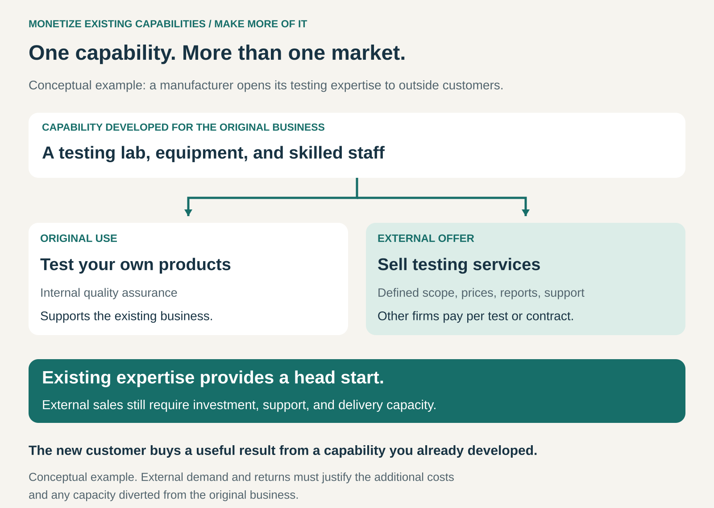

## What it is for

A manufacturer develops an excellent testing laboratory. A retailer builds sophisticated fulfilment software. A company learns how to reorganize production after years of difficult improvements.

These capabilities help the original business succeed. They may also solve problems that other organizations would pay to have solved.

Monetize Existing Capabilities turns expertise, infrastructure, technology, or operating processes developed for one business into an additional commercial offering.

It is useful when a company has built something valuable behind the scenes and can serve outside customers without undermining the business that developed it.

## The core idea

Make something your business already does well available to other organizations for a price.

The new offer might be consulting, contract manufacturing, testing, logistics, software, licensing, or managed infrastructure. Business Model Navigator calls this pattern **Make More of It**: using existing know-how and assets to generate revenue beyond the company’s original offering. [Business Model Navigator: Make More of It](https://purchase.businessmodelnavigator.com/pattern?id=29)

The starting advantage is an existing capability. The commercial opportunity depends on whether outside customers need it, trust it, and will pay enough for its delivery.

Unused capacity can help, but the pattern also applies to capabilities that require substantial expansion to serve a new market.

## How it works

Consider a manufacturer with a laboratory built to test its own products.

Other manufacturers need similar tests but cannot justify buying the equipment and employing specialists themselves. The laboratory’s owner could offer those tests commercially.

That requires turning an internal function into a clear offer: which tests are available, what customers must provide, what the reports contain, how long work takes, and what it costs.

The underlying capability supports two activities:

- **The original business:** testing helps the company develop and sell dependable products.
- **The external business:** other companies pay for testing services.

The commercial work may use spare laboratory hours initially. If demand grows, it may justify additional equipment and a dedicated team.

Similar transitions occur when internal software becomes a product, operational expertise becomes consulting, or a distribution network becomes a service for other businesses.

## Why it works

**It starts with accumulated experience.** The company has already encountered practical problems, developed methods, and learned what fails. That experience can reduce the work needed to create a credible offer.

**It gives customers access without requiring them to build everything themselves.** A customer can purchase a result or capability rather than recruit specialists, develop technology, and maintain infrastructure.

**It can spread investment across more uses.** Equipment, software, training, and process development may support both internal operations and external sales.

**It can reveal a more valuable market.** Customers may place considerable value on a capability that the original business treats as a supporting function.

**External use can stimulate improvement.** New requirements may expose weaknesses or suggest features that also benefit the original business. This depends on managing priorities well; outside requests can also create distraction.

## Famous examples

### Amazon Web Services: infrastructure expertise becomes a customer offering

Amazon’s experience operating its own business exposed the difficulty and expense of provisioning and managing technology infrastructure. AWS describes that experience as part of the motivation for launching its cloud infrastructure services in 2006. [AWS: Our origins](https://aws.amazon.com/about-aws/our-origins/)

Amazon S3’s original launch announcement described a storage service designed to support both internal Amazon applications and external developers. Customers received an interface through which they could purchase storage capabilities without building the underlying infrastructure themselves. [Amazon’s 2006 S3 launch announcement](https://press.aboutamazon.com/2006/3/amazon-web-services-launches)

The important step was designing a dependable external service around infrastructure expertise. Customers needed a product they could adopt and rely on, with its own interface and operating commitments.

### Porsche Consulting: restructuring experience becomes advisory work

Porsche Consulting grew out of knowledge acquired during Porsche’s restructuring. Founded in 1994, it began with four Porsche employees and the idea of making that experience available to other companies. [Porsche Consulting’s history](https://www.porsche-consulting.com/international/en/about-us/who-we-are)

The capability being commercialized was practical expertise: understanding how to improve an organization and implement change.

Other companies could purchase access to that knowledge through consulting engagements. Experience developed while solving Porsche’s own problems became the foundation for serving outside clients.

This illustrates the pattern without requiring a physical asset or a software platform. Knowledge and a repeatable delivery method can form the new offer.

### Ocado: grocery operations generate a technology business

Ocado developed technology and operating expertise around online grocery fulfilment. It subsequently made those capabilities available to other retailers through the Ocado Smart Platform, combining elements such as ecommerce, fulfilment, supply chain, and delivery technology. [Ocado’s account of its business](https://www.ocadogroup.com/about-us)

Ocado describes its online grocery technology model as generating recurring revenue through licensing hardware and software technology products and services. [Ocado’s explanation of its revenue model](https://www.ocadogroup.com/investors/investor-questions)

The external customer buys capabilities needed to operate online grocery services. The original operating experience supplies a foundation, while implementation and ongoing support become part of the commercial business.

## The economics

Existing investment can provide a head start. It does not make external revenue costless.

A new offer can require salespeople, documentation, customer onboarding, account management, additional equipment, and continuing development. Internal systems may also need modification before customers can use them independently.

The financial picture therefore includes:

**External revenue − delivery costs − commercialization and support costs − additional investment.**

Capacity diverted from the original business matters too. A consulting engagement can look profitable while occupying specialists whose internal work would create greater value.

There are also two different questions:

## Does accepting another customer make sense with capacity available today?

## Would this offering remain attractive if it had to fund replacement equipment, additional staff, and continuing development?

An initially attractive use of spare capacity can become an expensive new business as demand grows. Pricing and investment decisions need to reflect that transition.

## Useful when

This pattern is particularly useful when:

- A capability has already proved valuable through real operational use.
- Other organizations face a similar problem.
- Customers can purchase a clearly defined result or service.
- Existing assets or expertise provide an advantage over starting from scratch.
- External delivery can coexist with the original business or justify its own capacity.

It is less suitable when the capability depends heavily on unique internal circumstances, needs extensive customization for every customer, or exposes an advantage the company needs to retain exclusively.

## Common mistakes and limits

**Assuming internal usefulness proves external demand.** A process can be excellent for one organization and poorly suited to others. Different systems, volumes, skills, and expectations can change its value.

**Selling a department instead of an offer.** Customers need to understand what they receive, what it costs, and what responsibility remains with them. Access to capable employees is not always a clear enough proposition.

**Treating existing costs as permanently covered.** Equipment wears out, software needs maintenance, and experienced staff need time. External revenue must eventually support the resources it consumes.

**Overlooking service expectations.** Internal colleagues may tolerate informal arrangements that paying customers will not. Response times, documentation, reliability, and support become part of the product.

**Weakening the original business.** Shared resources can create priority conflicts. Both activities need clear capacity arrangements and accountable leadership.

**Giving away the source of differentiation.** Commercializing a capability can help competitors. The company needs to understand which knowledge it is selling and which advantages it intends to retain.

**Assuming everything used internally can be resold.** Third-party technology, licensed material, and confidential information can limit what the company is entitled to offer.

## Related patterns

[[licensing|Licensing]] — Licensing can generate revenue from technology or know-how developed internally. It is one way to commercialize an existing capability.

[[solution-provider|Solution Provider]] — An internal capability can become part of a broader offer that takes responsibility for solving a customer’s problem.

[[shared-access|Shared Access]] — Multiple customers may use common infrastructure or equipment. Monetize Existing Capabilities explains where that offering originated; Shared Access explains how resources are used.

[[unbundling|Unbundling]] — A supporting function can become independently purchasable. Commercializing that function may open a market beyond customers of the original product.
