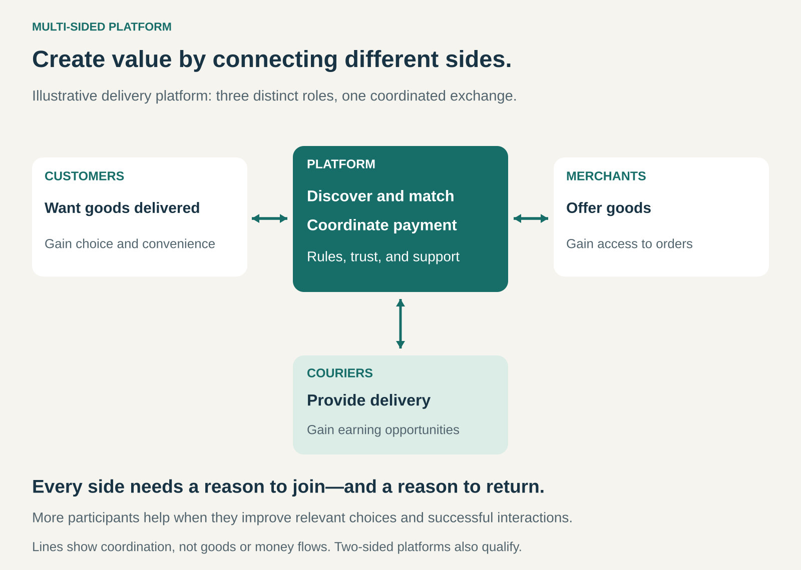

## What it is for

Customers struggle to find suitable providers. Providers struggle to reach customers. Other participants may be needed to complete the exchange: couriers, developers, payment institutions, or advertisers.

A Multi-Sided Platform creates value by bringing these distinct groups together and making their interactions easier, safer, or more productive.

The business succeeds when participation becomes worthwhile for each side because the other sides are there.

The proposition is: **we make it easier for you to find, interact with, and exchange value with the people you need.**

## The core idea

Build a business around interactions between two or more distinct participant groups.

A two-sided marketplace is a common form of this pattern. “Multi-sided” does not require three or more sides.

The distinction concerns participants’ roles, rather than the number of customer segments. Selling software separately to schools and hospitals does not automatically create a multi-sided platform. Enabling employers and candidates to find and engage with one another can.

The platform provides the conditions for interaction: discovery, matching, communication, payments, technical standards, reputation, or shared rules. Participants contribute important parts of the resulting value. [Harvard Business School: defining multi-sided platforms](https://www.library.hbs.edu/working-knowledge/three-dimensional-strategy-winning-the-multisided-platform)

A company can combine this model with others. For example, it might facilitate transactions between independent sellers and buyers while also selling some products itself. The relevant question is how each activity creates value.

## How it works

Consider a delivery platform connecting three groups.

Customers want suitable goods delivered conveniently. Merchants want profitable orders. Couriers want worthwhile earning opportunities.

The platform must coordinate all three. A large restaurant selection provides limited value if deliveries cannot be fulfilled. Plenty of couriers provide little benefit if orders are too scarce to support their participation.

The operator therefore needs a useful offer for each side, together with rules that make the overall exchange work.

That includes deciding:

- Who can participate and under what conditions.
- How participants discover or are matched with one another.
- What information they receive before committing.
- How prices, payments, and fees work.
- How quality, disputes, and failures are handled.
- Which decisions participants retain and which the platform controls.

These are central product decisions. The platform’s rules shape the experience and economics of everyone using it.

## Why it works

Platforms can reduce the effort required to find suitable counterparts and complete an interaction.

They can also create **cross-side network effects**: participation on one side makes the platform more useful to another. More relevant providers can improve customer choice; more active customers can create better opportunities for providers.

However, relevance and quality matter. Ten suitable providers in the right place may be more valuable than thousands who cannot meet the customer’s needs.

Growth can also create tension. More sellers can mean stronger competition for existing sellers. More demand can produce congestion if supply does not keep pace.

The advantage comes from improving useful interactions, rather than accumulating registrations alone. Platform research treats design, pricing, participant selection, and governance as linked strategic choices. [Andrei Hagiu: strategic decisions for multi-sided platforms](https://store.hbr.org/product/strategic-decisions-for-multisided-platforms/smr477)

## Famous examples

### Airbnb: connecting hosts and guests

Airbnb connects people offering accommodation with guests seeking a stay. Hosts establish listings, availability, prices, and rules; guests discover and book suitable options.

Airbnb’s terms describe the booking as creating a contract directly between host and guest. The platform provides supporting systems and charges service fees under its applicable fee structure. [Airbnb terms](https://www.airbnb.com/help/article/2857), [Airbnb service fees](https://www.airbnb.com/help/article/1857)

The interaction gives each side a reason to participate: hosts gain access to potential bookings, while guests gain access to accommodation choices.

The lesson is that the platform must support both sides of the transaction. Attracting guests without suitable available listings—or hosts without credible demand—creates little lasting value.

### Uber Eats: coordinating several complementary roles

Uber’s delivery business connects consumers, merchants, and delivery providers. Its reporting describes technology for discovery, demand prediction, matching, dispatch, routing, and payments. [Uber 2025 annual report](https://www.sec.gov/Archives/edgar/data/1543151/000154315126000015/uber-20251231.htm)

For a delivered restaurant order, the merchant prepares the food, a courier transports it, and the consumer receives it. The platform coordinates the exchange.

The commercial challenge extends beyond getting each group to sign up. Preparation times, courier availability, delivery distances, and customer expectations must work together.

This illustrates why platforms can require substantial operational capability. Software enables coordination, but successful exchanges still depend on participants’ actions in the physical world.

### Visa: connecting a payment ecosystem

Visa’s payment ecosystem connects cardholders and merchants through issuing and acquiring financial institutions. Issuers provide cards; acquirers support merchants’ acceptance and processing arrangements. Visa supplies network infrastructure and operating standards. [Visa’s explanation of the payment ecosystem](https://corporate.visa.com/en/solutions/commercial-solutions/knowledge-hub/tokenization.html)

Broader merchant acceptance can make a card more useful to cardholders. More cardholders can make accepting that network more valuable to merchants.

The commercial relationships also show why money moving through a platform must be distinguished from the platform’s own earnings. Interchange generally moves between acquiring and issuing institutions; it is not simply Visa’s revenue from the transaction. [Visa’s explanation of its fees and role](https://www.sec.gov/Archives/edgar/data/1403161/000140316123000061/filename1.htm)

The lesson is that a platform can coordinate an ecosystem without having the same direct relationship with every participant.

## The economics

A platform must decide both **how much to charge** and **which side to charge**.

Equal treatment does not necessarily mean equal fees. One group may participate free or receive incentives because its presence makes the platform more valuable to another group.

Revenue can come from transaction fees, subscriptions, listings, advertising, payment services, or additional tools. These mechanisms can coexist.

Consider a hypothetical marketplace facilitating 1,000 transactions averaging $50. That creates **$50,000 in transaction value**. If its only compensation is a 10% fee on that value, it earns **$5,000 in fees before costs**.

That income must support acquisition, incentives, payments, fraud losses, support, technology, and administration.

The important measures therefore include successful interactions, repeat participation, matching speed, participant earnings, and contribution after transaction-related costs.

The starting problem is especially difficult: each side may hesitate to join before the others are present. A focused initial market can help establish enough relevant activity to make participation useful.

## Useful when

- Distinct groups need to interact but face significant search or coordination difficulties.
- Participants contribute complementary goods, services, content, or capabilities.
- The operator can improve discovery, trust, transactions, or interoperability.
- There is a credible reason for every necessary side to participate.
- A focused starting market can support useful activity.
- Revenue can cover the cost of enabling and governing interactions.

## Common mistakes and limits

**Calling every intermediary a platform.** A conventional reseller buys goods and sells them onward. A multi-sided platform enables interactions between participating groups, although a business can combine both activities.

**Growing registrations without improving matches.** Large headline numbers can conceal unavailable supply, inactive users, or poor local coverage.

**Optimizing one side at another’s expense.** Lower customer prices can undermine provider participation. Higher provider fees can reduce supply or encourage participants to leave.

**Assuming scale guarantees defensibility.** Participants may use several competing platforms or switch easily. Network effects do not automatically produce an enduring advantage.

**Underestimating governance.** Ranking, access, reviews, payments, and dispute decisions shape incentives. Poor rules can damage the interactions that generate value.

**Ignoring direct alternatives.** Once participants meet, they may transact elsewhere. Continuing convenience, protection, and useful services help justify staying.

**Adding sides without a clear contribution.** Each additional group creates another participation problem. Complexity is worthwhile only when it improves the exchange sufficiently.

## Related patterns

[[third-party-funded-access|Third-Party-Funded Access / Hidden Revenue]] separates users from payers. It can support a platform’s pricing structure, but does not by itself establish interactions between distinct participant groups.

[[advertising-supported|Advertising Supported]] can add advertisers as a paying side. The operator must balance advertiser value with the experience that attracts the audience.

[[consignment|Consignment]] adds an arrangement for ownership, custody, and selling responsibilities. It can operate within a marketplace but does not itself make every consignment business a multi-sided platform.

[[curation|Curation]] improves the relevance and quality of available options. Within a platform, it can make participation more useful even when it reduces the total number of listings.
