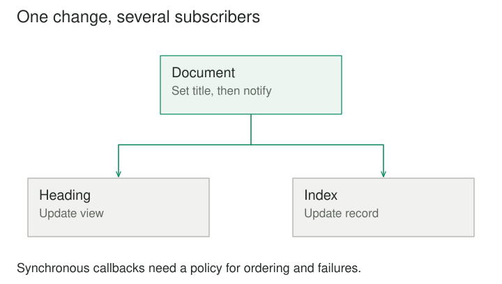

## Purpose and problem

A document model updates its title. The window heading, recent-files list, autosave indicator, and search index all need to react. If the model calls each of those components directly, every new dependent requires another reference and another special-purpose call.

## Core idea

Observer lets dependents subscribe to changes. The subject maintains a notification relationship and publishes relevant updates. Subscribers decide what to do with those updates, while the subject does not need to know their concrete roles.



## How it works

The core roles are a subject, observers, and a subscription mechanism. An observer can be an object with an update method or a callback. The subject records subscriptions and notifies them when the chosen change occurs.

There are two common data styles. A push notification carries the relevant state or event information. A pull notification tells observers that something changed and lets them query the subject. A design may combine both by sending a change description and allowing further queries.

Neither style is automatically correct. Push makes a specific update easier to interpret without another read. Pull can avoid large payloads, but the queried state may already have changed again by the time a delayed observer reads it. The notification contract should say whether it describes an event, a version, or the latest available state.

## Worked example

### Several views of one document

Suppose a document publishes TitleChanged with its identifier, old title, new title, and version. The window heading updates its display. The recent-files list changes its label. A search index marks the document for indexing according to its own policy.

Before Observer, the document model knows concrete UI and indexing components. Afterward, it knows only how to publish a meaningful change. A new dependent can subscribe without requiring another model-specific call.

The timing matters. The title and related invariants should normally be consistent before notification. An observer that queries the document halfway through a multi-field update may see an invalid state. Publishing after a coherent update or emitting one transaction-level change can avoid that problem.

Subscriptions also need an owner. When a window closes, it should stop observing the document if the subscription would otherwise retain it or trigger useless updates. An explicit subscription handle can make disposal clear.

### A small implementation

A document notifies callbacks after its title changes. Subscription returns an explicit cleanup operation. Notifications are synchronous, and the subscriber list is copied so callbacks may unsubscribe without corrupting iteration.

```python
class Document:
    def __init__(self):
        self.title = "Untitled"
        self.observers = []

    def subscribe(self, observer):
        self.observers.append(observer)

        def unsubscribe():
            if observer in self.observers:
                self.observers.remove(observer)

        return unsubscribe

    def rename(self, title):
        self.title = title
        for observer in tuple(self.observers):
            observer(title)


document = Document()
headings = []
unsubscribe = document.subscribe(headings.append)
document.rename("Design notes")
unsubscribe()
document.rename("Private draft")
print(headings)
# ['Design notes']
```

The document does not know whether the callback updates a heading, an index, or a test recorder. Cleanup ends the relationship explicitly. In this small version, a callback exception stops later notifications; an application must choose whether to propagate, isolate, or collect subscriber failures.

### Progress notifications during an import

An import job publishes progress while a status view and a diagnostic recorder subscribe. The job does not need to know whether either is present. The view updates a progress indicator; the recorder stores selected milestones.

The notification rate requires a policy. Reporting every row can overwhelm a UI or produce excessive logs. Aggregation or throttling may be appropriate at the producer or consumer boundary, depending on which information must be preserved.

Asynchronous delivery introduces another distinction. The producer might finish before a subscriber processes its final update. If completion must be observed, the system needs an explicit delivery or acknowledgment contract. A basic Observer relationship alone does not guarantee durable, ordered, exactly-once notification.

The example can stay in-process and simple. If it grows into cross-service messaging, transport, persistence, retry, and consumer identity become separate architectural concerns. Calling a message broker Observer does not explain those guarantees.

## When to use it

- An open-ended set of dependents reacts to one subject.
- The subject should publish change information without knowing each consumer.

Consider a simpler design when a fixed direct call is clearer, or when subscribers rely on unspecified order or atomic delivery.

## Tradeoffs and common mistakes

Observer reduces direct knowledge of concrete dependents, but subscribers can still depend on one another indirectly. If the status view assumes the indexer has already run, notification order becomes part of correctness. An unordered list of listeners is then an inadequate contract.

Where order genuinely matters, an explicit workflow or mediator may be clearer. Alternatively, the subject can publish after the prerequisite work completes. The important step is to make the dependency visible rather than encode it in subscription timing.

Reentrancy is another common problem. An observer reacts by changing the subject, which emits another notification, which invokes the observer again. Guards, idempotent reactions, or deliberately queued updates can help, but each approach changes timing and semantics.

Failure handling should be explicit. Should one observer exception stop later observers, be collected, or be isolated and reported? Different applications need different answers. Silently swallowing every failure can make updates appear successful when dependent state is stale.

Tests should cover subscribing and unsubscribing as well as notification. A listener that receives the right update at the wrong lifetime boundary can still produce incorrect behavior.

## Related patterns

[[mediator|Mediator]] can use Observer to hear events, then decide how participants should collaborate. Observer provides the notification relationship; Mediator provides coordination policy. They often work together without being interchangeable.

[[chain-of-responsibility|Chain of Responsibility]] offers candidate handlers a request according to a continuation rule, often stopping when one handles it. Observer normally notifies interested subscribers rather than searching for a single suitable receiver. [[command|Command]] can represent actions that observers enqueue in response to a change.

## Sources

Observer is one of the 23 patterns in Gamma, Helm, Johnson, and Vlissides, [*Design Patterns: Elements of Reusable Object-Oriented Software*](https://www.informit.com/store/design-patterns-elements-of-reusable-object-oriented-9780201633610). The examples, code, and illustrations here are original educational explanations.
