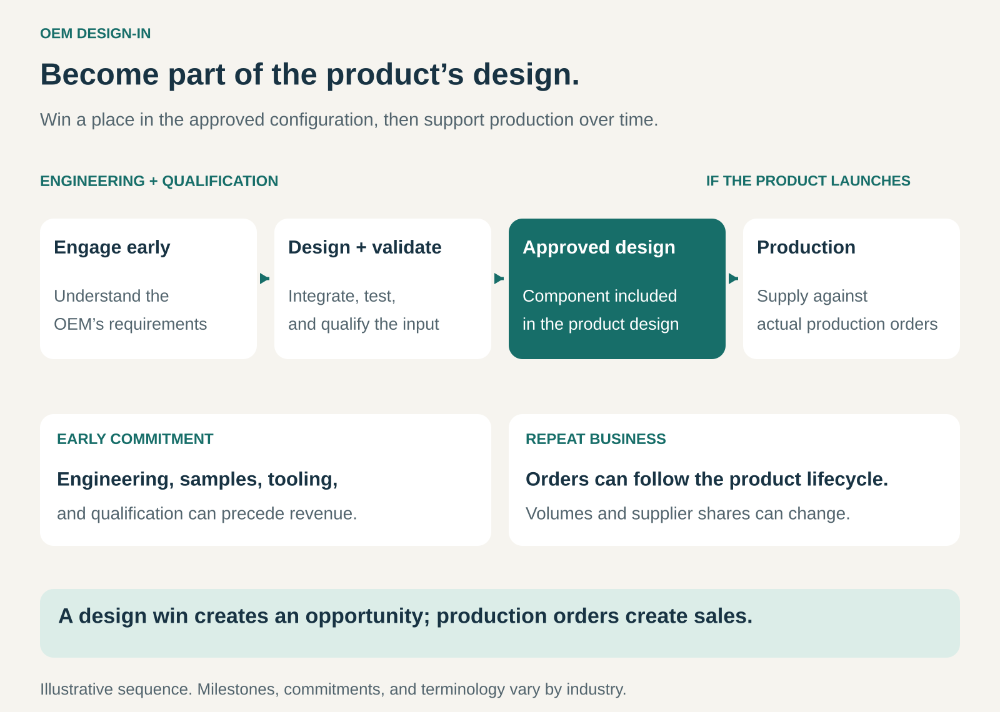

## What it is for

Win a place in a manufacturer’s product design so your component, material, or technology becomes part of its production requirements.

Manufacturers make important supplier choices before a product reaches the market. Engineers select components, test materials, establish interfaces, and qualify the resulting design.

A supplier that participates successfully in this process can gain repeat business throughout the product’s production life.

OEM Design-In is useful when technical integration matters, substitution requires effort, and the eventual production volume can justify investing in the customer’s development process.

## The core idea

**Become part of the approved product configuration before production begins, then supply and support that configuration over time.**

Here, **OEM** means _original equipment manufacturer_: the company responsible for the finished product or system, even when contractors perform some manufacturing.

The supplier might provide a standard component, an adapted material, a custom subsystem, or licensed technology. The important feature is its selection for a particular product.

Being registered as an approved supplier opens the door. Being designed into a product creates a specific production opportunity.

That opportunity is often called a **design win**. It still depends on the product launching, customer demand, purchasing decisions, and the supplier’s continued performance.

Consumer recognition is optional. A component can be commercially important while remaining invisible to the person buying the finished product.

## How it works

**1. Engage while requirements are being defined.**

The supplier works with people influencing the product’s design and sourcing decisions.

These can include engineers, product managers, procurement teams, and manufacturing specialists. Each evaluates different requirements: performance, cost, reliability, availability, integration effort, and production readiness.

Early involvement gives the supplier a chance to demonstrate how its contribution fits the system.

**2. Help the customer integrate and evaluate it.**

Samples, prototypes, documentation, development tools, and engineering support help the manufacturer test the proposed solution.

Some products require extensive joint development. Others use standard parts that still need evaluation within the customer’s application.

The supplier reduces uncertainty about how its contribution will work in practice.

**3. Meet qualification and selection requirements.**

The customer evaluates the component within the intended product and manufacturing process.

Selection can depend on technical performance, reliability, production consistency, commercial terms, and supply arrangements.

The result may be inclusion in an approved parts list, material specification, system architecture, or another controlled design document. Several suppliers or alternatives may be approved.

**4. Support production and the product lifecycle.**

Once production starts, the supplier must deliver consistent quality and sufficient capacity.

Changes to materials, software, manufacturing processes, or availability may require coordination with the customer. Technical support and end-of-life planning can remain important long after the original design decision.

The commercial relationship develops through execution as well as initial selection.

## Why it works

**One selection can support many purchases.** Production creates recurring demand for the selected input.

**Integration creates continuity.** Replacing a component may require engineering work, testing, documentation changes, and production adjustments.

**Early collaboration can improve the finished product.** The supplier contributes specialist knowledge while the customer can still make meaningful design choices.

**The supplier becomes familiar with the customer’s requirements.** That experience can support future development work, although each new program may require another competitive selection.

**The manufacturer gains access to specialized capabilities.** It can incorporate expertise without developing every component or material internally.

These advantages are strongest when the supplier continues to provide a competitive contribution. Design-in does not remove price pressure, alternative sourcing, or the possibility of redesign.

## Famous examples

### AMD and PlayStation 5 — silicon developed around system requirements

AMD describes its semi-custom products as customer-specific solutions developed through close work with customers to match their system requirements. Its semi-custom chips power Sony’s PlayStation 5 and Microsoft’s Xbox Series S and X consoles. [AMD’s description of its semi-custom business](https://www.sec.gov/Archives/edgar/data/0000002488/000119312526129106/d46357dars.pdf)

PlayStation 5 illustrates a component developed as part of a particular product architecture.

The commercial opportunity comes from supplying the resulting console program. The example demonstrates substantial technical collaboration, rather than simply adding a standard retail component after the system has been designed.

### Corning and Samsung Galaxy S25 Ultra — material selected for a specific device

Samsung’s Galaxy S25 Ultra incorporates Corning Gorilla Armor 2 as its display-cover material. The companies describe the selection as part of their continuing collaboration around mobile-device materials. [Corning’s announcement](https://www.corning.com/gorillaglass/worldwide/en/news/news-releases/2025/01/samsung-galaxy-s25-ultra-introduces-corning-gorilla-armor-2-industrys-first-anti-reflective-glass-ceramic-for-mobile-devices.html), [Samsung’s product description](https://www.samsungmobilepress.com/articles/samsung-galaxy-s25-series-sets-the-standard-of-ai-phone-as-a-true-ai-companion)

This illustrates design-in beyond electronics: a material becomes part of the approved construction of a named product.

Corning’s consumer-facing name also makes this an example of Ingredient Branding. The two patterns address different parts of the relationship—selection by the manufacturer and recognition by the customer.

### Bosch and Mercedes-Benz — a subsystem developed into production vehicles

Bosch and Daimler-Benz established a joint engineering project in 1992 to develop electronic stability control for production. ESP reached the Mercedes-Benz S-Class in 1995. [Bosch’s development history](https://us.bosch-press.com/pressportal/us/en/press-release-10752.html)

The example shows the depth that design-in can require. A vehicle-control subsystem must work within the wider vehicle, involving coordinated development before production use.

The supplier’s contribution becomes part of an operating system whose behavior depends on the integration of several elements.

## The economics

The supplier may invest in engineering, samples, tooling, and qualification before receiving substantial production revenue.

Some arrangements include customer-funded development payments. Others rely mainly on later component sales or licensing income.

Consider a hypothetical program:

| Program economics                       | 100,000 units shipped | 50,000 units shipped |
| --------------------------------------- | --------------------: | -------------------: |
| Sales at $20 per unit                   |            $2,000,000 |           $1,000,000 |
| Variable delivery costs at $14 per unit |           −$1,400,000 |            −$700,000 |
| Pre-production engineering and tooling  |             −$400,000 |            −$400,000 |
| Remaining contribution                  |          **$200,000** |        **−$100,000** |

The illustration assumes constant prices and unit costs, no separate development payment, and excludes general overhead, financing, and tax.

The same technical win produces very different economics at different shipment volumes.

Timing matters too. Development spending can precede production receipts by a substantial period. Forecasts therefore need to consider launch timing, production volume, supplier allocation, price changes, and continuing support costs.

Expected lifetime sales describe an opportunity. They are different from orders already placed.

## Useful when

- **Customers make important supplier choices during development.** Early engagement can influence selection.
- **Integration and qualification matter.** The input is more consequential than an easily interchangeable purchase.
- **Production can generate repeat demand.** The potential volume justifies the development effort.
- **The supplier can support the lifecycle.** Quality, capacity, documentation, and availability can be maintained.
- **The contribution improves the customer’s system.** Specialist capability provides a clear reason for selection.

## Common mistakes and limits

**Treating a design win as guaranteed revenue.** Products can be delayed, canceled, or sell below expectations.

**Confusing approval with allocation.** Several suppliers may qualify, while actual purchasing volumes are distributed differently.

**Underpricing engineering support.** Samples, debugging, redesigns, and qualification can consume substantial resources.

**Ignoring lifecycle price pressure.** Initial economics may change through negotiations, competition, or cost-reduction requirements.

**Becoming dependent on one product program.** A successful design-in can still create concentrated exposure to one customer’s demand.

**Winning technically but failing operationally.** Inconsistent quality or insufficient capacity can undermine the relationship.

**Assuming the next generation is already secured.** A redesign gives the manufacturer another opportunity to reconsider architecture and suppliers.

The pattern is harder to justify when development costs are high, likely production volumes are small, or customers can substitute alternatives with little effort.

## Related patterns

- [[ingredient-branding|Ingredient Branding:]] makes the supplier’s contribution visible to end customers. OEM Design-In concerns its selection and integration into the product.
- [[layer-player|Layer Player:]] supplies a specialist capability across several value chains. Design-in can establish that capability within individual customer programs.
- [[open-business-model|Open Business Model:]] connects external expertise with internal development and commercialization. Joint engineering can provide that connection.
- [[licensing|Licensing:]] allows technology to be incorporated through agreed usage rights, providing an alternative or complement to physical component sales.
