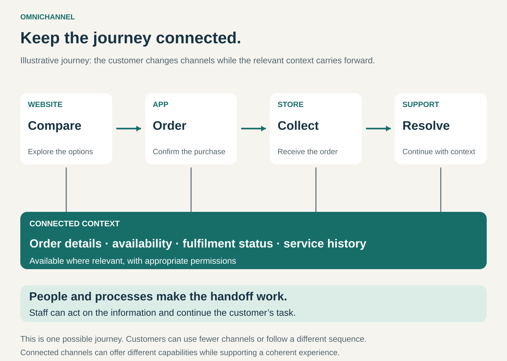

## What it is for

A customer researches a product online, asks a question in a store, orders through an app, and later contacts support. Each step makes sense to them as part of one purchase.

Problems arise when the business treats those steps as unrelated. The store cannot find the order. Support needs the story repeated. A loyalty benefit disappears when the customer changes channels.

Omnichannel connects these interactions so customers can continue their task as they move between digital and physical channels.

It is useful when buying, receiving, using, or servicing an offering naturally involves more than one point of contact.

## The core idea

**Organize channels around a continuing customer journey, with relevant context carried between them.**

A business can operate stores, a website, an app, and a contact centre. That gives it multiple channels.

Omnichannel adds coordination: an action in one channel can be recognized and continued in another. An online order becomes available for store collection. A service representative can retrieve the relevant purchase. Qualifying purchases contribute to the same loyalty account.

The channels do not need identical capabilities. A store can offer hands-on advice, an app can provide convenient ordering, and a support team can handle unusual problems.

They need to work together coherently.

“Omni” also does not require presence everywhere. Connecting the channels customers actually use can create more value than adding new channels with weak handoffs.

## How it works

The pattern depends on several forms of continuity.

**Recognize the task.** An order number, booking reference, account, or other identifier lets the next channel retrieve the relevant interaction. Customers should not need to reconstruct information the business already has.

**Carry useful context forward.** This might include selected products, an order’s status, a reservation, loyalty eligibility, or previous service actions. Information should be available where relevant, with appropriate permissions.

**Coordinate availability and commitments.** A pickup promise needs to reflect stock and staff capacity. A booking shown in an app needs to be recognized at the location providing the service.

**Let people act on the information.** Seeing an order is only useful if staff can perform the next task: release it, amend it, explain its status, or resolve a problem within their authority.

**Handle exceptions across channels.** Cancellations, substitutions, returns, and failed collections need clear ownership. Otherwise, customers can be passed between teams that each consider the problem someone else’s responsibility.

The customer does not have to use every channel. The value lies in making the transitions they choose workable.

## Why it works

Different channels are useful at different moments.

Customers may prefer digital search for comparing specifications, a physical location for examining a product, and a person for resolving an unfamiliar problem. Connecting those strengths reduces the effort of switching between them.

Continuity can also reduce uncertainty. A collection notification confirms that an order is ready. A recognized reservation connects planning with arrival. A shared order reference gives support a starting point.

For the business, coordinated channels can offer more ways to fulfil demand. Stores may provide collection or returns; digital tools may handle routine administration; specialists may focus on questions requiring judgment.

These benefits require operational coordination. An app can display a promise, but stock accuracy, staffing, and procedures determine whether the business can keep it.

## Famous examples

### Target: connecting digital ordering with store operations

Target lets customers place Order Pickup orders through its website or app and collect them at a local store. Its app also supports Drive Up, where eligible orders are brought to a customer’s vehicle.

Notifications and order details connect the digital purchase with the physical handover. Customers can also initiate eligible returns through their order details, with store or Drive Up options depending on the item and location. [Target pickup and Drive Up guidance](https://www.target.com/help/articles/delivery-options/drive-up-order-pickup)

The example demonstrates a coordinated handoff: digital ordering creates work for a store team, and the order’s status guides the customer’s arrival.

Availability and eligibility conditions remain important. The service does not imply that every item or location supports every option.

### Sephora: a loyalty relationship spanning channels

Sephora’s Beauty Insider programme recognizes qualifying purchases across its website and stores. Certain partner channels can also participate when the customer links the appropriate account.

Members identify themselves through their registered details or digital card, allowing qualifying activity to contribute to the same programme. Rewards can be redeemed through supported online and store routes, with conditions that vary by reward and channel. [Sephora Beauty Insider terms](https://www.sephora.com/beauty/beautyinsider-terms-conditions)

This illustrates continuity of the customer relationship across separate purchasing locations.

A connected loyalty programme is one layer of Omnichannel. It demonstrates a specific integration without establishing that every service or transaction works identically everywhere.

### Disney: connecting planning with the on-site experience

At Walt Disney World, guests can book selected dining experiences online, manage dining plans through My Disney Experience, and use mobile check-in at participating table-service restaurants. The app also supports advance food ordering at selected locations. [Walt Disney World dining options](https://disneyworld.disney.go.com/en_CA/dining/snack-dine-enjoy/)

Here, digital interaction supports an experience delivered in person. Planning, reservation management, arrival, and service become connected parts of the visit.

The example extends Omnichannel beyond retail. Its purpose is to help a guest carry an intention or reservation into the physical setting where it will be fulfilled.

## The economics

Omnichannel supports the business’s existing revenue model. Its financial value can come from additional purchases, better retention, fewer failed transactions, or lower costs of fulfilment and service.

It also creates costs: integration, training, stock accuracy, store handling, support, and coordination.

Consider a hypothetical retailer whose customers switch 500 existing monthly orders from home delivery to store collection:

- Each order avoids $6 in delivery costs.
- Each adds $4 in store handling costs.
- With all other costs assumed unchanged, the difference is $2 per order, or $1,000 per month.

That saving is before additional technology and fixed operating costs.

The orders are existing purchases moving between fulfilment methods. Their appearance in the pickup channel does not create additional sales revenue.

Similarly, customers using several channels may already be more engaged. Their higher spending alone does not establish that connecting the channels caused it. The business needs to distinguish additional value from activity that has simply moved or become easier to observe.

## Useful when

- **Customers naturally switch channels.** Research, advice, ordering, collection, and support happen in different places.
- **The task benefits from continuity.** Previous choices, purchases, or reservations help the next interaction.
- **Physical and digital channels provide complementary strengths.** Each performs a useful part of the journey.
- **Disconnected processes create repeated effort.** Customers or staff keep re-entering information and explaining earlier actions.
- **The business can coordinate commitments.** Its people and operations can fulfil promises made through another channel.

## Common mistakes and limits

**Equating more channels with better service.** Additional options can multiply confusion when they lack clear connections.

**Sharing information without enabling action.** Staff may recognize a transaction yet remain unable to help. Responsibilities and authority need to support the handoff.

**Promising availability too confidently.** Stock discrepancies and limited handling capacity can turn convenient collection into a wasted journey.

**Rewarding channels for competing internally.** Store teams may resist assisting online orders if their work is unrecognized. Measures and incentives should reflect their contribution.

**Forcing customers to identify themselves unnecessarily.** Relevant continuity can sometimes rely on an order or booking reference. A compulsory account is not always needed.

**Assuming consistency requires identical offers.** Channels can have different capabilities or conditions. Differences need to be understandable and communicated before customers rely on them.

**Ignoring the exception journey.** Returns, cancellations, missed collections, and service problems often reveal where coordination is weakest.

## Related patterns

[[e-commerce|E-Commerce]] enables electronic ordering. Omnichannel connects that ordering with other purchasing and service interactions.

[[direct-to-customer|Direct to Customer / No Middle Man]] concerns the selling relationship between a brand and its end customer. Omnichannel can coordinate the brand’s direct channels and relevant partner interactions.

[[membership|Membership]] can provide recognized identity and continuing benefits across channels. Omnichannel also works through individual order or booking references without membership.
