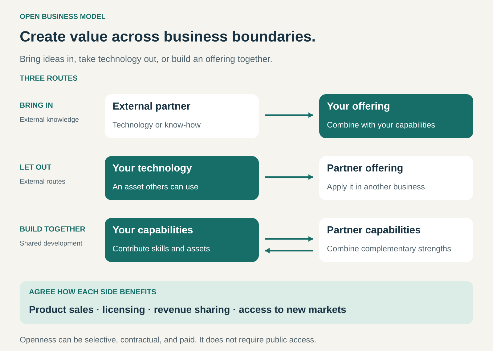

## What it is for

Create and commercialize offerings by combining your business’s capabilities with ideas, technology, and resources from outside it.

A business may have strong customer relationships but lack a particular technology. Another may have valuable research without the manufacturing capacity or market access to commercialize it. Customers and specialist partners may see opportunities that an internal team would miss.

Open Business Model is useful when collaboration can connect these complementary strengths.

The opportunity is to build a business around those connections, with a clear explanation of how participants contribute and how each benefits.

## The core idea

**Make collaboration across business boundaries a central part of how value is created and captured.**

Business Model Navigator describes an open business model as one in which collaboration with suppliers, customers, or other partners becomes a central source of value creation. [Business Model Navigator: Open Business Model](https://www.businessmodelnavigator.com/explore)

There are three useful routes:

- **Bring knowledge in.** Use external ideas, technology, or expertise within your offering.
- **Take knowledge out.** Let others commercialize technology or capabilities you have developed.
- **Build together.** Combine complementary contributions to develop and commercialize an offering.

A business can use one route or several.

“Open” describes the willingness to work across organizational boundaries. Access can still be selective, contractual, and paid. Intellectual property can remain proprietary.

The business-model question extends beyond finding good ideas: who will develop them, reach customers, fund the work, and earn income?

## How it works

**1. Identify complementary capabilities.**

The starting point is a specific opportunity that becomes more valuable when different contributions are combined.

A materials specialist might contribute a new coating while a manufacturer contributes production expertise and access to customers. A technology owner might provide a design that another business adapts for a different market.

Each side needs a reason to participate.

**2. Establish a route for collaboration.**

Possible arrangements include licensing, joint development, customer contribution programs, research partnerships, and jointly commercialized offerings.

The arrangement should fit the work. Access to an existing technology requires different coordination from developing an uncertain new product together.

Routine purchasing alone does not establish an open business model. The collaboration needs to play a meaningful role in shaping the offering or extending how it reaches the market.

**3. Connect the contributions to commercialization.**

An external invention can still require engineering, testing, manufacturing, distribution, support, and marketing.

The business needs to identify who performs those activities and how the separate contributions become something customers can use.

Finding a promising technology is one milestone. Turning it into a viable offering is another.

**4. Agree how value and responsibilities are shared.**

Participants need clarity about access, permitted uses, contributions, costs, and returns.

Commercial arrangements might include license fees, royalties, revenue sharing, development payments, or income from selling the resulting product.

They also need workable decisions about improvements, quality, customer relationships, and what happens if the collaboration ends.

## Why it works

**Useful knowledge exists beyond any one organization.** External specialists may already possess capabilities that would take substantial time to reproduce.

**Existing assets can find additional applications.** Technology developed for one market may be useful in another business with different customers or complementary capabilities.

**Development effort can be combined.** Participants can contribute different pieces instead of each attempting to build the entire system.

**Commercialization can use established strengths.** A partner may already have manufacturing capacity, distribution, or customer trust.

**Participation can reveal demand and opportunities.** Customers and communities can contribute ideas grounded in uses the business has not fully explored.

These advantages depend on the ability to evaluate and integrate external contributions. Access to more ideas also creates more work in selection, coordination, and execution.

## Famous examples

### P&G Connect + Develop — bringing external expertise into innovation

P&G’s Connect + Develop program seeks innovations from external companies and individuals, including technologies, products, packaging, and commercial opportunities. It provides a structured route for potential partners to submit contributions. [P&G’s Connect + Develop portal](https://pgconnectdevelop.inovasuite.com/pg/index.jsp?lang=en)

Its 2023 partner awards provide concrete examples. P&G recognized University of Cincinnati researcher Ana Kadekaro for a moisturizing-assessment capability and CR Competence for contributions to understanding product formulation. [P&G’s 2023 collaboration examples](https://pgresearchdevelop.com/blog/connect-develop-2023-awards/)

The pattern combines external specialist knowledge with the company’s internal development and commercialization capabilities.

### Arm’s IP licensing business — enabling partners to commercialize technology

Arm licenses CPU and related intellectual property that customers use in their chip designs. Its model combines licensing arrangements with per-unit royalties on substantially all chips shipped using its products. [Arm’s description of its business model](https://investors.arm.com/node/8361/html)

Partners incorporate Arm technology into products serving their own markets. Arm captures value from enabling those products through the licensing relationship.

This illustrates the outward route: internally developed knowledge can generate income through other businesses’ offerings. The technology remains available under agreed commercial terms.

### LEGO Ideas — customer contributions connected to commercialization

LEGO Ideas lets participants submit product concepts and gather community support. Reaching 10,000 supporters qualifies a product idea for review; LEGO then decides whether it may become an official set. [LEGO Ideas review process](https://www.lego.com/en-us/service/help-topics/article/what-happens-to-my-product-idea-after-i-reach-10-000-supporters)

The program’s terms provide compensation for product ideas selected for commercialization under the applicable rules. [LEGO Ideas terms](https://ideas.lego.com/agree_policies)

The arrangement connects external creativity and community participation with LEGO’s product business. Contributors supply ideas, the community signals interest, and LEGO retains the commercialization decision.

It is a structured relationship with defined participation and compensation rules.

## The economics

An open business model can capture value through product margins, license fees, royalties, shared revenue, or access to additional markets.

Consider a hypothetical technology owner receiving royalties from a partner:

| Item for the period                                             |       Amount |
| --------------------------------------------------------------- | -----------: |
| Royalties: 500,000 units at $0.40                               |     $200,000 |
| Technical adaptation and support                                |     −$80,000 |
| Partner management and reporting                                |     −$20,000 |
| Contribution before earlier research costs and general overhead | **$100,000** |

These are illustrative figures, not the terms of any example above.

The technology owner gains an external route to market but still bears costs for development, support, and managing the relationship. The partner must also earn enough from the resulting product to justify participation.

For inward collaboration, a license fee is only part of the calculation. Integration, testing, production changes, and continuing royalties can substantially affect the economics.

Sharing development work can reduce duplication. It does not make development free.

## Useful when

- **Important capabilities sit elsewhere.** A partner can contribute knowledge, technology, or market access you lack.
- **Your own assets have wider potential.** Others could apply them in markets you cannot serve effectively.
- **The contributions are complementary.** Combining them produces a stronger offering than either side can readily provide alone.
- **There is a credible commercialization route.** Someone can turn the combined work into a usable, saleable offering.
- **Participants can agree on a worthwhile exchange.** Contributions, responsibilities, and returns are clear enough to sustain cooperation.

## Common mistakes and limits

**Collecting ideas without a route to use them.** An innovation portal produces little value if internal teams lack the capacity or authority to develop promising submissions.

**Underestimating integration.** An external technology may work well in isolation while requiring considerable adaptation for a commercial product.

**Leaving rights and improvements ambiguous.** Participants need clarity about what each can use, develop, and commercialize.

**Designing a one-sided exchange.** Partners need sufficient reward and confidence to contribute their best capabilities.

**Depending too heavily on one partner.** A critical contribution can become difficult to replace or renegotiate.

**Sharing more than the collaboration requires.** Selective access can support cooperation while preserving other valuable knowledge.

**Assuming collaboration guarantees speed.** Negotiations, incompatible processes, and unresolved decisions can delay the work.

The pattern is harder to operate when contributions are difficult to evaluate, responsibilities cannot be separated, or participants have fundamentally conflicting commercial goals.

## Related patterns

- [[licensing|Licensing:]] provides a mechanism for others to use intellectual property under agreed terms. It can support either inward or outward collaboration.
- [[orchestrator|Orchestrator:]] coordinates complementary partners to deliver an offering. An open business model can provide the collaboration and commercial arrangements around that network.
- [[crowdsourcing|Crowdsourcing:]] draws contributions from a wider group. It becomes part of an open business model when those contributions connect to development, commercialization, and participant incentives.
- [[open-source|Open Source:]] permits use and modification under an open-source license. An open business model can incorporate open source, while also using proprietary technology and selective partnerships.
