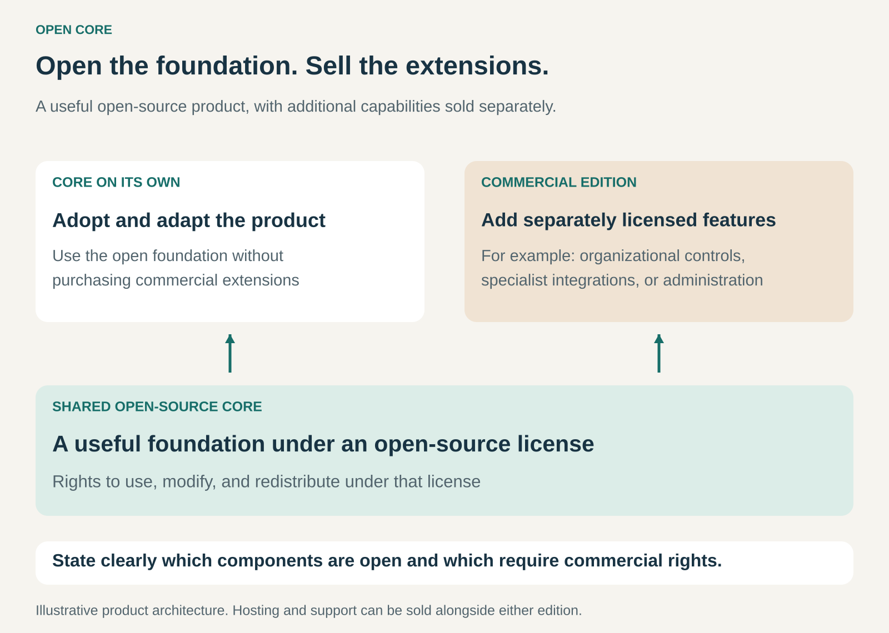

## What it is for

Encouraging adoption through a useful open-source product while earning revenue from additional commercial capabilities.

A small team may need a tool that solves an immediate problem. A larger organization may need the same tool plus centralized administration, specialized integrations, reporting, or controls across many teams.

Open Core serves both groups through a shared foundation.

The core remains open source. Customers with additional requirements can purchase an expanded commercial offering.

## The core idea

**Make the foundation openly available, and sell additional capabilities around it.**

The open-source core gives users rights to use, modify, and redistribute that software under its license.

The commercial offering adds features under separate terms—commonly proprietary or source-available licenses. Those extensions may be delivered as modules, an enterprise edition, or features activated through a subscription.

The distinction concerns software rights as well as price. Publishing readable code does not automatically make it open source; the license must provide the required freedoms. [Open Source Initiative: the Open Source Definition](https://opensource.org/osd)

Open Core is therefore more specific than offering free and paid plans. A proprietary product with a free tier can use Freemium without having an open-source foundation.

It also differs from Open Source with Paid Services. In that pattern, customers pay for work such as hosting, support, or implementation. In Open Core, additional software capabilities are a central reason to purchase.

A business can combine both approaches.

## How it works

The pattern depends on three connected decisions.

**What the core does.** The open product needs to solve a real problem on its own. Users should be able to adopt it, understand its value, and build useful work around it.

A core that functions mainly as an extended demonstration may attract attention without creating lasting adoption.

**What the commercial offering adds.** Paid capabilities address needs for which particular customers have a budget.

These might include organization-wide administration, advanced workflows, specialist connectors, deployment controls, or reporting. The appropriate boundary depends on the product and its buyers.

**How the two parts fit together.** Customers need a practical path from the core to the expanded offering. That might involve installing an extension, changing editions, or activating licensed features.

The boundary can be a licensing distinction within a shared codebase. It does not require every commercial feature to be a physically separate plugin.

The company also needs to explain which components are open, which rights apply to the extensions, and what happens when a commercial subscription ends.

## Why it works

The open core can make evaluation and adoption easier.

Developers can inspect the software, test it in their environment, and adapt it within the license’s terms. A useful project can attract documentation, integrations, and contributions that extend its reach.

Commercial demand comes from requirements beyond the core.

For example, an individual team may be satisfied with a basic workflow. An organization coordinating many teams may place greater value on administration, governance, and integration with existing systems.

That creates a possible relationship between broader adoption and paid demand.

The relationship is not automatic. Many users may never need the commercial capabilities. The business needs a sufficiently valuable paid offer, access to the people who buy it, and enough revenue to maintain both sides of the product.

## Famous examples

### GitLab: an open foundation with commercial capabilities for teams and organizations

GitLab describes its open core as MIT-licensed and the rest of its product as source-available. Its commercial plans add capabilities for areas such as team productivity, security, and compliance. [GitLab’s open-core description](https://about.gitlab.com/solutions/open-source/), [GitLab’s plans](https://about.gitlab.com/pricing/)

The foundation supports adoption, while expanded capabilities address additional organizational requirements.

GitLab also offers different deployment options. This shows why feature licensing and hosting should be understood separately: customers can purchase commercial capabilities for a self-managed installation as well as through hosted offerings.

The example does not mean every visible part of GitLab carries the same open-source rights.

### Grafana: open visualization software with enterprise extensions

Grafana’s core project uses an open-source license, with its licensing documentation identifying AGPLv3 for the core projects. Grafana Enterprise adds commercial features, including exclusive data-source plugins and additional authentication capabilities. [Grafana licensing](https://grafana.com/licensing/), [Grafana Enterprise](https://grafana.com/docs/grafana/latest/introduction/grafana-enterprise/)

The distinction becomes concrete in data-source permissions. Grafana documents capabilities for restricting access to particular data sources as available in Grafana Enterprise and Grafana Cloud. [Grafana’s data-source permissions](https://grafana.com/docs/grafana/latest/administration/data-source-management/)

The open product provides useful visualization capabilities. Commercial features address further requirements around integration and administration.

The purchase can therefore concern how an organization manages the product, rather than simply whether it can create a dashboard.

### Metabase: open analytics with separately licensed commercial features

Metabase offers its Open Source Edition under the AGPL. Its licensing page distinguishes this from Enterprise Edition, whose commercial features require an appropriate commercial license even though their source is available. [Metabase’s licensing terms](https://www.metabase.com/license)

Its plan comparison places capabilities such as SAML authentication in commercial plans. [Metabase’s plan comparison](https://www.metabase.com/pricing/compare-plans)

This illustrates both sides of the boundary: a usable open analytics product and additional capabilities for particular organizational needs.

It also provides a clear example of why seeing the code and possessing permission to use a commercial feature are different things.

## The economics

Consider a hypothetical Open Core business with **100 paying organizations**, each purchasing an annual subscription for **$6,000**.

Annual revenue is:

**100 × $6,000 = $600,000.**

Assume:

- Delivery and support cost **$900 per paying organization annually**.
- Shared annual costs for product development, maintenance, sales, and administration total **$400,000**.

The remaining amount is:

**$600,000 − $90,000 − $400,000 = $110,000.**

That is before tax and recovery of earlier investment.

With only **50 paying organizations**, assuming the same subscription price, per-customer cost, and shared costs:

**$300,000 − $45,000 − $400,000 = −$145,000.**

The open core may have many more users than paying customers. Their participation can be valuable, but it does not directly cover development costs.

The economics depend on a paid segment large enough to fund the shared foundation, commercial features, and business operations.

## Useful when

- A useful standalone core can attract adoption without requiring a purchase.
- Different customer groups have meaningfully different software requirements.
- Organizational buyers value additional capabilities enough to pay for them.
- Commercial extensions can share the core without creating excessive maintenance complexity.
- The business can explain and sustain a clear licensing boundary.
- Revenue can support continued investment in both the open and commercial product.

It is less attractive when there is little meaningful separation between user needs, or when the paid offering depends on making the core frustrating to use.

## Common mistakes and limits

**Making the core too limited.** If users cannot accomplish a worthwhile task, the product may fail to establish the adoption on which the model depends.

**Making the paid distinction unclear.** Customers need to understand what they receive, why it matters, and which rights accompany it.

**Calling the entire product open source.** An open core does not make separately licensed commercial components open source. Source availability alone does not settle the question.

**Assuming users naturally become buyers.** The people adopting a tool may not control organizational budgets. Selling commercial capabilities can require a separate purchasing process.

**Underestimating engineering complexity.** Shared code, different editions, upgrade paths, testing, and documentation all require maintenance.

**Ignoring contributor expectations.** People need clarity about how contributions are licensed, reviewed, and used across the product. A public repository does not remove the need for careful governance.

**Moving the boundary unpredictably.** Changes to editions or feature availability can disrupt customer plans and community trust. The commercial model depends partly on confidence that users understand what they are adopting.

## Related patterns

- [[open-source|Open Source:]] Establishes the software freedoms of the shared foundation.
- [[open-source-with-paid-services|Open Source with Paid Services:]] Earns from hosting, support, and implementation; it can operate alongside paid extensions.
- [[freemium|Freemium:]] Separates free and paid access levels, without necessarily providing open-source rights.
- [[core-plus-add-ons|Core plus Add-Ons:]] Shares the structure of a useful base offering with optional additions; Open Core adds a specific licensing distinction.
