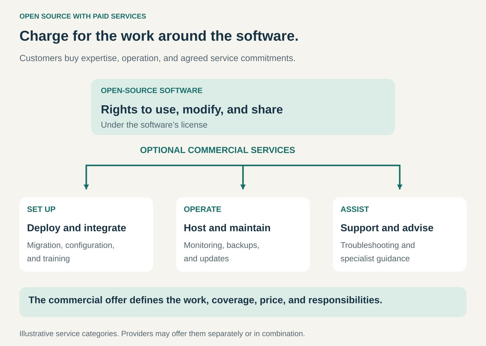

## What it is for

Building a business around helping customers successfully deploy, operate, and maintain open-source software.

A company can download a database without paying a software license fee. It still needs to migrate its data, configure backups, manage upgrades, and resolve production problems.

Access to the software answers one question. Running it reliably answers another.

Open Source with Paid Services earns revenue from that surrounding work. Customers pay for expertise, convenience, operational capacity, and agreed service commitments.

## The core idea

**Keep the software open, and charge for helping people use it successfully.**

The open-source license provides rights to use, modify, and redistribute the software under its conditions. A commercial agreement provides specified services around it.

The Open Source Initiative explicitly identifies support, customization, maintenance, warranties, and other assurances as ways to build businesses around open-source code. [Open Source Initiative: commercial business models](https://opensource.org/faq)

The provider might maintain the original project, contribute to it, or specialize in operating software developed by others.

This pattern is a specific commercial approach within the broader **Open Source** pattern. Its revenue comes from services. It can coexist with other approaches, but it does not require proprietary premium features.

Customers may have the technical option to do the work themselves and still find a paid service worthwhile.

## How it works

Paid services commonly address three stages.

**Getting started.** The provider helps customers evaluate, install, configure, migrate, and integrate the software. Training helps the customer’s team become capable of using it.

These engagements often have a defined project scope: migrate a database, deploy a publishing platform, or connect an application to existing systems.

**Keeping it running.** The provider supplies hosting, monitoring, backups, maintenance, upgrades, or ongoing administration.

The customer pays for work that continues throughout the life of the system. Automation and shared infrastructure can make delivery more efficient across many customers.

**Getting expert help.** The provider offers troubleshooting, performance analysis, architectural advice, or assistance with difficult incidents.

This can be sold through subscriptions, retainers, prepaid hours, or individual engagements. Customers may be paying partly for access to expertise when they need it, rather than a fixed amount of work every month.

These services require clear boundaries. Advisory support, hands-on operations, and responsibility for hosting are different commitments. A response-time promise also differs from a promise to restore service within a particular time.

## Why it works

The purchase decision concerns the customer’s total cost of using the software.

Doing the work internally requires people, tools, training, and time. It may also require maintaining specialist knowledge that is needed only occasionally.

A provider can concentrate that expertise across many customers. It can develop repeatable deployment methods, monitoring, diagnostic tools, and procedures for recurring problems.

For the customer, the service can reduce the burden of building those capabilities independently.

For the provider, a useful open-source project can create an audience with practical service needs. Demonstrated expertise, contributions, documentation, and successful delivery can help establish credibility.

None of this guarantees demand. Some users have capable internal teams. Others have simple requirements. The commercial opportunity depends on identifying customers whose operating needs justify the price.

## Famous examples

### Red Hat: maintained enterprise software and support

Red Hat subscriptions combine tested enterprise software with ongoing updates, lifecycle management, documentation, certifications, and support options. The company describes its offering as preparing and sustaining open-source technology for enterprise use. [Red Hat’s subscription model](https://www.redhat.com/en/about/subscription-model-faq)

The customer buys an ongoing relationship around maintaining systems and addressing operational needs.

This is broader than selling troubleshooting hours. Preparing releases, testing combinations, maintaining updates, and organizing expertise are recurring capabilities.

Support levels and subscription obligations vary. The example illustrates a commercial package built around open-source software, rather than a universal entitlement to every service.

### WordPress.com: managed operation of open-source publishing software

WordPress.com offers managed hosting based on WordPress. Its hosting description includes operating infrastructure and handling tasks such as updates, security measures, and backups. [WordPress.com’s managed hosting offering](https://wordpress.com/hosting/)

Customers can instead obtain WordPress and arrange hosting elsewhere. WordPress.com is a commercial service operated by Automattic; it is distinct from the broader WordPress project. [WordPress and WordPress.com explained](https://wordpress.com/support/com-vs-org/)

The paid service addresses an ongoing need: keeping a website available and maintained without requiring the customer to manage every technical component.

It demonstrates how operational convenience can remain valuable even when the underlying software is openly available.

### Percona: specialist services around databases

Percona offers database support, managed operations, and consulting, including services for PostgreSQL. Its service descriptions distinguish advisory incident support from hands-on management and project work such as migrations, upgrades, and performance tuning. [Percona’s database services](https://www.percona.com/services/)

That distinction makes the commercial offer concrete.

A customer may need an expert to explain a problem while its own team performs the work. Another may want a provider to manage recurring operations. A third may need help completing a difficult migration.

The software can be the same while the purchased service differs substantially.

## The economics

Consider a hypothetical support contract priced at **$2,400 per month**.

Assume onboarding is priced separately, and monthly delivery costs are:

| Monthly item                                             |     Amount |
| -------------------------------------------------------- | ---------: |
| Expert work: 10 hours at a loaded delivery cost of $100  |     $1,000 |
| Customer-specific tools and infrastructure               |       $200 |
| Allocated standby coverage                               |       $300 |
| Allocated software maintenance and project contributions |       $300 |
| Total                                                    | **$1,800** |

The contract contributes:

**$2,400 − $1,800 = $600 per month.**

That amount is before customer acquisition, general overhead, and tax.

If expert work rises to **20 hours**, with the other costs unchanged, total cost becomes **$2,800**. The contract loses **$400** that month.

Service demand can vary sharply. Pricing needs to account for incident patterns, system complexity, coverage hours, and the work the provider has agreed to perform.

Automation and shared expertise can improve the economics, but skilled labor and operational capacity remain real costs.

## Useful when

- Software adoption creates meaningful deployment or operating work.
- Customers need expertise they cannot justify maintaining internally.
- Reliability, maintenance, or response coverage matters to the buyer.
- The provider can deliver repeatable services across several customers.
- Customers want a defined commercial relationship around community-developed software.
- The provider has a credible advantage in implementation, diagnosis, or operation.

It is less attractive when customers have little need for assistance, service delivery remains entirely bespoke, or contract prices cannot cover the required capacity.

## Common mistakes and limits

**Assuming every user is a potential service customer.** A technically capable user with a simple installation may have little reason to pay. Service demand depends on circumstances.

**Leaving responsibilities ambiguous.** “Support included” does not explain who monitors the system, applies changes, restores backups, or makes decisions during an incident.

**Pricing only the average month.** Quiet periods do not eliminate the cost of maintaining coverage. Several customers may need help simultaneously.

**Confusing support with guaranteed outcomes.** A prompt response does not ensure immediate resolution. Commitments need to reflect what the provider can control.

**Underestimating maintenance.** Documentation, testing, release preparation, and security work continue between customer incidents. They need funding even when users rarely contact support.

**Assuming expertise guarantees exclusivity.** Other providers may offer services around the same software. Customers choose based on capabilities, trust, terms, and delivery.

**Neglecting the underlying project.** A service business depends on software that remains usable and maintained. Contributing improvements and supporting maintainers can strengthen the foundation on which the business relies.

## Related patterns

- [[open-source|Open Source:]] Establishes the software freedoms around which the service business operates.
- [[managed-service|Managed Service:]] Applies when the provider takes ongoing responsibility for defined operational work.
- [[retainer|Retainer:]] Reserves continuing access to expertise or capacity, often for support and advisory services.
- [[productized-service|Productized Service:]] Packages recurring deployment, maintenance, or migration work into a clearly scoped offer.
