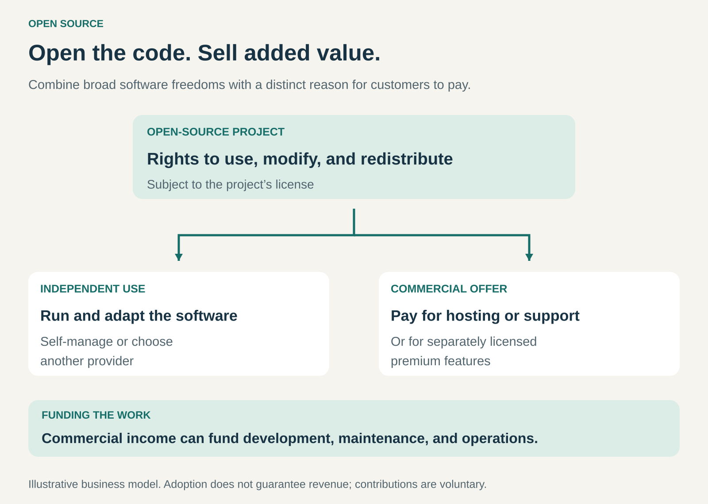

## What it is for

Encouraging adoption, inspection, adaptation, and collaboration by giving people substantial rights to the software—while building a business around capabilities customers value enough to purchase.

A company may want to use a tool before committing to a supplier. Developers may need to inspect how it works, adapt it, or connect it to other systems. An organization may want the option to operate the software itself.

Open source makes those possibilities part of the offering.

For a business, the opportunity is to combine broadly available software with paid hosting, support, implementation, enterprise features, or other complementary services.

## The core idea

**Make the software available under an open-source license, and establish a distinct reason for customers to pay.**

Open source involves more than publishing readable code. Its license must permit use, modification, and redistribution, including commercial use, subject to the license’s conditions. A restriction prohibiting commercial use does not meet the Open Source Definition. [Open Source Initiative: the definition](https://opensource.org/osd)

Open-source software can be sold. The important distinction concerns recipients’ rights, rather than whether the initial price is zero. [Open Source Initiative: commercial use](https://opensource.org/faq)

As a business pattern, Open Source therefore combines two decisions:

- **What rights does the software give people?**
- **What additional value will generate revenue?**

A useful project can succeed at the first without establishing a sustainable answer to the second.

## How it works

The pattern has three connected parts.

**A useful open foundation.** People can obtain the software, understand it, adapt it, and exercise the rights its license provides. Documentation, installation tools, and reliable releases make those freedoms practically useful.

**A way to participate.** Users may report problems, improve documentation, build integrations, or contribute code. Maintainers decide how proposed changes are reviewed and incorporated. Participation does not require accepting every contribution.

**A commercial offering.** Customers pay for something that improves their ability to use the software successfully.

Common approaches include:

- **Managed hosting:** operating the software for customers.
- **Support and assurance:** providing expertise, maintained releases, testing, and defined service commitments.
- **Implementation services:** helping customers deploy, configure, integrate, or migrate.
- **Open core:** offering an open-source foundation alongside separately licensed commercial features.
- **Complementary products:** selling hardware, extensions, training, or other services connected to the software.

These approaches can coexist. A business might offer hosted subscriptions, support self-managed installations, and sell implementation work.

Open source itself does not prescribe a single revenue model or governance structure.

## Why it works

Open source can reduce uncertainty about adopting a tool.

Developers can inspect its behavior and test it in their own environment. Organizations can evaluate whether it meets their needs and retain options for adapting or operating it independently.

An open project can also attract improvements and integrations from people with different requirements. That participation can extend the software’s usefulness beyond what one company could build alone.

Commercial demand arises because having the code does not eliminate the work of using it.

Running reliable infrastructure, managing upgrades, troubleshooting problems, and integrating systems require time and expertise. Some customers prefer to buy those capabilities.

The business therefore earns from convenience, dependable operation, specialist knowledge, or additional functionality.

These benefits are possibilities, rather than automatic consequences. Publishing code does not guarantee adoption, outside contributions, security, or paying customers.

## Famous examples

### Red Hat: enterprise subscriptions around open-source software

Red Hat’s subscription model combines enterprise software with ongoing updates, lifecycle management, certifications, documentation, and support options. Its subscription guidance describes the value of preparing and maintaining open-source technology for enterprise use. [Red Hat’s subscription model](https://www.redhat.com/en/about/subscription-model-faq)

The customer’s purchase addresses operational needs: maintaining systems, resolving problems, and working with supported combinations of software and infrastructure.

This illustrates how an open-source business can sell continuity and expertise.

The subscription is an ongoing commercial relationship with its own terms. Open-source licensing does not mean that every support service, maintained build, or subscription benefit is available without payment.

### WordPress and WordPress.com: software and hosting are separate offers

WordPress is open-source publishing software. WordPress.com is a hosted service operated by Automattic. Customers can also obtain WordPress software and arrange hosting elsewhere. [WordPress.com’s explanation of the distinction](https://wordpress.com/support/com-vs-org/)

The software provides the foundation for building a website. The hosted service provides a way to use that foundation without taking on all the infrastructure and maintenance work independently.

The distinction matters commercially. The open project supports an ecosystem of hosting providers, developers, agencies, and other businesses.

Automattic participates in that ecosystem; it is not synonymous with the entire WordPress project.

### GitLab: an open core alongside commercial offerings

GitLab describes its open core as MIT-licensed and the remainder of its product as source-available. It offers both self-managed and hosted options, with Free, Premium, and Ultimate plans. [GitLab’s description of its open core](https://about.gitlab.com/solutions/open-source/), [GitLab’s plans](https://about.gitlab.com/pricing/)

The example shows how a business can combine an open-source foundation with additional commercial functionality and delivery options.

It also demonstrates why the licensing boundary needs to be explicit. Visible source code does not establish that every part of a product is open source.

Customers need to understand which rights apply to which components, alongside what their subscription provides.

## The economics

Consider a hypothetical project used by **10,000 organizations**.

Suppose **200 organizations** purchase its managed service at **$100 per month**.

Monthly revenue is:

**200 × $100 = $20,000.**

Assume monthly costs are:

| Monthly item                 |      Amount |
| ---------------------------- | ----------: |
| Hosting and customer support |      $6,000 |
| Development and maintenance  |     $10,000 |
| Sales and administration     |      $2,000 |
| Total                        | **$18,000** |

The remaining amount is **$2,000 before taxes and other unlisted costs**.

The paying customers represent **2%** of the organizations using the project. That percentage is an assumption for this illustration, not a benchmark.

A large user base can create opportunities, but revenue depends on demand for the paid offer. Download counts alone cannot establish business viability.

Development and maintenance also remain real costs, even when outside contributors help.

## Useful when

- Adoption depends on developers being able to inspect, adapt, or integrate the software.
- Customers value the option to operate independently.
- A shared technical foundation can serve many organizations.
- External participation could improve integrations, documentation, or functionality.
- Customers have clear reasons to purchase hosting, support, implementation, or additional capabilities.
- The organization can sustain maintenance and manage contributions responsibly.

It is less attractive when the business depends entirely on restricting access to the same code it proposes to release, or when no meaningful paid need remains after independent installation.

## Common mistakes and limits

**Confusing source availability with open source.** Publishing code while restricting its permitted uses can create a different arrangement. The license determines the rights.

**Treating community participation as free staffing.** Contributions are voluntary. Reviewing changes, maintaining releases, answering questions, and resolving disagreements require sustained work.

**Assuming openness guarantees quality or security.** Inspection makes review possible. It does not ensure that qualified people perform that review or that problems receive timely fixes.

**Expecting users to become customers automatically.** Many users may be satisfied with independent operation. The paid offer needs a clear purpose.

**Ignoring competition.** Other businesses may offer services around the software, and users may create alternative versions, subject to the license. The original company still needs to earn preference.

**Leaving the commercial boundary unclear.** Customers and contributors should understand which components are open, which are separately licensed, and what paid plans include.

**Overlooking governance and trust.** Decisions about roadmaps, contributions, branding, and commercial priorities affect whether people continue participating. A company’s interests and a project’s community interests may overlap without being identical.

## Related patterns

- [[open-business-model|Open Business Model:]] Opens parts of value creation to external participation; open source provides a specific licensing foundation for software.
- [[managed-service|Managed Service:]] Generates revenue by operating software and infrastructure for customers.
- [[licensing|Licensing:]] Defines users’ rights and the conditions attached to using, modifying, and distributing the software.
- [[freemium|Freemium:]] Can coexist with open source, but addresses free and paid access levels rather than software freedoms.
