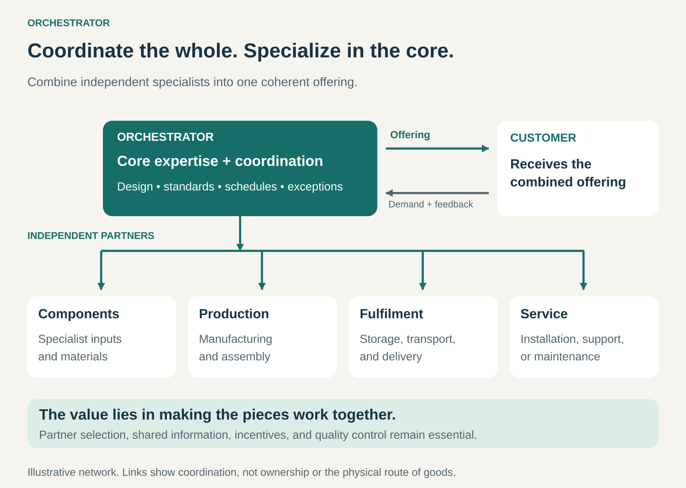

## What it is for

Deliver a complete product or service by combining the capabilities of independent specialists, while concentrating your own business on the activities where it adds the most value.

Orchestrator is useful when an offering requires several kinds of expertise, infrastructure, or local presence that would be expensive or slow to build internally. Customers want the finished result; your business assembles and coordinates the network that produces it.

A sportswear company can develop products and build its brand while manufacturing partners produce them. A supply-chain specialist can organize materials, factories, quality checks, and delivery for a retailer.

The opportunity lies in making those separate contributions work together reliably.

## The core idea

**Keep selected core capabilities inside the business and organize a partner network to perform much of the remaining work.**

The orchestrator usually retains something that gives the offering its direction and coherence: product design, customer understanding, technical architecture, brand, or the ability to manage a complex supply chain.

It then connects specialists around that core. Its work includes choosing partners, defining requirements, coordinating schedules, sharing information, checking quality, and resolving problems between participants.

Orchestration becomes a substantial business capability when the quality of the combined result depends on how well these relationships are organized.

Hiring an external accountant is ordinary outsourcing. Coordinating designers, component suppliers, manufacturers, logistics providers, and service partners to deliver a product is orchestration.

The pattern can operate across an entire business or within a particular offering. A company can own some stages and orchestrate others.

## How it works

**1. Define the offering and retain the capabilities that shape it.**

The orchestrator needs a clear understanding of the customer’s requirements and how the different contributions fit together.

For a consumer brand, that might mean retaining product development and marketing. For a technical business, it might mean retaining system architecture, software, and testing expertise. For a supply-chain company, coordination itself may be the central capability.

**2. Assemble complementary specialists.**

Partners contribute capabilities such as materials, production, transport, installation, or maintenance.

Selection goes beyond price. Capacity, technical competence, reliability, information sharing, and the ability to resolve problems all affect the performance of the whole network.

**3. Connect the work between partners.**

Each participant needs clear specifications, responsibilities, milestones, and acceptance criteria.

The difficult work often happens at the boundaries: a design change affects components, a component delay affects production, and a production delay affects delivery.

The orchestrator manages those dependencies and decides how exceptions will be handled.

**4. Keep the network commercially workable.**

Partners need a reason to invest, maintain quality, and prioritize the relationship. That may require dependable orders, timely payment, shared forecasts, or compensation for reserved capacity.

The orchestrator also needs enough visibility to recognize problems before they reach the customer. Delegating execution still requires the expertise to judge whether the work is being done properly.

## Why it works

**Specialists can contribute capabilities that would take years to reproduce internally.** Existing factories, technical teams, distribution networks, and local relationships can make a broader offering possible.

**The business can concentrate investment.** Resources can go toward the activities that distinguish the offering, while partners supply other essential capabilities.

**The network can adapt.** Different partners can support different products, regions, volumes, or technical requirements. This flexibility depends on qualification times, contracts, available capacity, and switching costs.

**Coordination can create value in its own right.** Customers may struggle to select suppliers, synchronize their work, and resolve disputes. A capable orchestrator reduces that burden and improves the reliability of the combined result.

These advantages depend on the network working well. Poor coordination can consume the savings from external specialization.

## Famous examples

### Nike — product and brand capabilities connected to manufacturing partners

Nike describes its principal activities as designing, developing, marketing, and selling athletic products. Nearly all its products are manufactured by independent contractors. It reaches customers through both its own retail and digital channels and wholesale relationships. [Nike 2026 annual report](https://investors.nike.com/_assets/_07be80eb1a0b76dace4543b752eda1f2/nike/db/950/9550/annual_report/Nike-Inc-2026-10K.pdf)

Nike illustrates how a business can retain substantial capabilities around the product and customer while relying on external specialists for production. Its own stores also show that orchestration can coexist with ownership of selected downstream activities.

### Li & Fung — organizing the supply chain as the offering

Li & Fung connects brands and retailers with a network of suppliers and vendors. Its services span product development, material and factory sourcing, compliance, manufacturing control, and logistics. It offers different commercial arrangements, including acting as an agent, importer, wholesaler, or supplier. [Li & Fung’s business model](https://www.lifung.com/supply-chain-innovation/our-business/)

Here, coordinating the network is a service sold to other businesses. The customer receives help organizing a complex production and delivery system rather than managing every relationship separately.

### Cisco — coordinating several layers of a technical supply chain

Cisco describes outsourced sourcing and manufacturing operations supported by a global supplier network. That network includes component suppliers, manufacturing partners that produce finished products, and logistics providers that transport or warehouse goods. [Cisco supply-chain overview](https://www.cisco.com/site/us/en/about/purpose/supply-chain-sustainability/index.html), [Cisco’s supplier roles](https://www.cisco.com/c/m/en_us/about/purpose/reporting-hub/responsible-innovation/supply-chain/responsibility.html)

The example highlights coordination across multiple layers. A finished product depends on components, manufacturing, and logistics fitting together—not simply on selecting one contractor.

External production also leaves financial exposure. Cisco’s annual report describes inventory and purchase commitments associated with securing supply and manufacturing capacity. [Cisco 2025 annual report](https://www.cisco.com/c/dam/en_us/about/annual-report/2025-cisco-full-annual-report.pdf)

## The economics

An orchestrator can earn money through a product margin, project price, coordination fee, commission, or ongoing management contract. Orchestration describes how delivery is organized; it does not prescribe one revenue model.

Consider a hypothetical business selling a complete project:

| Item                                                     |      Amount |
| -------------------------------------------------------- | ----------: |
| Customer price                                           |    $100,000 |
| Partner delivery costs                                   |    −$75,000 |
| Internal project design and coordination costs           |    −$15,000 |
| Contribution before central overhead, financing, and tax | **$10,000** |

The $25,000 difference between the selling price and partner costs must also fund the orchestrator’s own work.

An unexpected $8,000 in rework or expedited delivery would reduce the remaining contribution to $2,000.

Payment timing matters too. A business that pays partners before collecting from customers may need substantial working capital, even when it owns few production assets.

Where the business acts as an agent, the value of orders it coordinates should be distinguished from its own fee revenue.

## Useful when

- **The offering needs several specialist capabilities.** Building them all internally would require substantial time or investment.
- **Your strongest advantage sits in selected activities.** Design, customer relationships, architecture, or coordination provides a clear center for the business.
- **Partners have capabilities you can access reliably.** There is a credible supply base with sufficient quality and capacity.
- **Customers value a coordinated result.** Managing the separate providers themselves would be difficult or costly.
- **The work can be divided with clear handovers.** Specifications, responsibilities, and quality criteria can be communicated and checked.

## Common mistakes and limits

**Underestimating coordination costs.** Supplier selection, engineering support, inspections, scheduling, and dispute resolution require skilled people.

**Losing the expertise needed to judge quality.** A business can become dependent on partners it no longer understands well enough to evaluate.

**Assuming capacity is always available.** A supplier may serve several customers and prioritize another when demand rises. Reserved capacity may require commitments.

**Optimizing each contract while damaging the whole.** The cheapest component can increase assembly failures. A cheaper delivery arrangement can create service problems elsewhere.

**Making partners economically fragile.** Unrealistic prices, unstable forecasts, and slow payments can weaken the network the orchestrator depends on.

**Expecting outsourcing to remove responsibility.** Customers may still hold the orchestrator accountable for defects, delays, and poor service. Contractual responsibilities and practical recovery arrangements need to be clear.

The pattern is harder to operate when requirements change constantly, quality is difficult to verify, or essential suppliers are scarce and difficult to replace.

## Related patterns

- [[vertical-integration|Vertical Integration / Integrator:]] brings successive activities under common ownership and operation. A business can combine integration in selected stages with orchestration elsewhere.
- [[solution-provider|Solution Provider:]] describes the breadth of the customer solution. Orchestration is one way to deliver it.
- [[managed-marketplace|Managed Marketplace:]] combines a marketplace with substantial work to organize or assure transactions. Some managed marketplaces act as orchestrators.
- [[brokerage|Brokerage / Matchmaking:]] helps parties find suitable counterparts and reach agreements. Orchestration extends into coordinating their delivery.
- [[demand-driven-production|Demand-Driven Production / From Push to Pull:]] can guide when work enters the partner network, linking production more closely to actual demand.
