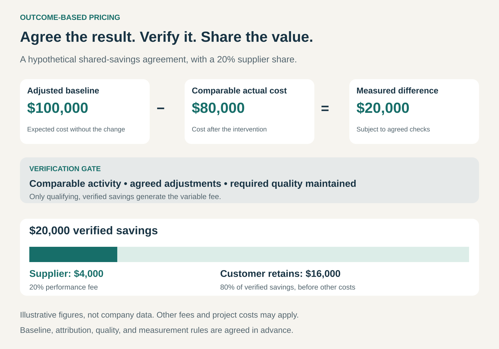

## What it is for

Tie payment to a result the customer wants to achieve. Outcome-Based Pricing helps a business sell measurable improvements, reduce uncertainty for buyers, and earn more when it delivers more value.

A customer may be willing to pay generously for lower energy costs, a successful hire, or a resolved support problem. Paying for the work involved can feel less attractive: the bill arrives even if the desired result does not.

Outcome-Based Pricing makes at least part of the supplier’s compensation depend on an agreed result. The commercial agreement therefore needs a clear definition of success—and a credible way to establish that it happened.

## The core idea

The supplier earns a fee when a qualifying outcome occurs, or receives a share of a verified improvement.

Common forms include:

- **Payment per successful outcome:** an agreed fee for each qualifying result, such as a completed placement.
- **Shared savings or gains:** the supplier receives a percentage of verified cost savings or additional value.
- **A base fee plus a performance component:** some compensation covers delivery capacity, while another portion depends on results.

The outcome can be a discrete event or a sustained improvement. A successful hire is an event. Maintaining an agreed reduction in energy consumption requires measurement over time.

The central design question is:

> What observable result should make the supplier entitled to payment?

That result needs to matter to the customer, remain meaningfully within the supplier’s influence, and be practical to verify.

## How the value is shared

In this hypothetical arrangement, comparable costs fall from an adjusted baseline of $100,000 to $80,000. After the agreed checks, $20,000 qualifies as savings.

At a 20% supplier share, the performance fee is $4,000. The customer retains $16,000 before other project costs or charges.

The calculation is simple. Establishing the inputs takes more care.

If production fell, energy prices changed, or service quality deteriorated, the apparent saving might not represent a supplier-created improvement. The baseline and adjustment rules determine what the percentage actually applies to.

## Why it works

Outcome-Based Pricing can bring the supplier’s incentives closer to the customer’s goal. A provider paid for successful results has a financial reason to improve the methods that produce them.

It can also reward efficiency. If automation delivers the same qualifying outcome with less effort, the supplier can improve its margin while the customer continues receiving the agreed value.

For buyers, a contingent fee can reduce the concern that they will pay for activity without receiving a useful result. For suppliers, it can create an opportunity to capture more of the value their expertise produces.

These benefits depend on the agreement. A poorly chosen metric can reward behavior that looks successful on a dashboard while making the customer’s actual situation worse.

## Famous examples

### Hays: payment linked to a successful placement

Recruitment provides a familiar example. Hays Australia says permanent-placement fees are typically invoiced upon successful placement. Its published Australian terms distinguish contingent assignments, with fees payable when the candidate starts, from retained assignments with staged payments. Those terms also include exceptions, such as possible charges for withdrawn assignments. [Hays payment guidance](https://www.hays.com.au/faqs), [published Australian terms, May 2019](https://www1.hays.com.au/HaysOnline/TOB/TOB-01%20Standard%20-%20Australia.pdf).

The commercial result is a candidate commencing employment. Researching candidates and arranging interviews contribute to that result, but do not themselves trigger the normal contingent placement fee.

This also reveals a boundary: a completed placement does not establish that the person will become an excellent long-term employee. A business can price against an observable intermediate outcome while still needing safeguards around the larger goal.

### General Motors: sharing energy savings

A US Department of Energy case study published in 2015 describes General Motors using shared-savings energy performance contracts. Energy service companies could fund and implement conservation projects, with energy cost savings divided according to an agreed percentage over a defined period. The split depended on project costs, contract length, and the risks each party accepted. [Department of Energy: General Motors energy performance contracting](https://betterbuildingssolutioncenter.energy.gov/implementation-models/general-motors-funds-energy-conservation-projects-through-energy-performance).

Here, the supplier’s reward is connected to the financial improvement produced by the project. The arrangement can help fund improvements when the customer’s own capital budget is constrained.

It also makes measurement commercially significant: the parties need agreement about which savings qualify and how long the supplier participates in them.

### Intercom’s Fin: charging for defined AI outcomes

Intercom bills Fin AI Agent against defined outcomes. These include resolutions and certain configured procedure handoffs, as well as sales qualification outcomes. It charges at most once per conversation. A resolution can be confirmed by the customer or assumed when the customer leaves after an answer without requesting further assistance. [Intercom’s outcome definitions](https://www.intercom.com/help/en/articles/8205718-fin-ai-agent-outcomes).

The pricing unit connects payment to a defined result rather than simply counting AI messages.

The definitions also show why the word _outcome_ needs scrutiny. A configured handoff can be billable even though a human still has work to do. An assumed resolution does not provide the same evidence as explicit customer confirmation. The contractual outcome and the customer’s broader goal can differ.

## The economics

The supplier must cover the cost of unsuccessful attempts as well as successful work.

Suppose, hypothetically, that delivering ten qualifying outcomes requires work on twenty cases. Revenue from the ten successes must support delivery costs across all twenty, along with measurement, administration, and any later reversals.

This makes case selection, success rates, and payment delays important. A profitable outcome fee can still produce cash-flow pressure if the supplier pays delivery costs months before results can be verified.

A hybrid model can make the arrangement more sustainable. A base fee supports ongoing capacity, while a meaningful performance component preserves the incentive to deliver results.

## Useful when

This pattern is especially useful when:

- **Results are observable:** both parties can identify a successful event or measure an improvement.
- **The supplier has meaningful influence:** its methods, expertise, or technology materially affect success.
- **Measurement is affordable:** verification does not consume a large share of the value created.
- **Buyers hesitate because results are uncertain:** contingent payment can make an unfamiliar approach easier to consider.
- **The supplier can manage variability:** it has the resources and repeatable delivery process to absorb unsuccessful work.

It becomes harder when outcomes take years to emerge, depend heavily on outside events, or cannot be separated from the customer’s other initiatives.

## Common mistakes and limits

**Rewarding a convenient proxy.** More leads can mean more unsuitable leads. Faster case closure can mean unresolved customers. Quality thresholds and measures of downstream harm help protect the larger goal.

**Claiming improvements that would have happened anyway.** A sales increase may come from market growth or a price change. Shared-gain arrangements need a credible baseline and attribution rules.

**Ignoring the customer’s responsibilities.** Results may depend on access to data, timely decisions, maintenance, or follow-through. Those dependencies need to be explicit.

**Counting success too early.** A booked meeting may be canceled, a hire may leave, or a support issue may reopen. Measurement windows and reversal rules affect both fairness and revenue.

**Underestimating selection incentives.** Suppliers may prioritize easy cases and avoid difficult customers. Eligibility rules and service commitments can prevent the hardest problems from being neglected.

Even a fully contingent fee leaves the customer with possible costs: implementation time, disruption, data preparation, and missed opportunities.

## Related patterns

- [[pay-per-use|Pay per Use:]] charges for consumption. Outcome-Based Pricing makes payment depend on qualifying success; the two can be combined.
- **Value-Based Pricing:** sets a price with reference to customer value. Outcome-Based Pricing additionally makes compensation contingent on measured results.
- [[solution-provider|Solution Provider:]] accepts responsibility for an integrated solution. Outcome-Based Pricing can connect that responsibility to compensation.
- [[retainer|Retainer:]] pays for continuing access, capacity, or service. A retainer can fund availability while a separate outcome fee rewards results.
