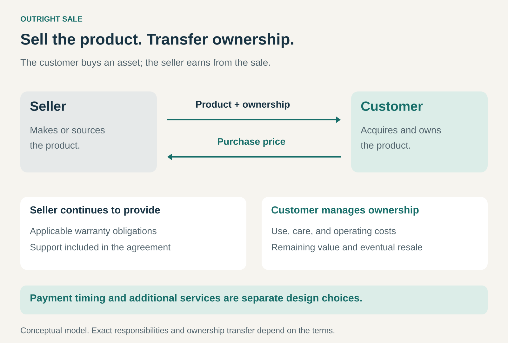

## What it is for

Use Outright Sale when customers want to own a product, control its use, and retain whatever value remains when they finish with it.

A household buys a dining table to keep for years. A designer purchases a computer for daily work. A construction company acquires an excavator for projects it expects to undertake repeatedly.

In each case, the customer purchases the asset itself. The seller earns from supplying it and transferring ownership, while the customer takes on the benefits and practical responsibilities of owning it.

The central proposition is: **buy it, own it, and decide how to use it.**

## The core idea

Outright Sale exchanges a product and its ownership for an agreed purchase price.

The customer can generally keep using the product throughout its useful life and may later sell it, give it away, or dispose of it. The seller’s return comes primarily from the sale, potentially supplemented by accessories, servicing, consumables, or future purchases.

Payment and ownership are connected but distinct decisions. A purchase may be paid in full or supported by financing; the arrangement determines when and under what conditions ownership transfers. Monthly payments alone do not identify a transaction as a subscription or rental.

The defining feature is the purchase of the asset, rather than temporary access to it.

## Why it works

Ownership can give customers continuity and control. They can organize their work or home around a product they expect to retain, without repeatedly arranging access.

Frequent use can make ownership attractive. Once purchased, a durable product may provide years of service, spreading the initial expenditure across many uses.

Ownership also gives the customer an interest in the product’s remaining value. Careful maintenance may extend its life or support a later resale.

For the seller, the transaction establishes a clear commercial unit: a product supplied for a purchase price. The business can focus on designing, sourcing, producing, and distributing products customers want to own.

It can also avoid some responsibilities associated with operating a rental fleet, such as repeatedly collecting, inspecting, storing, and reallocating the same assets. Manufacturing, inventory, warranty, and customer support can still require substantial resources.

## Famous examples

### IKEA: customers buy furniture to keep

IKEA’s conventional furniture offering illustrates Outright Sale. Customers purchase the furniture and can collect, transport, and assemble it themselves, or use available services to help complete those tasks. [IKEA’s services](https://www.ikea.com/us/en/customer-service/services/)

The furniture purchase establishes ownership; delivery and assembly address separate needs around acquiring and preparing it for use.

IKEA’s Buyback & Resell service makes the distinction particularly visible. At participating US locations, eligible customers can offer qualifying used furniture back to IKEA for assessment and store credit. That is a subsequent transaction involving furniture the customer already owns. [IKEA Buyback & Resell](https://www.ikea.com/us/en/circular/buy-back/)

The original sale does not depend on the customer eventually returning the furniture or accepting a particular resale offer.

### Apple Mac: owning hardware within a wider ecosystem

A customer who purchases a Mac acquires a physical computer. Apple also provides instructions for preparing that computer to be sold, given away, or traded in to a new owner. [Apple’s guidance for transferring a Mac](https://support.apple.com/en-la/102773)

This illustrates an important benefit of ownership: the customer can make a later decision about the asset’s next use and recover some remaining value where a buyer or trade-in offer exists.

It also shows why the boundaries matter. Owning the computer does not automatically include every associated application, cloud service, or future upgrade. Those can have separate commercial terms.

Outright Sale can therefore form the hardware foundation of a business that also earns through subscriptions, accessories, and support.

### Caterpillar: equipment ownership alongside other acquisition models

Cat dealers offer customers several ways to obtain equipment, including buying, financing, leasing, and renting. Caterpillar’s comparison explicitly distinguishes customer ownership under an equipment loan from provider ownership under rental and its operating lease offering. [Caterpillar’s acquisition options](https://www.cat.com/en_US/support/financing-protection/financing-options.html)

A contractor expecting sustained work may choose to purchase a machine and retain its remaining value. A contractor with a brief requirement may prefer temporary access.

Purchasing also creates continuing responsibilities. Caterpillar’s customer guidance discusses maintenance planning, ownership costs, protection plans, and support agreements. [Caterpillar’s equipment ownership guidance](https://www.catfinancial.com/en_US/support/getting-cat-equipment.html)

The example shows how a sale can coexist with extensive service relationships. Ownership does not require the customer to perform every maintenance task personally.

### The economics behind the sale

The purchase price must support more than the product’s immediate production cost.

Sourcing, distribution, selling, payment processing, expected returns, warranty work, and support all affect what remains from a transaction. Development and other shared costs also need to be recovered across sales.

Timing matters. A business may pay for materials and inventory long before the customer pays. Financing arrangements can further change when cash arrives and who carries payment risk.

Durable products create another challenge: a satisfied customer may have no reason to buy a replacement for years. Growth therefore depends on some combination of new customers, additional products, expansion into new uses, and eventual replacement.

A long useful life can strengthen reputation and resale value. The business still needs an economic model that works when customers keep its products.

### What ownership does—and does not—include

Ownership transfers an asset. It does not automatically transfer every responsibility connected with it.

Customers generally manage everyday use, care, operating expenditure, and the consequences of the asset becoming less valuable. They may purchase help with those responsibilities.

Sellers can retain obligations relating to product quality, warranties, returns, and agreed support. Apple’s published returns policy, for example, continues to govern qualifying purchases after delivery. [Apple’s US returns policy](https://www.apple.com/shop/help/returns_refund)

For connected products, practical usefulness can also depend on continuing software or online services. A customer may own the physical object while relying on a separate service to use particular functions.

A clear offer explains the product being sold, the support included, and any additional dependencies.

## Useful when

Outright Sale is especially useful when customers expect sustained use, value control, and can fund the purchase or obtain suitable financing.

It fits products whose ownership and maintenance are understandable, whose useful life is reasonably predictable, and whose continuing operation does not require the seller to manage every use.

It becomes less attractive when demand is occasional, equipment becomes obsolete quickly, or the customer primarily wants a result without managing an asset.

## Common mistakes and limits

**Treating the sale as the end of responsibility.** Warranty, support, and product obligations can continue after payment and delivery.

**Confusing revenue with profit.** A substantial purchase price can leave little contribution once fulfillment and expected service costs are included.

**Ignoring ownership costs.** Customers may need space, maintenance, energy, insurance, training, or replacement parts.

**Assuming ownership guarantees independence.** Software, consumables, connectivity, and service availability can still constrain practical use.

**Depending on rapid replacement without a compelling reason.** Customers who own a functioning product need sufficient additional value before purchasing another.

## Related patterns

- **Rental / Leasing:** provides access through an arrangement in which ownership may remain with the provider.
- [[pay-per-use|Pay per Use:]] charges according to usage; ownership is a separate choice.
- [[razor-and-blade|Razor and Blade:]] can combine an outright starter sale with recurring purchases of necessary supplies.
- [[solution-provider|Solution Provider:]] can combine a product sale with integration, expertise, and continuing support.
