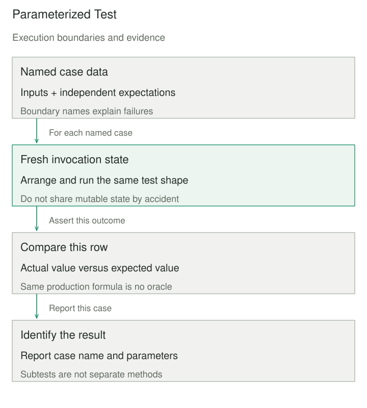

## Purpose and problem

A parcel tariff has tests for one gram, exactly one kilogram, and the first gram above that boundary. Each test repeats setup, invokes the same function, and compares the result. Adding the upper weight limit requires copying another nearly identical method, which makes the distinguishing values difficult to scan.

The team needs enough examples to describe the rule while keeping failures easy to locate. Parameterized Test separates the scenario data from a shared execution and assertion structure. It reduces repeated test mechanics without pretending that similar-looking business rules are always the same test.

## Core idea

**Keep the test shape; vary the case.** Each row provides inputs, an expected outcome, and preferably a recognizable case name. A runner invokes the shared structure for each row and reports failures in a way that identifies the row.

Data-driven and table-driven testing describe closely related forms. Frameworks differ in discovery and execution: JUnit and pytest can report separate parameterized invocations, while Python `unittest.subTest` identifies iterations inside one test method. That distinction affects selection, setup, and reporting; a loop alone does not guarantee independent test instances.



## How it works

Identify cases that genuinely have the same arrange, act, and assert structure. Put the varying inputs and expected outcomes in a small table or another explicit source. Keep case names close to the values so a failed run explains the business boundary it represents.

The runner supplies each case to the test body. Fixtures must have the required lifetime: fresh per invocation when state can change, deliberately shared only when its ownership and reset behavior are safe. pytest documents that supplied parameter objects are passed as-is rather than copied. A mutable input reused across cases can therefore make results depend on execution order.

Specify expectations independently. A table whose expected column calls the same production formula cannot reliably expose a mistake in that formula. Use examples derived from the contract, known reference cases, or another justified oracle. Parameterization organizes evidence; it does not manufacture the right expected result.

Select boundaries and representative categories deliberately. For a fee threshold, include immediately below, exactly at, and immediately above it, along with invalid inputs and the maximum accepted value. Those cases make different claims from a hundred arbitrary weights in the middle of a band.

Do not assume every runner continues after a failed assertion. A bare loop normally stops at the first exception. A subtest or parameterized invocation can retain diagnostics for later rows, depending on the framework and failure type. Test names, input rendering, and expected exception types are part of making the result usable.

## Worked example

### A tariff table with explicit units

The invented contract charges 500 US cents for the first 1,000 grams, then 200 cents per additional started kilogram, up to 20,000 grams. The implementation and complete Python 3 test program below need no third-party packages.

The expected values are written as tariff examples. They are not calculated by calling `fee` during table construction. Invalid inputs use a separate test structure because expecting an exception is a different assertion from comparing a returned fee.

```python
import unittest


def fee(grams):
    if type(grams) is not int or not 1 <= grams <= 20000:
        raise ValueError("whole grams from 1 to 20000 required")
    return 500 + 200 * ((grams - 1) // 1000)


class TariffTests(unittest.TestCase):
    def test_prices(self):
        cases = (
            ("minimum", 1, 500),
            ("below boundary", 999, 500),
            ("at boundary", 1000, 500),
            ("above boundary", 1001, 700),
            ("second boundary", 2000, 700),
            ("maximum", 20000, 4300),
        )
        for name, grams, expected_cents in cases:
            with self.subTest(case=name, grams=grams):
                self.assertEqual(fee(grams), expected_cents)

    def test_invalid_weights(self):
        for value in (0, -1, 20001, 1.5, True, "1000"):
            with self.subTest(value=value):
                with self.assertRaises(ValueError):
                    fee(value)


if __name__ == "__main__":
    unittest.main(verbosity=2)
```

Run the file with Python. It reports two successful test methods containing twelve subtest iterations. It does not report twelve separate test methods. A mutation that treats exactly 1,000 grams as the second band fails the `at boundary` row, while the other rows can still run and provide their own evidence.

The explicit integer check rejects `True`, which Python otherwise treats as an integer-like value. The maximum expectation, 4,300 cents, follows nineteen additional started kilograms after the first. These details prevent a superficially readable table from hiding ambiguous units or conversion rules.

Another useful context is a parser exercised with multiple encodings. Reuse the assertion shape when each case has the same semantic expectation, but name the encoding and supply independent input bytes. Keep a genuinely different lifecycle test—such as releasing a file descriptor after decoding failure—separate rather than adding flags that turn one body into several unrelated tests.

## When to use it

Use this when repeated tests differ primarily in data, especially for boundary rules, parsers, validation, and reference examples. A compact table can make omitted categories easier to spot in review.

Keep individual tests when their setup, action, or interpretation differs substantially. Two clear examples are often better than a parameter table full of optional columns and conditional assertions. Parameterize the repeated structure that exists rather than forcing all tests into a common framework.

## Tradeoffs and common mistakes

Large generated matrices can increase runtime and obscure which combinations matter. Pairwise or representative selections need a reason, and exhaustive combinations need an affordable domain. A high row count is not evidence of good coverage.

Shared mutable fixtures can leak state between cases, especially when execution order or parallelism changes. Build fresh state inside the invocation or use a fixture scope that matches the intended isolation. Do not depend on a previous row having run first.

An empty parameter source can also produce misleading results if the runner skips or never invokes the test. Inspect collection and execution results, and make a required nonempty case set explicit in generators. Stable, descriptive names improve failure diagnosis and selective reruns more than positional labels such as `case_417`.

## Related patterns

[[test-data-builder|Test Data Builder]] creates meaningful test inputs with visible overrides. A parameterized test can use one builder per invocation while retaining fresh ownership.

[[test-double|Test Double]] controls collaborators. Parameterizing their responses can exercise one subject under multiple conditions without changing what the subject is.

[[golden-master-approval-testing|Golden Master / Approval Testing]] compares a larger observed result with a reviewed baseline. Parameterized cases can select scenarios, while the approved baseline remains a separate oracle choice.

## Sources

- JUnit, [Parameterized Classes and Tests](https://docs.junit.org/current/writing-tests/parameterized-classes-and-tests.html): argument sources and separately reported invocations.
- pytest, [Parametrizing tests](https://docs.pytest.org/en/stable/how-to/parametrize.html): argument sets, case execution, and mutable parameters passed without copying.
- Python, [unittest subtests](https://docs.python.org/3/library/unittest.html#distinguishing-test-iterations-using-subtests): diagnostics for iterations inside a test method.

The tariff and encoding examples are original teaching material. Runner behavior should be checked against the framework actually used by the project.
