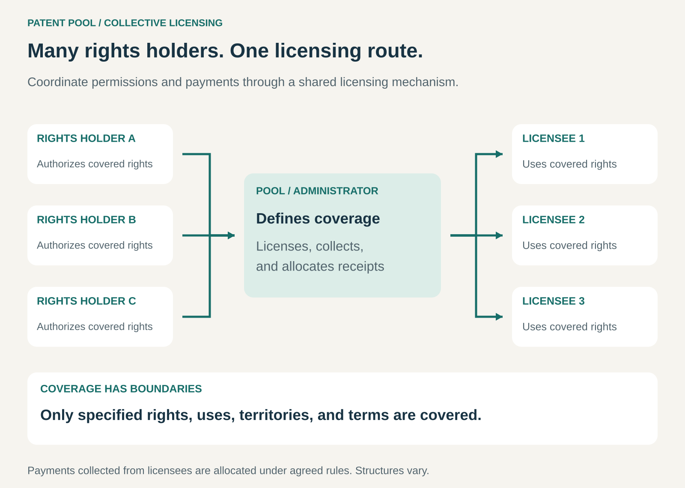

## What it is for

Making fragmented intellectual property easier to license, use, and administer.

A connected product may depend on patents owned by many companies. A business playing music may use works represented by numerous writers and publishers. A manufacturer may need permission to use technology held by several organizations.

Negotiating every permission separately can become expensive and slow.

Patent pools and collective licensing create a shared route through those relationships. Rights holders authorize a coordinated mechanism to grant specified permissions, collect payments, and allocate the proceeds.

## The core idea

**Bring rights from several owners into a shared licensing arrangement, so users can obtain defined coverage more efficiently.**

A patent pool coordinates the licensing of participating owners’ patents. Collective licensing applies a related mechanism more broadly, including the administration of copyright repertoires.

These arrangements share a coordination principle, but their legal structures and purposes differ.

A technology pool may assemble complementary patents needed to implement a standard. A music organization may administer public-performance rights across a repertoire of works.

WIPO describes patent pools as arrangements that can provide standard licenses and distribute licensing fees among participating owners according to an agreement. [WIPO: standards and patent pools](https://www.wipo.int/en/web/patent-law/developments/standards)

The shared route has boundaries. It covers the rights, activities, territories, and periods specified in the arrangement.

## How it works

The pattern connects four activities.

**Define the rights being represented.** Participants establish which patents, works, or other rights are included and what the administrator is authorized to license.

For standards-based patent pools, the relevance of contributed patents matters. Some programs use independent evaluations of whether patent claims are essential to implementing the standard. Access Advance describes such evaluations for its HEVC pool. [HEVC Advance’s evaluation process](https://accessadvance.com/hevc-advance-patent-pool-general-pool-terms/)

**Offer a usable licensing route.** The arrangement sets out coverage, fees, reporting requirements, and other terms. A licensee can obtain permissions through that mechanism rather than negotiating every covered right separately.

**Collect payments and information.** Depending on the arrangement, royalties may depend on units sold, revenue, usage, or another agreed basis. Reporting and verification support collection.

**Allocate the proceeds.** The administrator distributes receipts according to the applicable rules, after agreed deductions or charges.

Allocation might reflect evaluated patent contributions, reported use, ownership shares, or another method. There is no universal formula.

Ownership need not move into a single company. The mechanism can operate through authority granted by the participating rights holders.

## Why it works

Fragmentation creates costs for both sides.

Licensees must identify relevant owners, establish coverage, negotiate terms, and manage reporting. Rights holders must find users, administer agreements, collect payments, and monitor compliance.

A shared mechanism can reduce repeated work.

For complementary technologies, it can also make a package easier to assemble. A license to one necessary patent may be insufficient when implementing the technology requires others.

For large copyright repertoires, collective administration can make repeated uses practical without negotiating an individual agreement for every work.

The benefit is greater coordination and potentially lower transaction costs. It does not guarantee a lower royalty bill, complete coverage, or agreement about the value of the rights.

The administrator also performs substantial work: maintaining records, verifying authority, processing reports, allocating money, and resolving disputes.

## Famous examples

### Avanci: licensing cellular patents for connected vehicles

Avanci’s vehicle programs offer automakers a shared licensing route for cellular standard-essential patents held by participating licensors. Its 5G program covers specified essential patent claims relating to 5G and earlier cellular generations, including relevant cellular vehicle-to-everything technology. [Avanci’s 5G vehicle program](https://www.avanci.com/vehicle/5gvehicle/)

The program lists vehicle manufacturers including BMW Group, Ford, and Mercedes-Benz among its licensees.

The mechanism connects rights held across the telecommunications industry with companies incorporating connectivity into vehicles.

Coverage concerns participating licensors’ rights within the program’s scope. Avanci also states that bilateral licensing remains an option. [Avanci’s explanation of its vehicle licensing model](https://www.avanci.com/vehicle/)

### Medicines Patent Pool: coordinated licensing with a public-health purpose

The Medicines Patent Pool negotiates voluntary licenses with patent holders and then sublicenses to manufacturers and product developers.

Its description explains that participating manufacturers develop and supply licensed medicines for defined countries, sometimes in exchange for royalties. The organization operates with a public-health mandate. [Medicines Patent Pool: how licensing works](https://medicinespatentpool.org/what-we-do/licensing-for-public-health)

This illustrates a different objective for the pattern: facilitating access, additional manufacturing, and product development through coordinated permissions.

The licenses are negotiated case by case. They do not automatically cover every medicine or country, and patent permission alone does not establish that a product is approved or available in a market.

### BMI: collective administration of music-performance rights

BMI licenses represented musical works for specified public-performance uses and distributes royalties to affiliated songwriters, composers, and publishers. Its royalty policy describes how payments are calculated and allocated. [BMI’s performing-rights role](https://www.bmi.com/licensing/business_using_music_bmi_and_performing_rights), [BMI’s royalty policy](https://www.bmi.com/creators/royalty-policy-manual)

The collective mechanism makes a repertoire available through a manageable licensing relationship.

The scope is important. BMI’s performing-rights license does not provide every permission associated with music. Its explanation distinguishes performance licensing from mechanical and synchronization rights.

This is collective copyright licensing, rather than a patent pool. It demonstrates the same broader principle of coordinating permissions across many rights holders.

## The economics

Consider a hypothetical licensing collective serving **100 licensees**, each paying **$10,000 annually**.

Total collections are:

**100 × $10,000 = $1 million.**

Suppose the agreement allocates:

- **10% to administration:** $100,000.
- **90% to rights holders:** $900,000.

If three rights holders receive agreed shares of **40%, 35%, and 25%** of the distributable amount, they receive:

| Rights holder | Allocation |
| ------------- | ---------: |
| A             |   $360,000 |
| B             |   $315,000 |
| C             |   $225,000 |

If administering the arrangement costs **$80,000**, the administrator has **$20,000 remaining** before other unlisted costs and taxes.

The full $1 million collected is not its profit.

These percentages are illustrative. Actual arrangements use different funding, deductions, and allocation methods. Public-interest organizations may also operate with funding structures that differ from commercial licensing administrators.

For licensees, the economic benefit depends on coverage, price, and the work saved—not simply the number of rights included.

## Useful when

- A product or activity requires permissions from multiple rights holders.
- Repeated bilateral negotiations create substantial administrative costs.
- Complementary patents need to be licensed together.
- A large repertoire would be impractical to administer work by work.
- Participants can establish credible coverage and allocation rules.
- A shared mechanism can improve access while supporting rights holders’ objectives.

It is less useful when ownership is straightforward, users need only a few easily licensed rights, or the arrangement adds more cost than coordination value.

## Common mistakes and limits

**Assuming one license covers everything.** Relevant owners, rights, territories, or activities may sit outside the arrangement.

**Counting patents instead of assessing their relevance.** A large portfolio is not automatically a useful package. Scope, essentiality, validity, and remaining life matter.

**Treating allocation as a minor detail.** Participants need confidence in how contributions or usage translate into payments. Weak records and opaque rules can undermine cooperation.

**Confusing collections with earnings.** Much of the money handled by an administrator may be payable to rights holders.

**Assuming every participant benefits equally.** A convenient collective route may suit some owners and users more than others. Its value depends on the terms and alternatives.

**Ignoring competition concerns.** WIPO notes that pooling substitute patents can raise competition concerns, even where pooling complementary technologies can provide benefits. [WIPO: benefits and competition considerations](https://www.wipo.int/en/web/patent-law/developments/standards)

**Overpromising certainty.** A shared license can simplify permissions without eliminating disputes about ownership, coverage, reporting, or payment.

## Related patterns

- [[licensing|Licensing:]] Supplies the underlying mechanism of granting defined rights.
- [[one-stop-shop|One-Stop Shop:]] Makes several permissions accessible through one coordinated relationship.
- [[revenue-sharing|Revenue Sharing:]] Allocates collected income among participating rights holders.
- [[brands-consortium|Brands Consortium:]] Similarly coordinates selected activities across independent participants, although collective licensing concerns rights administration.
