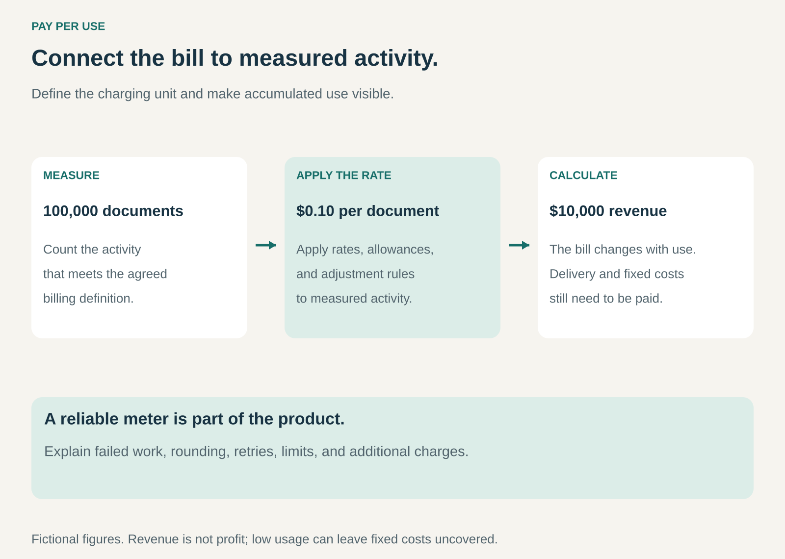

## What it is for

A business needs a service occasionally, in bursts, or at a scale it cannot predict. Buying a fixed amount of capacity creates waste when demand is low and constraints when it rises.

Pay per Use connects charges to a measured unit of consumption. It lets customers begin with limited activity and pay more as they use more, while the provider earns from the work or resources supplied.

The pattern is useful when consumption can be measured reliably and the charging unit makes sense to the customer.

## The core idea

**Make the bill respond to actual measured activity.**

A print service might charge for completed pages. A computing service might charge for requests and execution resources. A payment processor might charge for successful transactions.

The charging unit need not match the provider's costs exactly. It must be understandable, measurable, and commercially workable. A unit that customers cannot predict can make a technically accurate bill feel arbitrary.

Pay per Use concerns how charges are calculated. The provider can still invoice monthly, offer a free allowance, require a minimum commitment, or combine metered activity with a fixed fee.

## How it works

Define what counts as billable activity: a successful request, a processed document, a resource-second, a completed trip, or another agreed event. Specify rounding, minimums, retries, cancellations, and failed work where relevant.

Record usage in a way both sides can reconcile. Apply the rate schedule, allowances, and discounts. Give customers timely visibility so that they can understand and control consumption before the invoice arrives.

For services with several cost drivers, more than one meter may be necessary. Storage, computation, and data transfer can be separate. That improves cost alignment but increases the effort required to estimate a bill.

The operating system must also deal with interruptions, duplicate events, late records, and disputed measurements. Billing accuracy is part of the product experience.

## Why it works

Customers avoid paying for some unused capacity. This can lower the barrier to trying a service and accommodate variable demand. A small customer can start with little activity while a growing customer increases spending without changing the underlying commercial relationship.

The provider can connect income to a factor that also drives delivery costs or customer value. Successful growth in customer activity can generate additional revenue without a separate sales negotiation.

The arrangement shifts some uncertainty to the provider. Demand may fall, while staff, equipment, licenses, or availability commitments remain. Charging only for use does not make all underlying costs variable.

It can also create a tension: customers have a financial reason to consume less. A successful efficiency improvement may reduce their bill. The model works best when the provider's economics can support that outcome and increased useful adoption creates enough demand over time.

## Famous examples

### AWS Lambda — requests and execution resources

AWS Lambda Functions pricing meters requests and execution duration, with resource allocation affecting the calculation. Customers can connect spending to function activity instead of purchasing a fixed set of conventional servers for every workload.

This example uses several defined resource measures. Free allowances and additional services affect the final bill, and other Lambda offerings have their own pricing structures. It is not a promise that every application costs nothing while idle. [AWS Lambda pricing](https://aws.amazon.com/lambda/pricing/)

### Google BigQuery — on-demand query analysis

BigQuery's on-demand query pricing uses the amount of data processed. Google distinguishes this from capacity-based compute pricing, and storage has its own charges.

The distinction matters because the customer's visible result is not the billing unit. A query returning a few rows can still process substantial data. Google's guidance explains estimation and maximum-bytes-billed controls, showing why cost visibility belongs alongside metering. [BigQuery cost guidance](https://docs.cloud.google.com/bigquery/docs/best-practices-costs)

### Stripe — processing successful payments

Stripe's standard payments offering uses pay-as-you-go pricing, including charges attached to successful transactions. The public US card example combines a percentage with a fixed amount; actual terms depend on the payment method, geography, and services used.

This illustrates a hybrid meter: both transaction count and transaction value influence the fee. Payment volume is the merchant's commercial activity, while processing fees are Stripe's charges for the service. [Stripe pricing](https://stripe.com/pricing)

## The economics

Consider a fictional document-processing service charging $0.10 for each billable document. At 100,000 documents monthly, revenue is $10,000. If variable processing and support cost $0.04 per document, variable costs total $4,000 and contribution is $6,000.

With $5,000 of monthly fixed operating costs, the service has $1,000 remaining before other overhead and tax. At 50,000 documents, contribution falls to $3,000 and the same fixed costs produce a $2,000 shortfall.

At a $0.06 contribution per document, covering those fixed costs requires at least 83,334 documents. That threshold excludes customer acquisition, investment, and costs not included in the example.

The provider must therefore assess expected volume as well as unit margin. More usage can also cause capacity costs to rise in steps rather than smoothly.

## Useful when

- Customer demand varies or is difficult to predict.
- A reliable meter captures a meaningful unit of service.
- Customers can understand and manage the activity affecting their bills.
- Revenue at plausible volumes can support both variable and fixed costs.

## Common mistakes and limits

Unexpected bills are a major failure mode. Clear rates are insufficient if customers cannot see accumulating use or control runaway activity. Estimates, alerts, budgets, and appropriate limits can help, but their actual enforcement needs to be clear.

Do not assume usage equals value. Repeated failed attempts can consume resources without helping the customer. Billing rules should explain whether those attempts count.

Metering can also discourage useful exploration or collaboration. Some buyers will prefer a predictable package even when it costs more at their typical usage.

Finally, low unit prices can hide weak margins or large aggregate bills. The relevant calculation includes the customer's total workload and the provider's complete delivery obligations.

## Related patterns

[[flat-rate-access|Flat-Rate Access]] charges for a defined scope without billing every included use. [[credits|Credits]] represent consumption through an intermediate unit. [[commitment-for-discount|Commitment for Discount]] exchanges dependable spending or usage commitments for improved terms. [[per-seat-pricing|Per-Seat Pricing]] measures enabled users rather than each action they perform.
