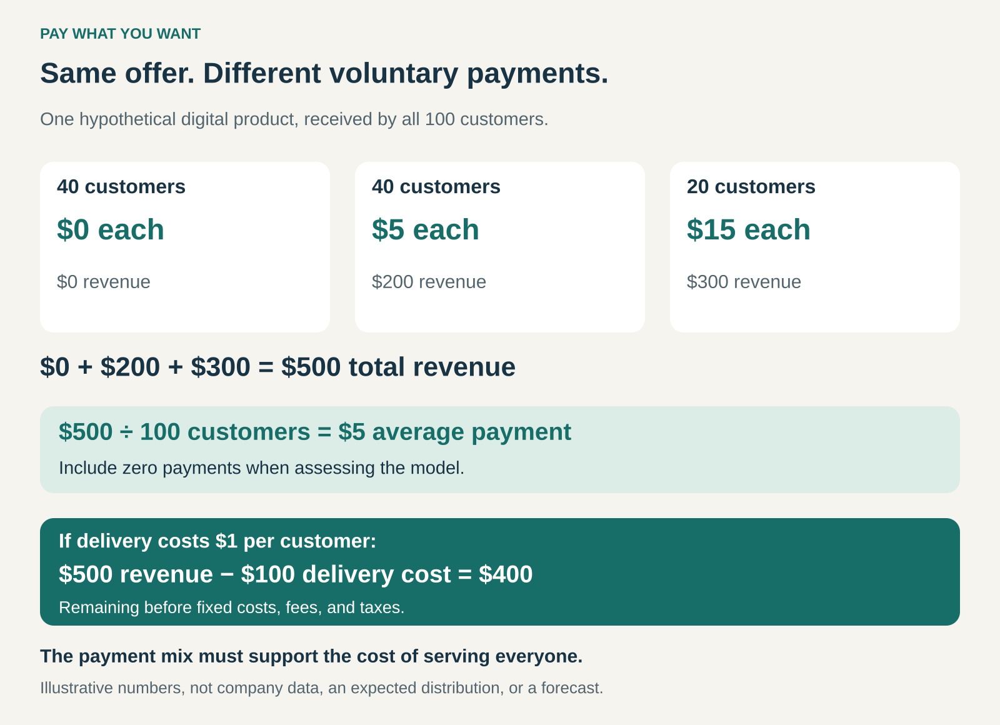

## What it is for

Let customers choose their payment for an offering. Pay What You Want can widen access, invite supporters to contribute more, and turn a purchase into an expression of appreciation or support.

A fixed price creates a boundary. Some people value the offering but cannot justify the charge. Others would gladly contribute more, yet pay the same amount as everyone else.

Pay What You Want gives those customers discretion over the amount.

In its fullest form, the customer can choose any price, including zero, and receive the same core offering. The business relies on the combined payment mix to support delivery.

## The core idea

Transfer the final pricing decision from the seller to the customer.

The seller defines the offering and explains the arrangement. The customer decides how much to pay, and the seller accepts that choice.

A suggested price can provide a reference without becoming compulsory. Information about production costs or the purpose of contributions can help customers understand what their payments support.

Several neighboring arrangements need distinguishing:

- **A positive minimum plus optional extra:** customers choose how much to pay above a required floor.
- **Pay What You Can:** emphasizes affordability and inclusion rather than personal valuation.
- **A fixed price plus a tip:** leaves the underlying purchase price compulsory.
- **Negotiation:** allows the seller to reject an offer; pure Pay What You Want accepts the customer’s permitted choice.

These arrangements can overlap, but they place different limits on customer discretion.

## How the payment mix works

In this hypothetical example, 100 customers receive the same digital product.

Forty pay nothing, forty pay $5, and twenty pay $15. Together, they contribute $500: an average of $5 across everyone served.

If delivery costs $1 per customer, $400 remains before fixed costs, fees, and taxes.

The model does not require every customer to cover their individual delivery cost. It requires the overall payment mix—and any explicit subsidy—to support the cost of serving the group.

That distinction is especially important when comparing digital downloads with meals, appointments, or other offerings that incur substantial costs for every additional customer.

## Why people might pay

Optional payment can appeal to motives beyond obtaining the product at the lowest possible price.

A customer may want to reward useful work, support a creator, preserve something they enjoy, or help make access possible for others. An established relationship can give those motives a concrete recipient.

The model also allows customers with different budgets to participate without requiring the seller to assess everyone’s financial circumstances.

For the business, this creates a possibility: lower-paying customers gain access while enthusiastic supporters contribute more than a fixed price might have captured.

Neither behavior is guaranteed. Customers may choose zero, misunderstand the arrangement, or avoid purchasing because choosing an appropriate amount feels uncomfortable.

The seller therefore needs both a credible reason for contributing and an economically workable level of voluntary payment.

## Famous examples

### Radiohead: an established audience chooses the price

Radiohead offered digital downloads of _In Rainbows_ on a pay-what-you-want basis in 2007. Fans could choose their payment instead of paying a standard download price.

In his interview with David Byrne, Thom Yorke emphasized that the experiment reflected Radiohead’s particular position, including its established audience. [David Byrne’s interview with Thom Yorke](https://www.wired.com/2007/12/ff-yorke/).

The transferable lesson concerns fit. An existing relationship with supporters can give voluntary payment a stronger basis. A famous release does not establish that an unknown creator will receive the same response.

### Bandcamp: optional payments within a direct fan relationship

Bandcamp supports name-your-price releases. Its digital pricing system allows a zero minimum, so fans can download an eligible release without paying or voluntarily contribute. Artists can also use a positive minimum, creating a more constrained version of customer-selected pricing. [Bandcamp’s announcement of zero-minimum pricing](https://blog.bandcamp.com/2009/04/16/minimum-name-your-price-minimum-now-zero/), [Bandcamp’s current help on no-minimum releases](https://get.bandcamp.help/en/articles/15263352-why-isn-t-my-release-appearing-in-discover).

This lets an artist combine broad distribution with a direct opportunity for financial support.

The distinction between configurations matters. A zero-minimum release permits free access. A release with a compulsory minimum protects a baseline payment while allowing supporters to contribute more.

The platform makes the mechanism available; each artist still needs an audience, an appealing offering, and workable economics.

### Panera Cares: the limits of voluntary payments for physical delivery

The Panera Bread Foundation launched Panera Cares community cafés in 2010 as a nonprofit, donation-based response to food insecurity. Customers contributed according to their circumstances, from very little to additional donations.

Panera’s own reporting states that continued operation proved unviable. The remaining cafés closed in January 2018 and February 2019. [Panera’s 2017–2019 responsibility report](https://www.panerabread.com/foundation/documents/press/2020/panera-bread-csr-2017-2019.pdf).

This was a Pay What You Can variation with an explicit social mission. It illustrates the challenge of applying voluntary pricing where ingredients, staff, and premises must be funded continuously.

The closure establishes a sustainability problem in this implementation. It does not, by itself, identify one simple cause or show that every community café will face the same result.

## The economics

The useful starting measure is revenue per person served, including people who pay nothing.

Looking only at paying customers can make the model appear stronger than it is. In the graphic, the average among the 60 paying customers is about $8.33. Across all 100 customers, it is $5.

The business also needs to account for customers who would have paid a conventional price but now choose less. Additional reach and generous contributions must compensate for that lost revenue if the goal is commercial improvement.

Digital distribution can make experimentation easier because serving another customer may cost relatively little. Creating the original work, attracting an audience, maintaining the service, and providing support still require funding.

Some implementations deliberately combine voluntary payment with grants, sponsorship, conventional sales, or other income. That can be a coherent model when the subsidy is explicit and dependable.

## Useful when

This pattern is especially useful when:

- **Additional delivery costs are low:** wider access does not create an equally large increase in costs.
- **A supportive relationship already exists:** customers understand whose work their payment sustains.
- **Access is part of the purpose:** serving people with limited budgets is a desired outcome.
- **Payment variability is manageable:** the organization can absorb uneven contributions.
- **The offer has other financial support:** voluntary payments supplement a clear funding arrangement.

It becomes harder when capacity is scarce, delivery costs are high, or predictable revenue is essential.

## Common mistakes and limits

**Assuming freedom always increases participation.** Choosing a price can create social discomfort. Field experiments found that some customers avoided a Pay What You Want purchase rather than pay an amount they considered inappropriately low. This occurred in particular settings, rather than establishing a universal response. [Research on self-image and voluntary pricing](https://rady.ucsd.edu/faculty-research/faculty/pay-what-you-want.pdf).

**Making the freedom feel false.** Public scrutiny, guilt, or staff judgment can turn an apparently optional payment into an uncomfortable obligation.

**Treating suggested prices as guaranteed income.** A reference amount may guide decisions, but the business must remain viable when customers choose differently.

**Relying on exceptional generosity.** A few large payments can distort a short trial. Sustainability depends on the ordinary payment mix over time.

**Ignoring capacity.** Even low-paying customers consume seats, appointments, support, or staff attention. Wider access can displace other demand.

## Related patterns

- [[freemium|Freemium:]] provides a useful free offering and charges for additional benefits. Pure Pay What You Want permits different payments for the same core offering.
- [[dynamic-pricing|Dynamic Pricing:]] changes prices as conditions change. Pay What You Want gives the customer control over the payment.
- **Cross-Subsidization:** lets higher contributions or other income support customers who pay less.
- [[blended-value|Blended Value:]] combines commercial and social goals; voluntary pricing can support access when its funding remains sustainable.
