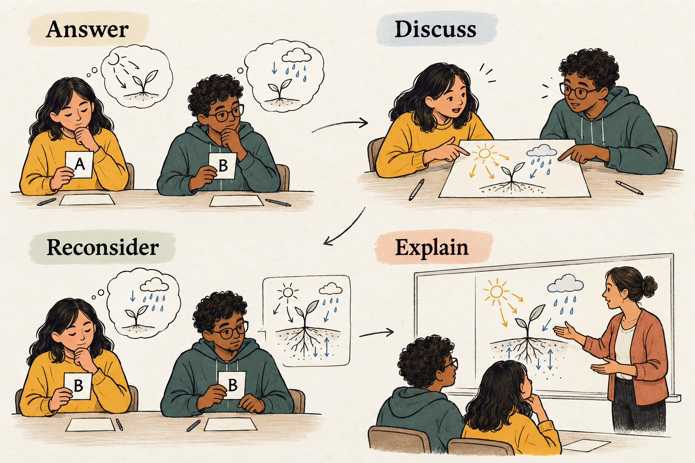

## Use different answers to uncover different reasoning

The teacher has explained the principle, demonstrated an example, and asked whether it makes sense. Several learners nod.

Then a short question produces three different answers.

One learner applies the principle correctly. Another follows an everyday intuition that conflicts with it. A third chooses the correct answer but cannot explain why. From the teacher’s explanation alone, these differences were invisible.

Peer Instruction makes them available for examination. Learners answer a conceptual question independently, discuss their reasoning with peers, and answer again before the teacher brings the ideas together. The important material is the reasoning behind the choices.

## Commit, discuss, reconsider

Developed by Eric Mazur, Peer Instruction organizes teaching around short conceptual questions. Learners first formulate their own answers, then explain and examine those answers with others. The teacher uses their responses to decide what needs further attention. [Mazur’s account of Peer Instruction](https://mazur.harvard.edu/presentations/peer-instruction-getting-students-think-class-1) emphasizes both conceptual understanding and feedback to the instructor.

The initial response matters because it establishes what each learner currently thinks. A brief written reason makes that response more informative.

During discussion, partners compare explanations. They might identify a mistaken assumption, discover that they interpreted the question differently, or realize that two apparently different arguments rely on the same principle.

The second response remains individual. Learners can change their minds, retain their answers with stronger reasons, or recognize an unresolved difficulty.

The teacher then explains the underlying concept and addresses the alternatives. Discussion creates material for that explanation.

## Choose answers that reveal something

A useful question gives learners a reason to think, rather than simply retrieve a fact or perform a lengthy calculation.

Prediction, comparison, interpretation, and diagnosis are productive forms. What changes if this condition changes? Which explanation fits the evidence? Where does this argument fail?

When using multiple choice, alternative answers should represent understandable reasoning. An implausible distractor reveals little. A plausible alternative can expose an assumption worth examining.

Wording matters equally. If learners disagree because the question is ambiguous, the teacher has learned something about the question’s design. Clarify that ambiguity before interpreting the results as evidence of conceptual difficulty.

The objective is to create a question whose answers help distinguish ways of understanding the topic.

## A classroom example: the truck and the car

Imagine a physics class that has encountered Newton’s laws. The teacher presents a collision between a heavy truck and a small car:

*“At a particular instant during the collision, how does the force the truck exerts on the car compare with the force the car exerts on the truck?”*

The options include a larger force from the truck, a larger force from the car, equal magnitudes, and insufficient information without knowing their speeds.

Learners answer independently and write one sentence explaining their choice.

Priya chooses the truck. Its greater mass seems to imply a greater force. Noah chooses equal magnitudes because he remembers Newton’s third law, but his explanation is little more than the law’s name.

The teacher asks pairs to compare reasons and examine the strongest competing answer.

Priya challenges Noah: “If the forces are equal, why does the car usually come off worse?”

Noah realizes that repeating the law does not address her question. They begin separating the interaction forces from their consequences. Equal force magnitudes do not imply equal accelerations when masses differ. Damage also depends on factors such as structure and deformation.

As the teacher circulates, she hears another pair arguing that equal and opposite forces should cancel. She notes a different misunderstanding: those interaction forces act on different objects.

After discussion, learners answer individually again. Priya changes her answer. Noah retains his but replaces the recalled label with an explanation distinguishing force from acceleration.

The teacher then brings the reasoning together. She draws the two objects separately, labels the interaction forces, and explains why they do not cancel on either object’s individual force diagram.

A later question about two skaters pushing apart checks whether learners can use the same principle in another situation. The changed vote is encouraging; the new explanation provides more useful evidence.

## What discussion can—and cannot—show

An increase in correct responses after discussion could reflect improved understanding, but it could also reflect copying or deference to a confident partner.

Smith and colleagues investigated this distinction in an undergraduate genetics course. After peer discussion, learners answered a second, similar conceptual question independently. Their results supported gains in understanding, including in groups where nobody initially selected the correct answer. [Smith et al., 2009](https://pubmed.ncbi.nlm.nih.gov/19119232/)

A subsequent study in majors’ and nonmajors’ genetics courses found stronger performance gains when peer discussion was followed by instructor explanation than with either approach alone. Time on task was not strictly controlled, and the study did not establish long-term retention. [Smith et al., 2011](https://pmc.ncbi.nlm.nih.gov/articles/PMC3046888/)

These findings support the method while leaving room for context and implementation to matter. Explaining may expose gaps; disagreement may prompt learners to reconsider assumptions. Those are plausible mechanisms, not guarantees that any conversation produces learning.

## Respond to what the answers reveal

A divided response can justify discussion when learners have enough knowledge to examine the alternatives.

If almost everyone is confused, a short clarification or simpler example may be more useful first. If almost everyone answers correctly, ask for reasoning or move to a more demanding question. Agreement alone cannot establish understanding.

Avoid revealing the correct answer before the exchange has done its work. Also consider whether showing the first voting distribution would focus attention on popularity rather than reasons.

Listen while learners talk. The explanation needed afterward may concern a distinction that the answer counts alone could never reveal.

## Adapt the format and protect its purpose

Polling technology makes responses easy to collect, but cards, paper, or simple digital forms can also work. Keep initial choices private where practical so learners establish their own positions.

Pairs or small groups can discuss online or in person. Give each learner an opportunity to explain before inviting evaluation. A useful prompt is: “What principle supports your answer, and how does it address the alternative?”

Common mistakes include treating discussion as a competition, accepting confidence as evidence, and ending immediately after the second vote. Learners need feedback on the reasoning, including why attractive alternatives fail.

Peer Instruction also requires suitable questions and sufficient background knowledge. It complements explanation, sustained practice, and extended inquiry.

## Connect it to related methods

**[[think-pair-share|Think–Pair–Share]]** also protects individual thinking before conversation. Peer Instruction adds an explicit initial answer and reconsideration around a conceptual question.

**[[think-aloud-pair-problem-solving|Think-Aloud Pair Problem Solving]]** follows reasoning through a task, while **Examples and Non-Examples** clarifies conceptual boundaries.

Peer Instruction is especially useful when several answers appear reasonable—and examining why they appear reasonable is precisely the teaching work that needs to happen.
