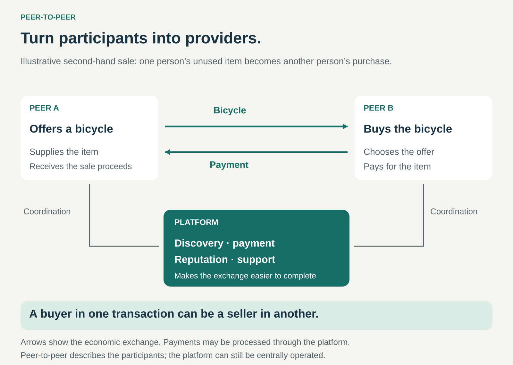

## What it is for

People often already have something that other people need: a bicycle they no longer ride, a car available for the weekend, an empty seat on a journey, or knowledge someone else would value.

Individually, these resources can be difficult to find, assess, and exchange. A person with an unused item rarely has the reach, reputation, or payment infrastructure of an established business.

Peer-to-Peer creates a way for individuals to provide value to one another. The business makes these exchanges easier to discover, trust, and complete.

## The core idea

**Let participants supply the offering, while the business organizes the exchange.**

A conventional retailer sources inventory and sells it to customers. A conventional rental company acquires assets and rents them out. In a Peer-to-Peer model, much of that supply comes from the participants themselves.

One person offers something; another buys it, rents it, shares its costs, or exchanges something in return.

The organizing business might provide listings, search, messaging, payments, identity checks, reputation systems, and dispute handling. Its commercial opportunity comes from making transactions possible or sufficiently convenient that participants choose to use its service.

“Peer” describes the relationship between participants. It does not require them to have equal expertise, identical resources, or equal bargaining power. Nor does it require every participant to alternate between supplying and buying.

A platform can also be centrally owned and operated while enabling Peer-to-Peer exchanges. The business-model pattern is separate from the technical meaning of a decentralized computer network.

## How it works

The model usually brings together four elements.

**Participants make supply available.** They list an item, publish availability, offer a service, or describe a resource they are willing to share. The business needs a workable way to represent that supply: photographs and condition descriptions for clothing, dates and locations for cars, or routes and departure times for journeys.

**Other participants find a suitable match.** Matching depends on the category. A buyer may search nationally for a collectible, but a passenger needs a driver going to the right place at the right time. The useful size of the network is therefore often much smaller than its total membership.

**The platform reduces uncertainty.** Profiles, transaction histories, reviews, clear terms, payment handling, and support help people transact with someone they have never met. Different categories require different safeguards.

**The peers fulfil the exchange.** A seller packages an item, a host hands over a vehicle, or a driver provides the agreed seat. The platform may coordinate substantial parts of this work, but the underlying offer originates with participants.

Participation can be occasional or regular. Over time, some suppliers may become professional operators. That changes the character of the marketplace and may require different rules for different kinds of supplier.

## Why it works

Peer-to-Peer can make fragmented supply economically accessible.

A person selling one used jacket cannot justify building a shop. A platform shared by many sellers can spread the cost of discovery, payments, and support across their transactions.

It can also make better use of existing resources. An empty seat on a planned journey may become useful to another traveller without requiring another vehicle. An unwanted item can find a new owner instead of remaining in storage.

Another advantage is variety. Participants may offer unusual products, locations, schedules, or experiences that a centrally planned assortment would overlook.

These advantages depend on coordination. A large number of listings has little value if buyers cannot find suitable offers, sellers never respond, or completing the exchange takes more effort than the benefit justifies.

The business creates value by making scattered resources practically usable.

## Famous examples

### Vinted: turning personal possessions into resale supply

Vinted allows members to photograph items, describe them, and offer them to other members. Sellers prepare and send their items, while the platform supports discovery, communication, payment, and the handling of problems. A buyer can inspect a seller’s reviews and contact them before purchasing. [Vinted selling basics](https://www.vinted.com/help/14/26-selling-step-by-step), [Vinted buying basics](https://www.vinted.com/help/5/25-buying-basics)

The Peer-to-Peer mechanism is the conversion of dispersed personal possessions into an accessible second-hand assortment. The supply does not need to be purchased into a central retailer’s inventory before it can be offered.

Vinted also illustrates a boundary that becomes important as platforms grow: it distinguishes ordinary members selling their possessions from commercial sellers, with business selling permitted through eligible Vinted Pro accounts under its rules. [Vinted on commercial selling](https://company.vinted.com/newsroom/qa-commercial-selling)

### Turo: distributing car supply across hosts

Turo connects guests with vehicles supplied by hosts. Guests choose a particular vehicle and receive pickup instructions; handover can happen in person or through supported remote arrangements. Hosts manage the availability of their vehicles and the practical conditions for pickup and return. [How Turo works](https://turo.com/us/en/car-rental/united-states/how-turo-works), [Turo’s hosting guide](https://turo.com/us/en/car-rental/united-states/host-hub/resources/getting-started-guide)

The pattern makes independently supplied vehicles discoverable and bookable through a common service.

It also shows how Peer-to-Peer can develop into a mixed supplier model. Turo explicitly includes local small businesses among its hosts. The example therefore extends beyond the simple image of someone occasionally renting out their personal car.

### BlaBlaCar: matching spare seats with compatible journeys

BlaBlaCar’s carpooling service connects drivers with empty seats to passengers travelling in the same direction. Drivers publish journeys, and passengers find and book suitable seats.

Its carpooling rules frame the passenger’s payment as a contribution to the journey’s costs, with drivers also bearing their share. This makes it a different economic arrangement from hiring a driver to undertake a journey for profit. [BlaBlaCar carpooling](https://www.blablacar.co.uk/apps-mobile), [BlaBlaCar terms](https://legal.blablacar.com/en-gb/terms-and-conditions/)

The useful resource is capacity within a journey the driver intends to make. The platform’s role is to find compatible travellers and coordinate the exchange. This example concerns BlaBlaCar’s carpooling service; its bus offerings involve a different supply structure.

## The economics

Peer-to-Peer describes how supply and exchange are organized. It does not prescribe one revenue model.

A business might earn transaction fees, listing fees, subscriptions, charges for additional services, or advertising revenue. The payer could be the supplier, the recipient, or both.

Consider a hypothetical platform that facilitates 1,000 transactions at an agreed price of $40 each:

- Participants exchange $40,000 in transaction value.
- A 10% platform fee deducted from those payments produces $4,000 in fee revenue.
- Suppliers collectively receive $36,000 before their own expenses.

The $4,000 is revenue before payment costs, support, fraud losses, customer acquisition, and other operating expenses. It is not profit.

Suppliers have their own economics. A car host must consider wear, cleaning, handover time, and other costs. Someone selling an unwanted possession may primarily value clearing space and recovering some money.

The platform needs an arrangement that remains worthwhile for both sides. Raising fees can increase revenue per transaction while making low-value exchanges unattractive.

## Useful when

- **Valuable supply is dispersed among individuals.** Existing businesses have difficulty discovering or assembling it.
- **Resources are unwanted or underused.** Resale, spare capacity, and occasional access can create additional value.
- **Participants can describe their offers adequately.** Buyers can understand what they are choosing.
- **Matching creates substantial value.** Location, timing, taste, or specialist needs make finding the right person difficult.
- **Trust and coordination problems are manageable.** The platform can reduce uncertainty at a cost the transaction can support.

## Common mistakes and limits

**Treating supply as free.** Participants still need a reason to list, respond, prepare, and deliver. Low effort and worthwhile returns matter.

**Confusing registration with a functioning market.** Thousands of members do not guarantee an available car nearby or a compatible ride tomorrow.

**Relying entirely on reviews.** New participants have no history, ratings can be manipulated, and some problems become visible only after serious harm. Reputation needs appropriate supporting controls.

**Assuming existing assets mean negligible costs.** Extra use can create wear, inconvenience, damage, and replacement needs. Peer supply shifts costs between parties; it does not remove them.

**Allowing professionalization to change the offer unnoticed.** Business suppliers may improve availability and consistency, while also changing prices, expectations, and competitive conditions for occasional participants.

**Expecting participants to keep paying for an introduction forever.** Once people know each other, they may arrange future exchanges directly. Continuing value—such as convenient payment, protection, scheduling, or reliable support—helps justify continued platform use.

## Related patterns

[[marketplace|Marketplace]] organizes transactions between buyers and sellers. Peer-to-Peer specifies that the exchange draws on individual participants as suppliers.

[[multi-sided-platform|Multi-Sided Platform]] explains the interdependence between participant groups and how their interactions create value.

[[access-over-ownership|Access over Ownership]] combines with Peer-to-Peer when participants provide temporary use of assets. Peer-to-Peer also supports outright sales.

[[managed-marketplace|Managed Marketplace]] adds operating responsibility. A Peer-to-Peer business can inspect items, coordinate delivery, or manage other transaction tasks while participants continue to supply the underlying offering.
