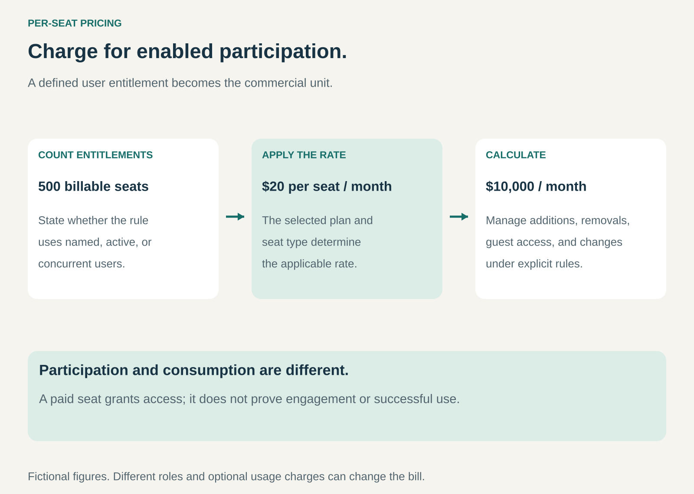

## What it is for

A software product serves one person, then a team, then an organization. Charging every organization the same amount can make a small buyer pay for scale it does not need while a large buyer receives much more access for the same price.

Per-Seat Pricing connects the bill to the number of users entitled to use the offering. It creates an understandable way for revenue to grow as more people participate.

The pattern is useful when individual access is a meaningful part of customer value and the provider can define which users require a paid seat.

## The core idea

**Charge for enabled participation, using a clearly defined user entitlement.**

A seat usually gives a named person a specified level of access during a billing period. Some arrangements instead use active users or concurrent access. These are different counting rules and should not be treated as interchangeable.

The unit concerns access rather than every action. A person may perform hundreds of included tasks without creating hundreds of separate charges. Usage limits and additional metered services can still coexist with the seat price.

## How it works

The provider defines the entitlement: which capabilities a seat includes, who can use it, and what makes it billable. It then specifies the counting period and the treatment of additions, removals, guests, inactive accounts, and role changes.

The customer assigns access to people. The provider tracks the relevant entitlements and applies the agreed pricing and adjustments. Administrators need a clear view of the seats they are buying and a predictable way to manage them.

Not every participant needs the same entitlement. Editors, developers, reviewers, and occasional viewers may receive different roles. Charging them differently can make broad collaboration easier, but introduces more rules to explain and administer.

Seat pricing can also sit inside a tier. A business might choose an advanced package and pay a defined amount for each user on that package. Volume discounts, minimum purchases, and annual commitments can change the effective rate.

## Why it works

The user count is usually easier for a buyer to understand than an abstract measure of computation. It provides a planning unit that connects to hiring, team structure, and rollout decisions.

For the provider, wider adoption can expand revenue within an existing customer. Supporting more users may increase both product value and operating work, making seat count a useful commercial approximation even when the relationship is not exact.

The pattern also creates friction. A customer pays more to invite another colleague, even if that person's participation benefits everyone. Some customers respond by restricting access, sharing accounts inappropriately, or delaying wider adoption.

The design therefore needs to balance monetization with participation. Free viewing roles, carefully defined guest access, or different seat types can address some cases without implying that all participants should be free.

## Famous examples

### Slack — team communication priced by users

Slack's paid plans present prices per user per month, with billing-term differences. An organization can connect the price of a plan to the team members using its communication environment.

The example illustrates a user-based commercial unit, rather than payment for every message. Buyers must still understand the plan's actual billing rules and capabilities. A user-based headline does not by itself explain every adjustment or optional service. [Slack pricing](https://slack.com/pricing)

### Salesforce — access to sales capabilities

Salesforce's public sales pricing presents several editions using a per-user, per-month unit, with specified billing terms. The customer chooses a capability level and scales licensed access across the people who need it.

This combines tiered packaging with seats. It does not mean that all Salesforce products, AI activity, support, or additional services are covered by a single user charge. The complete configuration determines the commercial arrangement. [Salesforce sales pricing](https://www.salesforce.com/sales/pricing/)

### Figma — different seats for different roles

Figma's pricing distinguishes seat types, including Full, Dev, and Collab seats, within its plan structure. The arrangement recognizes that participants can need different combinations of design, development, and collaboration capabilities.

This is a useful refinement of the pattern: an organization need not treat every participant as the same kind of buyer. It also shows the administrative challenge of role-based pricing. Customers must understand which entitlement a particular action or role requires, alongside any separate allowances or add-ons. [Figma pricing](https://www.figma.com/pricing/)

## The economics

Consider a fictional service with 500 paid seats at $20 each per month. Monthly revenue is $10,000. If delivery and support average $4 per seat, those costs total $2,000, leaving $8,000 before fixed costs.

With $6,000 of monthly fixed operating costs, $2,000 remains before other overhead and tax. If customers remove 100 seats, revenue becomes $8,000 and the assumed variable costs become $1,600. The same fixed costs leave $400.

At a $16 contribution per seat, 375 seats cover the stated fixed costs. This is an illustrative threshold, not an industry benchmark. Real support and infrastructure costs may depend on usage, organization size, or service requirements rather than seat count alone.

Revenue expansion also needs interpretation. Adding 20 seats to an existing account differs from raising the price of all its seats. Both change revenue, but they have different effects on adoption and retention.

## Useful when

- Named or otherwise clearly countable users are a meaningful source of value.
- Buyers can estimate the people who need access.
- Administrators can manage entitlements without excessive effort.
- The price supports delivery costs at realistic patterns of use.
- Participation rules leave room for necessary external or occasional collaborators.

## Common mistakes and limits

The most common mistake is leaving the unit ambiguous. Registered accounts, active people, purchased licenses, and simultaneous sessions can produce different bills. The rules need to be explicit.

Unused paid seats can become a source of dissatisfaction. Customers need clear renewal and removal rules, while providers need predictable commitments. Neither follows automatically from the phrase per seat.

Seat pricing can fit poorly when automation performs most of the work, a few users generate very large costs, or the product's value depends on inviting many occasional participants. A usage-based, organization-wide, or hybrid model may be more appropriate.

Avoid interpreting seats as actual engagement. A paid entitlement establishes access, not whether someone uses the product successfully.

## Related patterns

[[subscription|Subscription]] supplies the recurring billing relationship. [[good-better-best|Good–Better–Best]] differentiates capability levels. [[pay-per-use|Pay per Use]] connects charges to measured activity. [[flat-rate-access|Flat-Rate Access]] can provide an organization-wide scope without charging for each additional included user.
