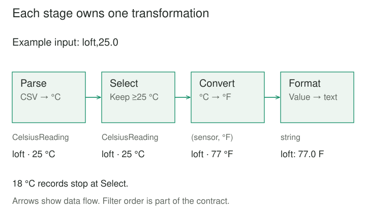
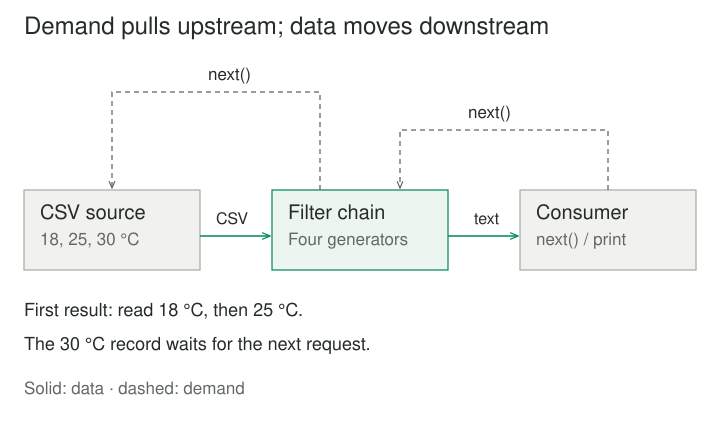

## Purpose and problem

A building-monitoring tool reads temperature records, checks their format, selects warm readings, converts units, and prints a report. All five concerns live in one loop. A second report needs the same parsing and conversion but a different selection rule. Copying the loop creates two places to fix malformed-input handling.

The program needs reusable processing steps without making each step understand the whole application. Its order still matters: the selection threshold is expressed in Celsius, while the displayed values use Fahrenheit. Separating the code must preserve that meaning.

## Core idea

**Pipes and Filters** divides processing into independent stages called **filters**, joined by **pipes** that carry data from one stage to the next. A filter consumes input and produces output without knowing its neighbors. The composition determines which outputs feed which inputs. [Hohpe and Woolf's pattern catalog](https://www.enterpriseintegrationpatterns.com/patterns/messaging/PipesAndFilters.html).

A filter need not discard records. Parsing, transforming, selecting, and aggregating are all possible filter responsibilities. The compact mental model is **small processors connected by explicit data contracts**.

Richards and Ford also call the style **Pipeline Architecture**. This names a processing arrangement; a deployment pipeline or workflow scheduler may organize quite different concerns. [Pipeline architecture style](https://www.oreilly.com/library/view/fundamentals-of-software/9781492043447/ch11.html).



## How it works

### Contracts make composition possible

The source supplies records. Each filter owns one processing responsibility; the sink consumes the final results. Pipes may be in-process iterators, operating-system streams, or message channels. Separate processes and concurrent execution are implementation choices.

Define each boundary's shape, units, ordering, and error behavior. Compatible types are necessary but insufficient: a threshold of 25 has different meanings in Celsius and Fahrenheit. Even two filters accepting strings may change the result when reordered. Components are reusable when their behavioral contracts fit, rather than because every permutation works.

Filters can emit zero, one, or several outputs per input. Stateful operations need further rules: a global sort must see the entire finite input before producing its first sorted result. A streaming interface alone does not guarantee low latency or bounded memory.

### Data flow and execution flow differ

In the example, data moves downstream while demand propagates upstream. Asking the final generator for its next result advances earlier generators only as needed. A selection stage may consume several records before yielding one. This is one thread using Python's [generator suspension and resumption](https://docs.python.org/3/reference/expressions.html#yield-expressions), rather than workers running in parallel.



A push implementation needs its own capacity policy. For example, Python's [bounded queue](https://docs.python.org/3/library/queue.html#queue.Queue) can block a producer when full. Unbounded buffering merely lets a faster producer accumulate work. Concurrency may improve throughput across records, while adding ordering, cancellation, and failure decisions.

## Worked example

### A temperature report composed from four filters

The source contains headerless CSV records with a sensor name and a Celsius value. Keep readings at or above 25 °C and display Fahrenheit values to one decimal place. The numbers are illustrative measurements; this is a reporting transformation, not an alarm system.

Save these three files together and run `python3 main.py`. They use Python 3.8 or later and only its standard library. The parser uses Python's [CSV reader](https://docs.python.org/3/library/csv.html) rather than splitting on commas manually.

**filters.py — reusable stages**

```python
import csv
import math
from dataclasses import dataclass


@dataclass(frozen=True)
class CelsiusReading:
    sensor: str
    celsius: float


def parse_csv(lines):
    for number, row in enumerate(csv.reader(lines, strict=True), 1):
        if len(row) != 2 or not row[0].strip():
            raise ValueError(f"Record {number}: expected sensor,celsius")
        try:
            degrees = float(row[1])
        except ValueError as error:
            raise ValueError(f"Record {number}: invalid temperature") from error
        if not math.isfinite(degrees):
            raise ValueError(f"Record {number}: temperature must be finite")
        yield CelsiusReading(row[0].strip(), degrees)


def at_least_celsius(readings, minimum):
    if not math.isfinite(minimum):
        raise ValueError("Threshold must be finite")
    for reading in readings:
        if reading.celsius >= minimum:
            yield reading


def fahrenheit_rows(readings):
    for reading in readings:
        degrees = reading.celsius * (9 / 5) + 32
        if not math.isfinite(degrees):
            raise ValueError("Converted temperature is out of range")
        yield reading.sensor, degrees


def format_rows(readings):
    for sensor, degrees in readings:
        yield f"{sensor}: {degrees:.1f} F"
```

**pipeline.py — wire the contracts together**

```python
from filters import at_least_celsius, fahrenheit_rows, format_rows, parse_csv


def report(lines, minimum_celsius=25.0):
    parsed = parse_csv(lines)
    selected = at_least_celsius(parsed, minimum_celsius)
    converted = fahrenheit_rows(selected)
    return format_rows(converted)
```

**main.py — source and sink**

```python
from pipeline import report


lines = ["kitchen,18.0\n", "loft,25.0\n", "boiler,30.0\n"]
for line in report(lines):
    print(line)
# loft: 77.0 F
# boiler: 86.0 F
```

Parsing produces immutable Celsius readings; selection preserves their order and units. Conversion produces `(sensor, Fahrenheit)` pairs. Formatting produces strings. The exact threshold value qualifies, so the loft appears. Display rounding happens after selection and cannot promote a reading just below the cutoff.

Constructing `report` does not consume the source. Its first result requires two input records: the kitchen is omitted, then the loft is emitted. The boiler is consumed on the next request. These filters retain no complete intermediate collection; memory also depends on the caller's source, sink, record sizes, and any additional stages.

An empty input produces no output. A malformed numeric value raises `ValueError` when consumed; malformed CSV syntax can raise `csv.Error`. Earlier printed results remain visible after a later failure. A sink requiring all-or-nothing publication needs staging and a commit boundary of its own.

Another report can omit selection and reuse parsing, conversion, and formatting. The filters do not change; the composition does. If files replace the list and console, the caller owns opening and closing them, including early termination.

## When to use it

Use this pattern when work naturally forms successive transformations, useful stages recur across processing tasks, or boundaries make intermediate results easier to test and inspect. Text processing, import validation, and image transformations often have this shape.

A short, stable operation may be clearer as one function. Work dominated by shared mutable state or tightly coupled interactive decisions may not fit stream boundaries. Separating every expression into a filter adds overhead without creating useful independence.

## Tradeoffs and common mistakes

**Order is part of correctness.** Preserve record order where required. Parallel workers may finish out of order and need sequence identifiers or a reordering stage. Matching schemas do not remove semantic dependencies.

**Modularity does not guarantee delivery.** In a distributed implementation, retries can repeat effects or outputs. Acknowledgment, deduplication, idempotency, and transaction boundaries need explicit design. Microsoft's [implementation guidance](https://learn.microsoft.com/en-us/azure/architecture/patterns/pipes-and-filters) discusses these failure cases. The local example supplies no restart or replay mechanism.

**Buffers and serialization have costs.** Queues absorb bursts, not unlimited overload. Large intermediate representations and remote boundaries can outweigh the benefits of separating small computations. Measure the actual workload before claiming a speed improvement.

**Hidden shared state defeats independent reasoning.** Filters that mutate a shared record or consult changing global configuration can make isolated tests misleading. Test compositions as well as individual stages, particularly their units, errors, and exhaustion behavior.

## Related patterns

[[chain-of-responsibility|Chain of Responsibility]] passes a request among potential handlers. Pipes and Filters focuses on successive processing, with a stage's output becoming downstream input.

[[microkernel|Microkernel]] separates a product core from optional capabilities. Its example analyzers each receive the same input; filters instead consume the previous stage's output.

[[ml-workflow-pipeline|Workflow Pipeline]] coordinates steps, artifacts, and run conditions. One workflow step can contain a Pipes and Filters transformation chain.

[[adapter|Adapter]] can reconcile a boundary's representation with a filter's expected contract. Translation must preserve meaning, including units and error distinctions.

## Sources

Buschmann, Meunier, Rohnert, Sommerlad, and Stal catalog Pipes and Filters in [*Pattern-Oriented Software Architecture, Volume 1*](https://www.oreilly.com/library/view/pattern-oriented-software-architecture/9781118725269/9781118725269_c02.xhtml); the accessible preview establishes that placement. [Hohpe and Woolf](https://www.enterpriseintegrationpatterns.com/patterns/messaging/PipesAndFilters.html) describe the composition in messaging. [Richards and Ford](https://www.oreilly.com/library/view/fundamentals-of-software/9781492043447/ch11.html) establish the Pipeline Architecture alias. Official Microsoft and Python documentation linked above supports implementation choices and limitations.

The sensor scenario, code, and illustrations are original teaching material. They demonstrate synchronous iterator composition, without distributed messaging or measured performance claims.
