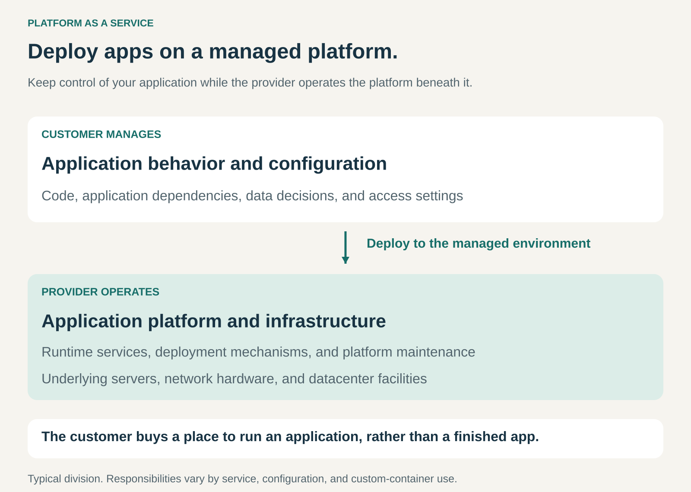

## What it is for

Helping customers build and run applications without operating the entire technical environment beneath them.

A team developing a booking service needs more than application code. It also needs somewhere to run it, a deployment process, platform updates, monitoring, and a way to adjust capacity.

Platform as a Service supplies a managed environment for that work.

The customer concentrates on the application and its users. The provider operates the platform that supports deployment and execution.

## The core idea

**Sell a managed application environment that customers can build on.**

Platform as a Service, usually shortened to **PaaS**, lets customers deploy applications using supported languages, tools, and services while the provider manages the underlying platform and infrastructure.

NIST’s definition places control of the deployed application with the customer, while the provider manages underlying resources such as servers and operating systems. [NIST: Platform as a Service](https://csrc.nist.gov/glossary/term/platform_as_a_service)

The distinction between common cloud models is useful:

- **Infrastructure as a Service:** obtain computing resources and manage more of the software environment yourself.
- **Platform as a Service:** deploy an application into a managed environment.
- **Software as a Service:** use a finished application supplied by the provider.

PaaS combines flexibility at the application level with a standardized way of operating the layers underneath.

## How it works

The pattern connects three layers.

**The customer’s application.** The customer supplies or selects the application, defines its behavior, and manages its configuration. Responsibilities typically include application dependencies, data decisions, user access, and the quality of the code.

**The managed platform.** The provider supplies a supported environment for deploying and running applications. This can include deployment tools, routing, logs, runtime maintenance, and scaling capabilities.

**The underlying infrastructure.** Computing, networking, and storage resources support the platform. The provider may operate these directly or obtain them from another infrastructure supplier.

Customers access the platform through tools that make common operations repeatable: deploying a release, changing settings, viewing logs, or adjusting capacity.

The provider earns through subscriptions, reserved capacity, usage charges, or combinations of these. Databases, storage, network traffic, and additional services may have separate charges.

The precise responsibility boundary varies. Microsoft’s shared-responsibility guidance emphasizes that customers retain duties around their data, identities, application configuration, and code security. [Microsoft: shared cloud responsibilities](https://learn.microsoft.com/en-ca/azure/security/fundamentals/shared-responsibility)

## Why it works

Many application teams repeatedly need similar operational capabilities.

Provisioning environments, maintaining runtime services, deploying releases, and collecting logs are necessary, but they may contribute little to what distinguishes the customer’s product.

A platform provider can develop those capabilities once and operate them across many customers.

For customers, this can reduce setup work and ongoing operational effort. It can also give smaller teams access to capabilities they would struggle to maintain independently.

For providers, standardized environments and automated operations can spread development and maintenance costs across a larger customer base.

There is a tradeoff. Customers gain convenience within the platform’s supported choices. Unusual operating requirements may be difficult to accommodate.

The commercial proposition depends on whether the reduction in operational work justifies the price and constraints.

## Famous examples

### Heroku: an application-centered operating environment

Heroku describes its offering as a PaaS based on a managed container system. Applications run in containers called dynos, while its runtime manages their lifecycle, routing, and other platform functions. [Heroku’s platform](https://www.heroku.com/platform/), [Heroku Runtime](https://www.heroku.com/platform/runtime/)

The customer deploys an application into that environment instead of assembling every operating component independently.

The value lies partly in the repeatable experience: deploying code, managing releases, inspecting logs, and changing capacity through a common set of tools.

Customers still need applications that fit the platform’s operating model. A managed runtime does not resolve application bugs or make every workload suitable for the service.

### Microsoft Azure App Service: managed application hosting

Azure App Service provides managed hosting for web applications, with platform maintenance, deployment capabilities, and scaling features. Microsoft explicitly identifies it as Platform as a Service. [Azure App Service documentation](https://learn.microsoft.com/en-us/azure/app-service), [Azure’s description of the offering](https://azure.microsoft.com/en-us/solutions/app-service)

A team can deploy its application while Microsoft operates the supporting platform.

The customer still makes consequential choices about configuration, access, dependencies, and application architecture. Scaling capabilities also need to match how the application behaves.

The example illustrates the division of work: the provider maintains a reusable hosting environment; the customer remains responsible for the service built on it.

### Google App Engine: deploying applications into a managed environment

Google describes App Engine as a managed platform that provisions servers and scales application instances according to demand. It also supports application versions and traffic routing between them. [Google’s App Engine overview](https://docs.cloud.google.com/appengine/docs/an-overview-of-app-engine)

This makes the application the customer’s main operating unit. The team deploys a version and configures how the platform should run it.

App Engine is an established example of the model. Google’s current documentation directs new users toward Cloud Run, showing how particular offerings evolve while the underlying pattern continues.

The enduring proposition is access to an application environment whose underlying operation is handled by a provider.

## The economics

Consider a hypothetical application running under two arrangements.

Assume comparable workload, service requirements, and relevant infrastructure costs.

| Monthly item                             | Customer-managed environment |       PaaS |
| ---------------------------------------- | ---------------------------: | ---------: |
| Infrastructure or platform bill          |                         $600 |     $1,600 |
| Customer operational effort              |                     30 hours |    8 hours |
| Operational time valued at $100 per hour |                       $3,000 |       $800 |
| Combined monthly resource cost           |                   **$3,600** | **$2,400** |

The PaaS bill is **$1,000 higher**, but the arrangement releases **22 hours** of operational capacity.

At the assumed hourly value, the combined difference is **$1,200 per month**.

That is not automatically a cash saving. Existing employees may use the released time for product development rather than leave the payroll.

The comparison also excludes migration costs and assumes the application fits the platform. At a different workload or staffing arrangement, the result could change.

For the provider, revenue must cover infrastructure, platform engineering, operations, support, and customer acquisition. Standardization helps only when those costs remain controlled.

## Useful when

- Customers need custom applications but do not want to build an entire operating platform.
- Common deployment and maintenance tasks consume substantial engineering time.
- Applications fit supported runtimes and operating patterns.
- Repeatable environments can shorten setup and release work.
- A provider can automate operations across many customers.
- Buyers value an integrated platform enough to accept its commercial and technical boundaries.

It is less suitable when applications require extensive control over operating systems, unusual infrastructure, or configurations the platform cannot support.

## Common mistakes and limits

**Assuming the provider manages the whole application.** Platform maintenance does not replace responsibility for application behavior, dependencies, configuration, or access decisions.

**Comparing only hosting bills.** A cheaper infrastructure bill can require more internal work. A convenient platform can also become expensive at scale. Both sides belong in the comparison.

**Treating scaling as unlimited or automatic.** Plans, quotas, configuration, and application design affect what scaling can achieve.

**Overlooking additional services.** Databases, storage, logs, network traffic, and integrations can materially affect the total bill.

**Assuming every application will fit unchanged.** Storage behavior, background work, supported runtimes, and deployment conventions may require adaptation.

**Ignoring portability.** Platform-specific services and configuration can make migration more involved than moving the application’s source code.

**Confusing platform availability with customer outcomes.** An operating platform can remain available while an application fails because of its own code, configuration, or dependencies.

## Related patterns

- [[managed-service|Managed Service:]] Shares the transfer of operational work; PaaS packages that work into a reusable application environment.
- [[virtualization|Virtualization:]] Can supply configurable computing resources beneath the platform.
- [[pay-per-use|Pay per Use:]] Can align platform charges with resource consumption.
- [[lock-in|Lock-in:]] Platform-specific integrations and operating conventions can increase the work required to change providers.
