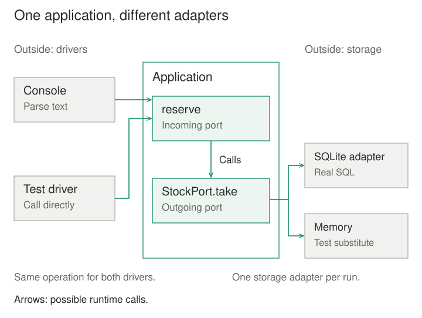
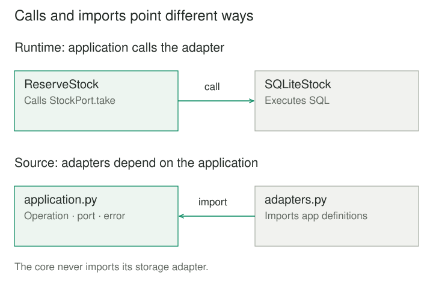

## Purpose and problem

A shop's stock-reservation rule lives inside a web handler. Testing it requires starting the web framework and preparing a database. A batch importer now needs the same behavior, but calling the handler also means constructing HTTP requests and understanding its response format.

Moving the rule into a service helps until that service creates its own database connection. The application still depends on the machinery surrounding it. The competing needs are concrete: use real interfaces and storage in production, while keeping reservation behavior understandable and executable independently.

## Core idea

**Ports and Adapters**, also called **Hexagonal Architecture**, separates an application from its external technologies. A **port** describes a purposeful conversation; an **adapter** connects a particular technology to that conversation. Several adapters can serve the same port. Cockburn's original pattern emphasizes this inside–outside boundary; the hexagon does not require six ports. [Original description](https://alistair.cockburn.us/hexagonal-architecture/).

The useful mental model is an application with sockets defined by what it does and needs. “Reserve these units” expresses an application operation. “Handle this framework request” describes an adapter's work.



## How it works

### Driving and driven conversations

A **driving**, or primary, adapter initiates an application operation: a controller, command-line parser, or automated test. A **driven**, or secondary, adapter performs something the application requests, such as allocating stock. These roles describe who initiates the conversation, rather than which direction data travels. [Cockburn's application notes](https://alistair.cockburn.us/hexagonal-architecture/).

The application defines the operation and the contracts it needs. Adapters translate external representations and relevant failures. Startup code selects implementations and supplies them to the application. Constructor injection is one way to do this; an injection framework is optional. Fowler explains why separating configuration from use matters in his [dependency injection article](https://martinfowler.com/articles/injection.html).

### Calls and source dependencies

At runtime, a reservation calls a storage adapter. In source code, the application refers to its own stock contract, while the adapter depends on application definitions. The application never imports SQLite or a web framework. Dependency inversion makes an outward call possible without an outward source dependency.



That boundary needs behavioral contracts, too. A stock port must specify whether allocation is all-or-nothing, how insufficient stock differs from unavailable storage, and when success becomes durable. A matching method name cannot establish those properties.

## Worked example

### Reserve units without importing storage

The shop starts with three notebooks. Reserving two should succeed; reserving another two should fail without consuming the remaining one. The original handler mixes input parsing, validation, and SQL. The revised application validates quantities and requests one indivisible stock operation. The storage adapter implements it.

Save these four files together. Run `python3 main.py`, then `python3 test_application.py`. They use Python 3.8 or later and only its standard library.

**application.py — the operation and its outgoing contract**

```python
from typing import Protocol


class StockUnavailable(Exception):
    pass


class StockPort(Protocol):
    def take(self, sku: str, units: int) -> bool:
        """Positive units: remove all or none; raise StockUnavailable on failure."""
        ...


class ReserveStock:
    def __init__(self, stock: StockPort):
        self._stock = stock

    def reserve(self, sku: str, units: int) -> str:
        if type(units) is not int or units <= 0:
            raise ValueError("Units must be a positive integer")
        return "reserved" if self._stock.take(sku, units) else "unavailable"
```

Here `reserve` is the incoming port; it needs no separate interface class. `StockPort` describes the outgoing port. Its `False` result means insufficient stock, including an unknown product identifier (`sku`). `StockUnavailable` means the storage operation could not be completed normally. Python's [Protocol](https://docs.python.org/3/library/typing.html#typing.Protocol) expresses structural compatibility for type checkers; it does not enforce these semantics at runtime.

**adapters.py — input conversion and SQLite access**

```python
import sqlite3
from application import ReserveStock, StockUnavailable


def reserve_text(app: ReserveStock, sku: str, text: str) -> str:
    return app.reserve(sku, int(text))


class SQLiteStock:
    def __init__(self, connection):
        self._connection = connection

    def take(self, sku: str, units: int) -> bool:
        try:
            with self._connection:
                result = self._connection.execute(
                    "UPDATE stock SET units = units - ? "
                    "WHERE sku = ? AND units >= ?",
                    (units, sku, units),
                )
            return result.rowcount == 1
        except sqlite3.Error as error:
            raise StockUnavailable("Stock storage failed") from error
```

**main.py — wiring and resource ownership**

```python
import sqlite3
from contextlib import closing
from application import ReserveStock
from adapters import SQLiteStock, reserve_text


with closing(sqlite3.connect(":memory:")) as db:
    db.execute(
        "CREATE TABLE stock "
        "(sku TEXT PRIMARY KEY, units INTEGER NOT NULL CHECK(units >= 0))"
    )
    db.execute("INSERT INTO stock VALUES (?, ?)", ("notebook", 3))
    db.commit()
    app = ReserveStock(SQLiteStock(db))
    print(reserve_text(app, "notebook", "2"))
    print(reserve_text(app, "notebook", "2"))
# reserved
# unavailable
```

Units are whole items; this example assumes string product identifiers and quantities within SQLite's integer range. The conditional update checks and decrements in one statement; a separate read followed by an unconditional write would weaken the allocation contract. The adapter owns each call's transaction on a dedicated connection with no pending work. It returns after commit. Python's connection context manages commit or rollback; `closing` separately closes the connection. [SQLite connection lifecycle](https://docs.python.org/3/library/sqlite3.html#how-to-use-the-connection-context-manager).

**test_application.py — drive the application without SQLite**

```python
from application import ReserveStock


class MemoryStock:
    def __init__(self):
        self.units = {"notebook": 3}

    def take(self, sku: str, units: int) -> bool:
        available = self.units.get(sku, 0)
        if available < units:
            return False
        self.units[sku] = available - units
        return True


stock = MemoryStock()
app = ReserveStock(stock)
assert app.reserve("notebook", 2) == "reserved"
assert app.reserve("notebook", 2) == "unavailable"
assert stock.units["notebook"] == 1
print("isolated checks passed")
```

This test imports no adapter module. Its memory substitute models sequential allocation, without proving database durability or thread safety. Zero, negative, or non-integer quantities raise `ValueError` before storage access. Non-numeric text fails during input conversion. Database errors become `StockUnavailable`, rather than being mistaken for a normal shortage.

## When to use it

Use this arrangement when several interfaces need the same behavior, external systems obstruct application tests, or framework and provider details spread into business decisions. A command-line adapter can support a useful application before its final UI exists.

A small script with stable I/O may need only a function accepting another function. Introduce a port for a meaningful conversation, rather than an interface for every class. The boundary can live inside one process; it does not require microservices.

## Tradeoffs and common mistakes

**Contracts cost design work.** Extra interfaces and conversions earn their place by separating decisions that actually change independently. Copying a vendor SDK's vocabulary into a port can preserve the dependency in disguise.

**Substitutes can conceal mistakes.** Run integration checks against real adapters as well as isolated application tests. The memory implementation above cannot reveal SQL errors, locking, or transaction failures.

**Isolation does not supply delivery guarantees.** Concurrent allocation depends on the adapter's transaction behavior. Retrying a remote request after an uncertain result might allocate twice; this example has no idempotency mechanism. An architectural boundary supplies neither exactly-once execution nor a distributed transaction.

**An adapter is not a security boundary.** A future HTTP adapter must authenticate and establish caller identity; sensitive authorization rules must still hold for other entry points. Wiring and shutdown must also own real connections and clients explicitly.

## Related patterns

[[layers|Layers]] orders responsibilities. Ports and Adapters emphasizes application-owned conversations with the outside; the application can still have internal layers.

[[adapter|Adapter]] resolves a particular interface mismatch. This architectural pattern organizes multiple such boundaries around an application.

[[facade|Facade]] can offer a focused entry point, but does not by itself isolate the application's outgoing dependencies.

Clean Architecture is a related design with its own internal responsibilities and inward dependency rule, rather than another alias for this pattern. [Robert C. Martin's description](https://blog.cleancoder.com/uncle-bob/2012/08/13/the-clean-architecture.html).

## Sources

Alistair Cockburn's [original 2005 article](https://alistair.cockburn.us/hexagonal-architecture/) establishes Ports and Adapters and its Hexagonal Architecture alias. [Martin Fowler](https://martinfowler.com/articles/injection.html) explains dependency injection and separating configuration from use. [Robert C. Martin](https://blog.cleancoder.com/uncle-bob/2012/08/13/the-clean-architecture.html) explains the related Clean Architecture dependency rule. Python's [Protocol](https://docs.python.org/3/library/typing.html#typing.Protocol) and [SQLite documentation](https://docs.python.org/3/library/sqlite3.html#how-to-use-the-connection-context-manager) support the implementation details.

The stock-reservation scenario, code, and illustrations are original teaching material. The example performs local allocation only; it does not implement a complete order workflow.
