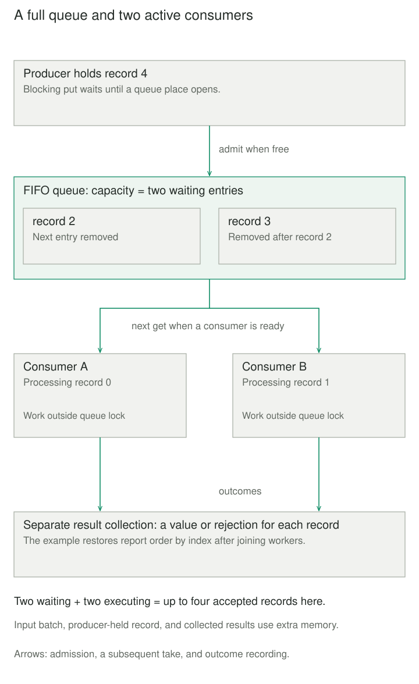

## Purpose and problem

A device gateway receives batches of readings. Parsing each reading inside the receiving loop means a slow parser delays reception of the next record. Starting a new thread for every record avoids that immediate wait, but a burst can create far more threads and pending data than the gateway can support.

Creation and processing need to progress independently, while keeping the amount of waiting work under control. They also need an agreement about who handles each record, what happens to invalid input, and how the system knows a batch has finished.

## Core idea

**Producers put work into a buffer; consumers take work out and process it.** The buffer separates their timing and synchronizes the handoff. A fixed consumer count limits simultaneous processing. A bounded buffer limits queued work and makes overload visible at admission.

The classic **bounded-buffer problem** describes this bounded form of the collaboration. Producer-Consumer also appears with other buffer policies; it is not intrinsically FIFO, durable, distributed, or lossless. Here, a synchronized FIFO queue blocks producers when full and consumers when empty. Competing consumers divide jobs: they do not each receive a copy.



## How it works

### Handoff and backpressure

The producer constructs a complete job and calls the buffer's admission operation. After successful admission, a consumer can remove that job and own its processing. A thread queue usually transfers a reference rather than copying an object. Use immutable messages, transfer exclusive access, or define additional synchronization; queue safety does not make arbitrary payload mutation safe.

A bounded queue absorbs temporary rate differences. If producers remain faster than consumers, it eventually fills. Blocking admission propagates pressure upstream only if the upstream source can wait. A device that cannot pause needs a deliberate rejection, spill, sampling, or loss policy. Increasing capacity postpones this decision and increases waiting latency; it cannot create processing capacity.

Consumers should perform slow work outside the queue's synchronization. Do not poll `empty()` or `full()` before acting: another participant can change the queue immediately. Use atomic blocking operations or their documented timeout/nonblocking variants.

### Admission, removal, and completion differ

Successful insertion means accepted into this buffer, not processed. Removal frees a queue place even while the job is still running. Track completion separately when the coordinator must wait for outcomes.

FIFO specifies removal order. Multiple consumers can finish in another order, and waiting threads need not receive fair turns. Preserve business ordering through an explicit design, such as one consumer per ordered key, rather than inferring it from a FIFO buffer.

## Worked example

### A finite batch of readings

The receiving thread becomes the producer; two reusable consumers parse readings. Invalid records become error outcomes, so one bad reading does not terminate a consumer and strand later jobs. The coordinator assigns indexes and sorts outcomes for reporting; that sorting does not serialize processing.

Save `readings.py` and `demo.py` together and run `python3 demo.py` with Python 3.11+. The input is a finite tuple of immutable byte strings, each at most eight bytes. A valid reading contains ASCII digits representing 0–100 units. Worker count and capacity are positive integers. All shape checks run before workers start.

```python
from queue import Queue
from threading import Thread


def decode_record(payload):
    if not payload.isdigit():
        raise ValueError("expected ASCII digits")
    value = int(payload)
    if value > 100:
        raise ValueError("outside 0..100 units")
    return value


def parse_readings(records, workers=2, capacity=2):
    if type(records) is not tuple or any(
        type(r) is not bytes or len(r) > 8 for r in records
    ):
        raise ValueError("Supply a finite tuple of 0..8-byte records")
    if any(type(n) is not int or n < 1 for n in (workers, capacity)):
        raise ValueError("Worker count and capacity must be positive integers")
    pending = Queue(maxsize=capacity)
    outcomes = Queue()
    stop = object()

    def consume():
        while True:
            item = pending.get()
            try:
                if item is stop:
                    return
                index, payload = item
                try:
                    value = decode_record(payload)
                except ValueError as error:
                    outcomes.put((index, "error", str(error)))
                else:
                    outcomes.put((index, "ok", value))
            finally:
                pending.task_done()

    consumers = [Thread(target=consume, daemon=False) for _ in range(workers)]
    for thread in consumers:
        thread.start()
    try:
        for item in enumerate(records):
            pending.put(item)
    finally:
        for _ in consumers:
            pending.put(stop)
        pending.join()
        for thread in consumers:
            thread.join()
    return sorted(outcomes.get_nowait() for _ in records)
```

```python
from readings import parse_readings

for index, status, value in parse_readings((b"7", b"bad", b"11", b"0")):
    print(index, status, value)
```

The four output lines are `0 ok 7`, `1 error expected ASCII digits`, `2 ok 11`, and `3 ok 0`. The values are units; an error string is a rejected reading, not a measurement. An empty batch returns an empty list and still stops and joins its consumers.

The stop marker is a private identity object, distinct from every data job. The sole producer enqueues one marker per consumer after its last job. Consumers continue running while those insertions may block. With several producers, first wait for all of them to finish; an individual producer must not stop consumers while others still submit.

Every retrieved entry, including an invalid reading or stop marker, receives exactly one `task_done()`. Queue `join()` waits for that bookkeeping, which includes handled failures. Thread `join()` then waits for worker termination. Neither operation declares every reading successful.


## When to use it

Use this pattern when work creation and execution have different timing, bursts need limited buffering, or a stable group of consumers should share independent jobs. An I/O pipeline might receive records, validate them, and write results in separate stages; each stage consumes from upstream and produces downstream.

A direct loop is simpler for cheap, sequential work. An existing executor or channel may already supply the lifecycle you need. This tiny pure-Python parser teaches coordination, not a speedup: threads do not imply CPU parallelism on conventional CPython with the GIL.

## Tradeoffs and common mistakes

The example bounds pending entries, not total memory. It retains the finite input batch and one outcome per reading in a separate unbounded queue. A continuous stream needs a concurrent result sink and bounds across every stage. Blocking on a full result queue while its only reader waits for workers to finish would deadlock.

This shutdown assumes threads start successfully and parsing and outcome recording finish. Expected `ValueError` failures are handled; unexpected worker death, resource exhaustion, or a stuck operation can leave a producer or join blocked indefinitely. There are no deadlines, cancellation, supervision, or crash recovery here.

A local queue does not survive process failure. If processing changes an external system, removing a job and recording completion do not make that effect atomic or exactly once. Retries, acknowledgments, idempotency, and durable messaging require additional protocols.

## Related patterns

[[monitor-object|Monitor Object]] encapsulates synchronized state and condition waiting. It can implement the buffer; Producer-Consumer describes the participants and handoff around it.

[[active-object|Active Object]] queues method requests for an object's execution owner. Producer-Consumer can distribute independent data jobs across several consumers without giving one mutable object a private scheduler.

[[data-publish-subscribe-distribution|Publish-Subscribe]] sends an event to independent subscriptions. Consumers competing for one work queue divide entries instead of broadcasting each entry to every consumer.

## Sources

- [Eiffel: Producer-consumer](https://www.eiffel.org/doc/solutions/Producer-consumer) — established producer, consumer, and shared bounded-buffer roles.
- [Microsoft: BlockingCollection overview](https://learn.microsoft.com/en-us/dotnet/standard/collections/thread-safe/blockingcollection-overview) — bounding, blocking, multiple participants, and completion.
- [Microsoft: Producer-consumer dataflow](https://learn.microsoft.com/en-us/dotnet/standard/parallel-programming/how-to-implement-a-producer-consumer-dataflow-pattern) — separation through message buffers and pipeline collaboration.
- [Python: queue](https://docs.python.org/3.11/library/queue.html) — synchronized FIFO operations, capacity, task accounting, and queue-state inspection limits.
- [Python: threading](https://docs.python.org/3.11/library/threading.html) — thread ownership, joining, non-daemon lifecycle, and CPython execution limits.

The reading parser, limits, outcome policy, shutdown composition, and diagrams are original teaching material.
