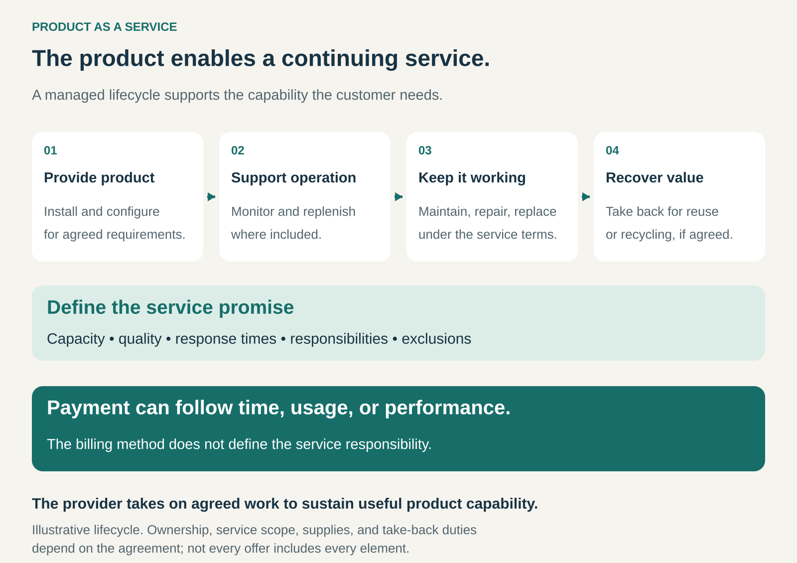

## What it is for

Deliver a product’s useful capability through an ongoing managed service. Product as a Service helps customers obtain functioning equipment, supplies, and support through one arrangement, while giving providers continuing responsibility for agreed aspects of performance.

An office needs dependable printing. A factory needs compressed air. An airport needs suitable lighting throughout its operating hours.

Equipment enables those capabilities, but purchasing it also creates work: installation, maintenance, replenishment, repairs, and eventual replacement.

Product as a Service brings the product and that continuing work into a coordinated offer.

## The core idea

Organize the business around sustaining useful product capability over time.

The provider supplies or arranges the equipment and takes responsibility for an agreed combination of activities, such as:

- Installation and configuration.
- Maintenance, repairs, and replacement.
- Monitoring and replenishment.
- Capacity adjustments or upgrades.
- Recovery, refurbishment, or recycling.

In a characteristic arrangement, ownership remains with the provider or its financing partner. The customer receives use and service under a continuing agreement.

The model can incorporate rental, leasing, subscriptions, or usage charges. These patterns overlap. Product as a Service emphasizes the managed capability and the responsibilities surrounding the equipment.

The contract needs to explain what is included, how service is assessed, and what remains the customer’s responsibility.

## How the service works

The graphic follows the product through its service life.

The provider establishes the equipment, supports operation, keeps it working under the agreed terms, and may recover it afterward.

Those activities support a defined promise: for example, printing capacity, lighting quality, or a compressed-air supply.

The promise needs boundaries. Repair support, a replacement commitment, and a contractual uptime guarantee are different obligations. A useful offer makes the distinction understandable.

Payment can follow time, usage, capacity, or verified performance. The billing unit alone does not determine how much responsibility the provider accepts.

## Why it works

The provider can coordinate activities that customers would otherwise manage separately.

A manufacturer may understand failure patterns, spare parts, operating conditions, and repair methods better than an individual customer. Bringing that knowledge into continuing service can reduce the customer’s administrative burden and make maintenance more systematic.

The arrangement can also change the provider’s incentives. When repairs and replacements are included in its costs, durable equipment and preventable failures become commercially significant.

Retaining products can create opportunities to refurbish them, reuse components, and manage their next deployment.

These benefits depend on execution. The provider must have the service capacity, parts, logistics, and financial resources to sustain its commitments.

Moving responsibility into a contract does not make the underlying work disappear.

## Famous examples

### Philips Lighting at Schiphol: lighting through a service agreement

Philips Lighting’s 2017 annual report describes its circular lighting project in Lounge 2 at Amsterdam’s Schiphol Airport.

The arrangement used a monthly service fee including energy and maintenance costs. At the end of the contract, Schiphol could extend the arrangement with upgraded lighting or choose new lighting, with luminaires available for return to Philips Lighting for reuse or recycling. [Philips Lighting’s 2017 annual report](https://www.signify.com/static/2017/philips-lighting-annual-report-2017.pdf).

This historical project combined lighting equipment with continuing service and an intended recovery route.

The commercial relationship extended beyond delivering fixtures. Equipment design, maintenance, energy use, and end-of-contract handling formed parts of the offer.

### HP All-In Plan: printing with equipment, ink, and support

HP’s US All-In Plan combines an HP-owned printer with automatic ink replenishment, support, and replacement arrangements when remote troubleshooting cannot resolve a problem.

Customers select a printing allowance, with additional page charges when applicable. The service requires an internet connection for monitoring and replenishment. Cancellation involves returning the printer and supplies, and early cancellation charges may apply. [HP’s All-In business offer](https://www.hp.com/us-en/all-in-plan/business/printers.html), [HP’s service explanation](https://support.hp.com/us-en/document/ish_10177439-10177493-16).

The customer obtains a coordinated printing arrangement rather than separately acquiring and managing every component.

The example also shows the dependencies created by the model. Continued service relies on connectivity, an active agreement, and compliance with the plan’s conditions.

### Kaeser: compressed air as a utility

Kaeser’s SIGMA AIR UTILITY offer includes analyzing requirements, building and installing a compressed-air system, and operating, monitoring, and maintaining it.

Its published US description specifies a basic price covering an agreed quantity of compressed air, with a contractual rate for additional quantities. [Kaeser’s compressed-air service](https://us.kaeser.com/services/compressed-air-as-utility-service/).

The customer obtains an industrial capability supported by equipment and specialist operation.

This is more than simply supplying a compressor. System design, air treatment, controls, maintenance, and service support contribute to the delivered supply.

Its pricing also demonstrates that Product as a Service need not mean payment only for actual consumption. A committed base quantity and additional usage charges can coexist.

## The economics

For customers, the relevant comparison includes equipment, operation, administration, and the consequences of downtime.

A service arrangement may reduce initial expenditure and consolidate responsibilities. It does not automatically reduce total cost. Minimum commitments, usage charges, exclusions, and termination conditions affect the result.

For providers, recurring income must support the full service obligation.

Costs can include equipment funding, installation, consumables, technicians, replacement stock, monitoring, transport, and eventual recovery. The provider may spend substantially before receiving enough payments to recover that expenditure.

Reliability can improve margins when failures create costs the provider must absorb. Poorly priced commitments can have the opposite effect.

The model therefore depends on understanding operating conditions and defining a sustainable service scope.

## Useful when

This pattern is especially useful when:

- **Customers value continuing functionality:** possession of the equipment is only part of their need.
- **Maintenance or replenishment matters:** ongoing work materially affects useful operation.
- **The provider has relevant expertise:** it can manage the product more effectively than customers acting alone.
- **Service requirements can be defined:** capacity, quality, response times, and responsibilities are understandable.
- **The relationship lasts long enough:** the provider can recover setup and equipment costs while delivering continuing value.

It becomes harder when operating conditions are unpredictable, customers require extensive independent control, or reliable servicing is impractical.

## Common mistakes and limits

**Changing the invoice without changing the service.** Monthly billing alone does not create a managed product capability. The continuing responsibilities need substance.

**Leaving performance vague.** “Worry-free operation” provides little clarity about response times, replacement, exclusions, or compensation when service falls short.

**Taking responsibility without sufficient control.** Customer misuse, unsuitable conditions, connectivity, or infrastructure may affect operation. The agreement needs to address those dependencies.

**Underestimating service demand.** A growing installed base also creates growing repair, replenishment, support, and replacement obligations.

**Confusing usage with outcomes.** A printed page or quantity of compressed air is a measurable output. It does not establish that the customer achieved its larger business objective.

**Assuming recovery will happen automatically.** Repairability, collection, refurbishment, and viable reuse routes require operational design and funding.

**Ignoring the end of the relationship.** Equipment removal, replacement arrangements, data handling where relevant, and continuity after cancellation affect the customer’s practical freedom.

## Related patterns

- [[solution-provider|Solution Provider:]] integrates responsibilities around a customer need. Product as a Service applies that approach to a continuing capability enabled by physical products.
- [[leasing|Leasing:]] supplies asset use through a committed agreement. It can provide the equipment-funding component of a broader service.
- [[subscription|Subscription:]] organizes recurring payment and entitlement; Product as a Service defines what the provider supplies and manages.
- [[outcome-based-pricing|Outcome-Based Pricing:]] makes compensation contingent on agreed results. A Product as a Service offer can use it, but can also charge through time, capacity, or usage.
