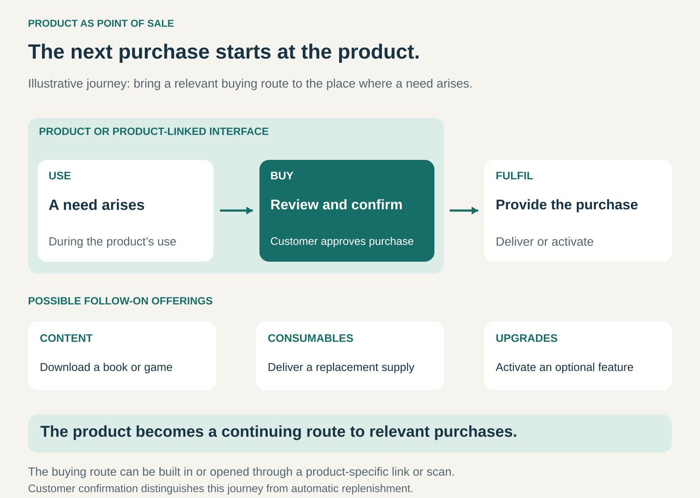

## What it is for

A reader finishes a book and wants another. A player wants an additional game. A machine needs a replacement consumable, but finding the correct item means searching elsewhere.

Product as Point of Sale brings a relevant buying opportunity into the product’s use.

It is useful when the product provides a natural place to discover, select, and purchase something that extends its usefulness or replenishes what it consumes.

## The core idea

**Make the product a continuing channel for further purchases.**

The customer uses a product for its original purpose and can also buy related goods, content, services, or capabilities through it.

The buying route might be a built-in store, an upgrade screen, or a product-specific link opened by scanning a label. The product does not need a large screen or its own payment system. Identification through a smartphone can connect a physical object with a relevant purchasing interface. [Fleisch, Weinberger and Wortmann: business models and the Internet of Things](https://www.iot-lab.ch/wp-content/uploads/2019/01/7_Fleisch_et_al_2014_Business-Models-and-the-IoT.pdf)

The important connection is between use and purchase. The product helps the customer act where the need arises, with useful context already available.

The customer reviews and confirms the purchase. Automatic replenishment is a related pattern in which an agreed process can place orders without a fresh purchasing decision each time.

## How it works

The pattern connects five elements.

**A product with continuing use.** The customer returns to the device, equipment, or associated interface. That repeated use creates opportunities to encounter relevant offerings.

**A reason for another purchase.** The customer may want new content, replacement supplies, an accessory, an optional capability, or additional service.

**Useful purchasing context.** The product can help identify the correct model, compatible content, required component, or available entitlement. This can reduce the work of finding a suitable option.

**A clear buying decision.** The customer sees what is offered, what it costs, and any continuing commitment before confirming. Stored account details can simplify payment while appropriate authorization protects the decision.

**Connected fulfilment.** Digital content downloads, a feature activates, a service becomes available, or a physical item is dispatched.

For example, a hypothetical machine could carry a code that opens an ordering page for its compatible filter. The customer checks the item and price, confirms the order, and receives the replacement by delivery.

The machine supplies the context and entry point. The associated commerce operation completes the transaction.

## Why it works

The pattern shortens the distance between recognizing a need and acting on it.

Customers can avoid searching for a separate retailer, identifying the product again, or checking compatibility from scratch. The purchasing route is available while the task and requirements are still clear.

It also gives the business a continuing distribution channel. The relationship can extend beyond the initial product sale to content, supplies, services, or upgrades.

Where the offering is digital, purchase and availability can be closely connected. A reader can buy a book and begin reading it on the same device.

The commercial opportunity depends on relevance. A useful route to the next purchase can improve the product experience. Unrelated promotions or repeated interruptions can make the product less pleasant to use.

## Famous examples

### Amazon Kindle: the reading device contains the bookshop

On supported Kindle e-readers, customers can open the Kindle Store from the device, browse or search for books, review details, and purchase a title. The book then downloads to the device through its internet connection. [Amazon: buying books on Kindle](https://www.aboutamazon.com/news/devices/how-to-buy-kindle-books)

The device used for reading is also a route to the next book.

The customer does not need to identify the reading device again or arrange a separate physical delivery. Discovery, purchase, and consumption are connected within the reading environment.

This illustrates the pattern particularly clearly: a durable product supports a continuing series of separately chosen purchases.

### Apple iPhone: a device that provides a software storefront

The App Store on iPhone lets customers discover free and paid apps, examine information such as compatibility and reviews, and obtain their selection.

For a paid app, the customer selects the price and completes any required authentication. Purchases use the payment method associated with the Apple Account. [Apple: getting apps on iPhone](https://support.apple.com/en-gb/guide/iphone/iphc90580097/26/ios/26)

The device provides a purchasing interface for software that expands what it can do, including offerings from third-party developers.

The product’s role as a point of sale is separate from who creates the additional offering and how the commercial arrangements are structured.

### PlayStation: buying games and additions through the console

PlayStation Store can be accessed through supported consoles as well as through other channels. Customers can browse games, add-ons, subscriptions, and season passes, review requirements, and complete a purchase.

Purchased games and add-ons can then be downloaded through the console’s library or store interface. [PlayStation purchasing guidance](https://www.playstation.com/en-gb/support/store/purchase-games-apps-ps-store/)

The console becomes a continuing route to content and services used with it.

Compatibility information is part of the buying experience: the customer needs the correct edition, platform, and any required subscription. The usefulness of the embedded store depends partly on making those conditions understandable.

## The economics

Product as Point of Sale does not prescribe one revenue model.

The operator might earn a margin on its own goods, receive a share of third-party sales, collect referral commissions, or sell subscriptions and optional upgrades.

Consider a hypothetical product with 10,000 monthly active users:

- Five percent make a purchase through its buying interface.
- Those 500 purchases average $20.
- Gross purchase value is $10,000.
- If the operator receives a 10% commission, its commission revenue is $1,000 before costs.

These figures illustrate one arrangement, not the terms of any example company.

The operator must cover the costs associated with the interface, integrations, support, security, and ongoing operation. Selling its own offerings creates a different calculation involving product costs, fulfilment, refunds, and other expenses.

A large installed base is only a starting point. Active use, relevant demand, purchase frequency, and contribution per transaction determine the commercial opportunity.

Purchases through the product may also replace purchases that would have occurred through the business’s existing website or stores. Channel activity and additional revenue need to be assessed separately.

The initial product can remain profitable in its own right. Subsidizing it to generate later purchases is an optional additional strategy.

## Useful when

- **The product creates recurring or adjacent needs.** Content, consumables, accessories, services, or capabilities extend its value.
- **Compatibility makes purchasing difficult.** Product identity can help customers find the correct offering.
- **Customers use the product repeatedly.** The buying route remains accessible at relevant moments.
- **Purchase and fulfilment can connect reliably.** Orders lead to the expected delivery, download, or activation.
- **The commercial interface improves the task.** Customers gain convenience without unnecessary interruption.

## Common mistakes and limits

**Adding a shop without a relevant buying need.** Access to a screen or connected device does not establish demand.

**Confusing a reminder with a purchasing route.** A low-supply notification helps identify a need. The pattern adds a practical way to review and order the appropriate replacement.

**Making purchases too easy to trigger accidentally.** Shared devices and stored payment details require clear confirmation and appropriate authorization.

**Leaving compatibility or entitlement unclear.** Customers need to understand which device, account, region, or version a purchase supports.

**Assuming the product must sell only the operator’s offerings.** Third-party content or services can participate, provided responsibilities and terms are clear.

**Allowing selling to weaken the original product.** Excessive prompts, obstructive interfaces, or poorly explained paid additions can damage the experience that brings customers back.

**Ignoring the product’s service life.** A purchasing feature may depend on accounts, connectivity, and ongoing support. Customers need understandable expectations about that dependency.

## Related patterns

[[e-commerce|E-Commerce]] supplies electronic ordering. Product as Point of Sale places a relevant entry point within the product or its immediate use.

[[razor-and-blade|Razor and Blade / Bait and Hook]] structures revenue around an initial product and subsequent purchases. Product as Point of Sale provides a convenient channel for those purchases.

[[modular-upgrade-revenue|Modular Upgrade Revenue]] sells additional capabilities over time. The product itself can provide the interface for choosing and purchasing them.

**Product Self-Service / Automatic Replenishment** automates an ordering process under agreed rules. Product as Point of Sale retains an explicit customer purchasing decision.
