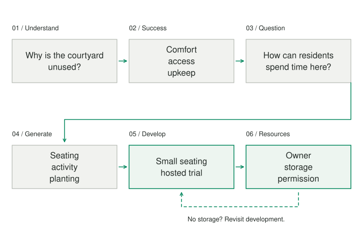

A neighborhood association wants to make its unused courtyard welcoming. One person proposes benches, another a mural, and another a calendar of events. The discussion becomes a contest among ready-made solutions before anyone has agreed what “welcoming” would mean or why the courtyard is unused.

## Core idea

Tim Hurson’s Productive Thinking Model connects several different thinking jobs: understand the situation, define success, frame the question, generate answers, develop a solution, and align the resources needed to act. It is useful when an idea needs to travel from a vague concern to a workable plan without collapsing every stage into the first proposal.

This article is a connecting overview and a compact original application of the model described in Hurson’s *Think Better*. Each stage can open into a more focused Patternverse practice when the issue deserves additional work.

## When to use it

Use the model when a project needs both creative expansion and disciplined follow-through. It is particularly useful when a group is arguing for different solutions before agreeing on the concern or on success.

## How it works

1. **Understand the situation.** Establish what is happening and who is affected.
2. **Describe success.** Name the outcomes and requirements that matter.
3. **Frame the question.** Find wording that permits different answers.
4. **Generate alternatives.** Give distinct possibilities room to develop.
5. **Develop a solution.** Improve a promising proposal against the requirements.
6. **Align resources.** Name responsibility, permissions, a first action, and a review point.

## Worked examples



### Understand what is happening

Begin with the actual situation, its effects, the people involved, and what is known. The courtyard may be empty because it lacks seating. It may also be difficult to reach, poorly lit, or perceived as belonging to one part of the neighborhood.

Speak to people who use it and people who do not. Separate observations from interpretations. “There are no visitors after six” is different from “nobody values the space.” The second statement may hide an explanation the group has not tested.

[[iceberg-model|Iceberg Model]] can help when the concern recurs and underlying arrangements deserve attention. Do enough inquiry to avoid designing against an invented problem, while recognizing that complete understanding is unlikely before action.

### Describe success before defending a solution

The association might want residents with different schedules to use the courtyard comfortably, while keeping maintenance affordable and preserving access for deliveries. Those conditions are more useful than “install the benches,” which confuses an implementation with its purpose.

Make success observable where possible. Who would be able to do what? What burden should not increase? Whose experience could reveal that the change is failing? A space can become busier while becoming less usable for the people the project was meant to include.

Success criteria will sometimes conflict. Record the conflict rather than resolving it with vague words such as “balanced” or “inclusive.” Later evaluation needs something more precise to work with.

### Find a question that opens the search

A good question preserves the real requirement without prescribing the answer. “How can residents comfortably spend short periods here at different times of day?” permits different arrangements. “Where should we put the benches?” does not.

Try several questions. One may concern access, another informal conversation, another stewardship. Choose the one that matters most to the present project and keep the others visible. [[abstraction-laddering|Abstraction Laddering]] helps move between purpose and implementation when the question remains too narrow or too vague.

Changing the question is not avoiding the work. It is useful only if the revised frame still addresses the original concern and the people affected recognize it.

### Generate answers before selecting one

The association could consider portable seating, short hosted activities, a sheltered standing area, a shared planting project, or improved access with no new furniture. Preserve a period in which alternatives can become understandable before they are scored.

[[zwicky-box|Zwicky Box]] offers a structured way to combine dimensions such as activity, hosting arrangement, and physical setup. [[reframing-generate-real-options|Generate Real Options]] helps check that the alternatives differ in meaningful ways.

A list is not yet a solution. Each candidate needs enough description to reveal how it would work and what it assumes. “Community engagement” is an aspiration; a recurring hosted tea break with named responsibilities is a proposal.

### Develop rather than merely choose

Compare promising candidates against the success criteria. Look for strengths to preserve, weaknesses to address, and combinations that improve the design. The goal is not to reward whichever incomplete idea scored highest in its first draft.

Portable seating may reduce installation cost but introduce storage and setup work. A hosted activity may make the space approachable but depend on a few volunteers. The group could combine a small amount of fixed seating with a limited hosted trial, then test whether participation continues outside hosted periods.

[[decision-matrix|Decision Matrix]] can make some comparisons explicit, but a total cannot settle every concern. A mandatory access requirement should remain a requirement rather than a low-weight preference that other scores can offset.

### Align resources and responsibility

A solution becomes actionable when someone can name the next action, the responsible person, the permissions and resources required, and the evidence that will inform the next decision. “The association will maintain it” is incomplete if no one has accepted the work.

Plan a bounded first commitment. Perhaps the group confirms access requirements, obtains permission for a trial, and tests one setup over two weekends. Record what would justify continuing, revising, or stopping. The practice produces that plan; it does not obtain consent or perform the work.

## Pitfalls and limits

These jobs are connected, but the process is not a one-way production line. Discovering that storage is unavailable may require developing another candidate. Hearing that residents avoid the courtyard because of a conflict may require returning to the situation and success criteria.

Use the model when a project needs both creative expansion and disciplined follow-through. For a small familiar task, the full process may be unnecessary. For a consequential project, one short session is only an initial pass.

Keep the handoffs explicit: which observation supports the question, which requirement guides selection, and which uncertainty shapes the first action? That continuity makes the final plan understandable and revisable instead of merely enthusiastic.

## Related patterns

[[abstraction-laddering|Abstraction Laddering]] helps repair a question that is too narrow or too broad. [[zwicky-box|Zwicky Box]] provides a focused way to generate alternatives, while [[decision-matrix|Decision Matrix]] can support comparison once the requirements are explicit.

## Sources and attribution

- [Tim Hurson: Think Better](https://www.timhurson.com/think-better/), author’s page for the 2007 book introducing the Productive Thinking Model. This overview and its courtyard example are original applications.

## Practice — Develop a Possibility Into a Plan

**Purpose:** Connect problem understanding, success criteria, creative alternatives, evaluation, and an executable plan.

**Time:** About 30 minutes. The practice produces a reflection or plan; it does not execute actions for you.

```patternverse-language
:language 1
:title "Develop a Possibility Into a Plan"
:output result

!show {
About 30 minutes. Work with one manageable situation. This participant-led practice needs no AI. Review each group before Continue. The result is a reflection or plan; actions are not carried out or scheduled for you.
}
situation = !form {
:title "Understand the situation"
concern = !ask {
What concrete concern brought you here?
}
observations = !ask {
What is known, and what is interpretation?
}
people = !ask {
Who is affected or needs to contribute?
}
}
success = !form {
:title "Describe success"
outcome = !ask {
What would improve for whom?
}
criteria = !ask {
What observable criteria and nonnegotiable requirements would a useful solution satisfy?
}
}
question = !form {
:title "Frame a generative question"
first = !ask {
What question opens alternatives without prescribing a solution?
}
alternative = !ask {
What different framing could expose another route?
}
chosen = !ask {
Which question will you work on now, and why?
}
}
options = !collect {
:min 1
:max 5
entry = !form {
:title "Add an entry"
name = !ask {
Name a genuinely different possibility.
}
mechanism = !ask {
How would it serve the chosen question?
}
fit = !ask {
Where does it meet or miss the success criteria?
}
}
-> yield entry
}
!show {{options}} {

}
priorities = !rank [from=options, label=name] {
Arrange the possibilities by their promise after reviewing the criteria. This is your provisional judgment.
}
develop = !form {
:title "Forge a workable solution"
proposal = !ask {
Describe the candidate or combination you will develop.
}
improve = !ask {
What weakness will you address, and which useful feature should remain?
}
unknown = !ask {
What important assumption needs testing?
}
}
resources = !form {
:title "Align a first commitment"
action = !ask {
What bounded action will happen next?
}
owner = !ask {
Who must accept responsibility, and whose permission is needed?
}
resources = !ask {
What time, support, or other resources are required?
}
review = !ask {
What evidence will justify continuing, revising, or stopping?
}
}
result = {situation: situation, success: success, question: question, options: options, priorities: priorities, solution: develop, resource_plan: resources}
!show {
Your developed proposal: {{develop.proposal}}
First commitment to arrange: {{resources.action}}
Responsibility and permission: {{resources.owner}}
Review using: {{resources.review}}
}
-> end
```
