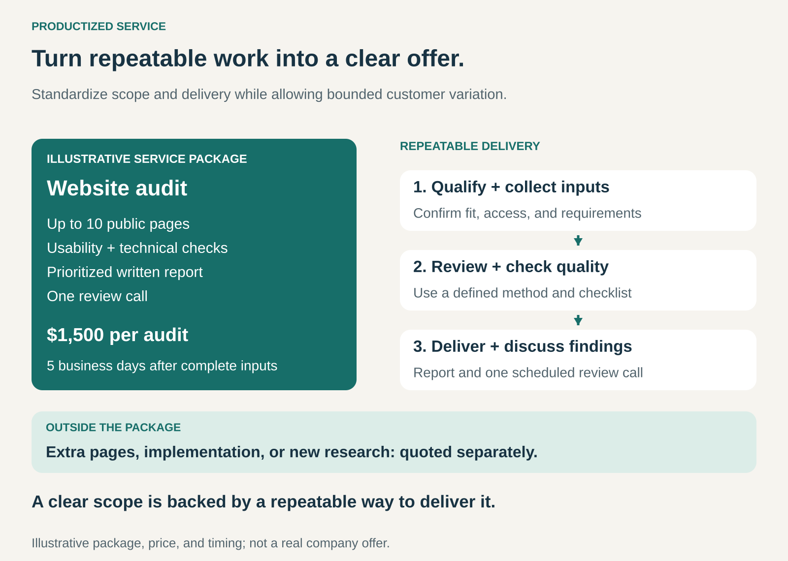

## What it is for

Make a service easier to understand, buy, and deliver by turning recurring work into a clearly defined offering.

Customers often struggle to buy services because they cannot tell what they will receive, how long the work will take, or what the final bill will be. Providers face a related problem: every enquiry becomes a new proposal, and every project develops its own process.

Productized Service is useful when customers have a recurring need that can be addressed through a repeatable approach.

A website audit, furniture assembly package, or defined design service gives customers something concrete to purchase while giving the provider a consistent way to organize the work.

## The core idea

**Package a service around a defined scope, clear commercial terms, and a repeatable delivery process.**

The offering specifies who it is for, what customers receive, what they must supply, and where the boundaries lie. A fixed package price is common, although defined options or pricing rules can accommodate differences between customers. [Shopify’s guide to productized services](https://www.shopify.com/blog/productized-service)

The output can still be individual. Two customers buying a website audit receive different findings. Two customers buying a design service receive different designs.

What repeats is the structure of the service: how work enters the system, what is included, how it is performed, and how completion is judged.

A fixed-price quote for a unique project provides price certainty. Productization goes further by making substantial parts of the offering and delivery method reusable across customers.

## How it works

**1. Define a recognizable customer need.**

A useful package addresses something customers can identify and value.

“Marketing consulting” leaves many questions open. “An audit of your checkout process, with prioritized recommendations and a review call” describes a more specific purchase.

The need must recur often enough to justify developing an offering around it.

**2. Establish scope and eligibility.**

The package explains what is included, what is excluded, and which conditions must be met.

A website audit might cover up to ten public pages, a defined set of checks, a written report, and one review call. Implementation could be a separate service.

Eligibility matters too. A service designed for a straightforward website may be unsuitable for a complex application requiring extensive investigation.

**3. Standardize delivery behind the offer.**

The provider develops a consistent approach to intake, preparation, execution, quality checks, and handover.

Templates and tools can support the work, while specialists apply judgment where the customer’s situation requires it.

This operating structure makes the package credible. A polished sales page alone does little to control delivery effort or quality.

**4. Define how variation is handled.**

Customers will request changes, provide incomplete information, or arrive with unusual requirements.

The service needs rules for revisions, additional work, delayed inputs, and requests outside its scope. Some differences can be handled through predefined options; others require a separate engagement.

A stable core with explicit variation keeps the service understandable without forcing every customer into an unsuitable package.

## Why it works

**Customers can assess the purchase more easily.** Defined deliverables and boundaries reduce uncertainty about what they are buying.

**Sales effort can become more reusable.** The same explanation, examples, and qualification criteria can support many enquiries.

**Delivery becomes easier to organize.** Familiar workflows help providers estimate workload, assign people, and identify bottlenecks.

**Quality can become more consistent.** Common checks reduce reliance on each individual remembering every step.

**Improvements can benefit future customers.** A better intake form, testing method, or reporting template can improve the whole offering.

These advantages depend on genuine repetition. If most customers require extensive exceptions, the package may conceal a bespoke service with unpredictable costs.

## Famous examples

### LegalZoom — business formation offered through defined packages

LegalZoom presents business formation services through named packages with specified inclusions. Its LLC offerings include Basic, Pro, and Premium options, with different combinations of filing assistance, documents, and additional support. State filing fees are identified separately from package prices. [LegalZoom LLC packages](https://www.legalzoom.com/business/business-formation/llc-overview.html/), [LegalZoom’s May 2026 investor presentation](https://investors.legalzoom.com/static-files/93c856f7-a316-422f-8a03-b8d114266b22)

The example shows how a service category can become a catalog of understandable purchases.

The package also establishes a boundary: buying a particular formation service does not mean purchasing every kind of assistance a business might subsequently need.

### Geek Squad — installation work with a service specification

Best Buy Canada offers TV setup and mounting with pricing organized by television size. The service lists included activities such as unboxing, mounting, connecting devices, and testing. It also identifies exclusions, including electrical or structural modifications, wire concealment, and required hardware. [Best Buy Canada: TV setup and mounting](https://www.bestbuy.ca/en-ca/help/installation-and-setup-services/tv-home-theatre-setup)

Customers’ homes and equipment differ, but the purchased service has a recognizable structure.

This is productization applied to physical work: define the eligible situation, describe the included tasks, and make additional requirements visible.

### Design Pickle — recurring creative work within a structured service

Design Pickle combines creative services with a platform for submitting, tracking, reviewing, and approving requests. It publishes a service scope covering supported design work and exclusions. Its current pricing process involves a consultation to establish a plan and flat-rate price based on requirements such as volume, turnaround, and services. [Design Pickle’s offering](https://designpickle.com/pricing), [Official service scope](https://help.designpickle.com/en/articles/464399-official-scope-of-design-service)

The creative output varies, while the request process and service boundaries provide a repeatable structure.

The example also shows that productization can allow configuration before purchase. It does not require every customer to buy an identical package through instant checkout.

## The economics

Productization can reduce repeated proposal work and make delivery more efficient. It also places pressure on the provider to understand the cost of fulfilling the promise.

Consider the hypothetical website audit shown in the graphic:

| Item                                                        |   Amount |
| ----------------------------------------------------------- | -------: |
| Package price                                               |   $1,500 |
| Delivery work: 12 hours at an internal cost of $60 per hour |    −$720 |
| Direct tools and other delivery expenses                    |     −$80 |
| Contribution before sales costs and general overhead        | **$700** |

If the same package takes 22 hours, delivery labor rises to $1,320. After the other direct expenses, only $100 remains.

The package price stays the same while the provider absorbs the additional effort.

That makes qualification, scope, revisions, and rework economically significant. Tracking internal time remains useful even when customers do not pay by the hour.

A defined deliverable also differs from a guaranteed business outcome. An audit package can promise an agreed review and report without promising that the customer’s sales will increase.

## Useful when

- **Customers repeatedly ask for similar work.** There is a recognizable need behind individual enquiries.
- **The service can be bounded.** Deliverables, inputs, exclusions, and completion criteria can be explained.
- **Delivery follows a reasonably consistent approach.** Customer differences do not require starting from scratch.
- **Buying uncertainty slows decisions.** Customers struggle with open-ended scope, timelines, or fees.
- **The provider understands delivery costs.** There is enough experience to price the offering and accommodate normal variation.

## Common mistakes and limits

**Packaging the promise without improving delivery.** A named package still needs workable processes, skilled people, and quality control.

**Standardizing before understanding the work.** An attractive price can become a costly commitment when important sources of complexity remain unknown.

**Allowing unlimited exceptions.** Individually reasonable concessions can gradually remove the boundaries that make the service repeatable.

**Leaving customer responsibilities unclear.** Missing content, access, approvals, or equipment can delay delivery and create disputes about timing.

**Confusing a subscription with a service specification.** A recurring charge says when customers pay. It does not explain what work they receive, how quickly, or within what limits.

**Promising results beyond the provider’s control.** Deliverables and service standards need to be distinguished from commercial outcomes dependent on customers or third parties.

Productization is harder when discovery dominates the work, requirements change continually, or unusual circumstances are central to the customer’s need. A defined diagnostic service may be more suitable than packaging the entire engagement.

## Related patterns

- [[subscription|Subscription:]] can provide recurring payment for a productized service. Productization defines the offering; subscription defines the payment cadence.
- [[retainer|Retainer:]] reserves ongoing access or capacity. A retainer becomes more productized when its scope and delivery arrangements are explicitly defined.
- [[core-plus-add-ons|Core plus Add-Ons:]] supports a standard service package with separately priced extensions.
- [[product-as-a-service|Product as a Service:]] provides ongoing access to a product’s function. Productized Service packages service work into a repeatable offering.
