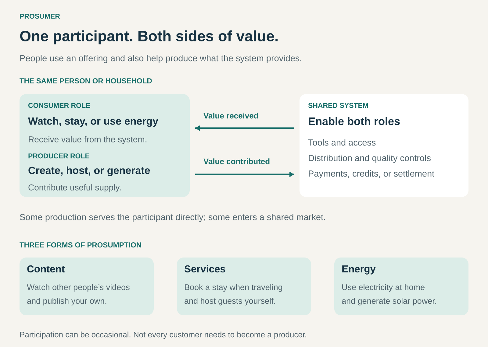

## What it is for

Prosumer helps a business create value by enabling customers to become producers as well as consumers.

It is useful when people have knowledge, creativity, assets, or productive capacity that could contribute to the offering they already use. A viewer can publish videos. A traveler can host guests. A household can consume electricity and generate some of its own.

The business makes this participation possible through tools, infrastructure, coordination, and access to a wider market.

## The core idea

**Enable the same participant to both consume and produce value within a related system.**

“Prosumer” combines _producer_ and _consumer_. The two roles can coexist or alternate over time.

A person might produce something for their own use, contribute something other people consume, or do both. Participation can be occasional, voluntary, or increasingly professional.

For a business, the opportunity is to support this dual role:

- **Provide production tools:** help customers create content, products, or other useful outputs.
- **Enable service provision:** let customers supply services they also purchase.
- **Connect distributed resources:** coordinate customer-owned equipment or productive capacity.
- **Support exchange:** help participants distribute, sell, or receive credit for their contributions.

This pattern describes how participants create value. Revenue may come from equipment sales, subscriptions, transaction fees, advertising, or a share of the value produced.

## How it works

The business connects five elements.

**An accessible producer role.** Customers need a practical way to contribute. Publishing tools, hosting interfaces, production equipment, or automated connections can reduce the knowledge and effort required.

**Something worth producing.** The contribution must serve a real need. More uploads, listings, or connected devices create value only when their outputs are useful.

**Infrastructure that supports both roles.** Consumption and production have different requirements. Watching a video needs playback; publishing one also needs uploading, editing information, permissions, and performance feedback.

**Quality and coordination.** The business establishes standards, handles disputes, and helps supply reach suitable demand. Physical systems may also require scheduling, technical integration, or capacity limits.

**A worthwhile return for participants.** Benefits can include income, lower costs, recognition, learning, control, or access to a better shared resource. The arrangement needs to remain attractive after participants account for their own effort and expenses.

## Why it works

Customers can hold resources that a centralized provider would find difficult or expensive to reproduce.

They may have local knowledge, a distinctive creative perspective, an available room, or equipment capable of generating electricity. Enabling these resources can expand the offering without requiring the business to own every productive asset.

Experience as a consumer can also inform production. Someone who regularly uses a service may understand what other users appreciate, where the gaps are, and what would make an alternative worthwhile.

Participation can strengthen engagement because people have a stake in the system’s quality and continuity.

These effects are conditional. Production takes effort, and increased supply can create congestion or competition. A successful model makes productive participation useful and rewarding while continuing to serve people who primarily want to consume.

## Famous examples

### YouTube — viewers can become creators

A person can watch videos on YouTube and publish their own through YouTube Studio. The platform provides an upload and distribution system, allowing participants to contribute to the content offering they also consume. [YouTube’s publishing guidance](https://support.google.com/youtube/answer/57407?hl=en).

Eligible creators can apply to the YouTube Partner Program, which provides monetization features, including advertising revenue sharing. Participation requires meeting relevant criteria and passing review; uploading does not automatically generate income. [YouTube Partner Program overview](https://support.google.com/youtube/answer/72851?hl=en).

The prosumer mechanism is the combination of roles within the same ecosystem. A viewer can contribute a tutorial, performance, or explanation that becomes useful to other viewers. YouTube provides the infrastructure through which that contribution can reach an audience.

### Airbnb — travelers can also provide accommodation

Airbnb explicitly supports people who both host and travel. Its account system lets participants switch between managing their hosting activity and making bookings as guests. Airbnb notes that many hosts also use the service as travelers. [Switching between hosting and traveling](https://www.airbnb.com/help/article/3546).

Someone who consumes accommodation when traveling can provide accommodation to others at another time. Airbnb supplies listing and booking tools through which that service can be offered. [Airbnb’s hosting overview](https://www.airbnb.com/host/homes/).

The prosumer pattern applies to participants who occupy both roles. Some users remain guests, and some providers operate primarily as businesses. The wider marketplace can accommodate all these forms of participation.

### Tesla’s solar and Powerwall ecosystem — households consume and contribute energy

A household with solar panels can generate electricity for its own consumption and, where permitted, export electricity to the grid. Battery storage can shift when energy is used or supplied. The International Energy Agency describes how these distributed resources allow consumers to participate actively in electricity production and markets. [IEA overview of distributed energy resources](https://www.iea.org/reports/unlocking-the-potential-of-distributed-energy-resources/executive-summary).

Tesla’s virtual power plant programs coordinate participating home batteries to support the grid. Eligibility, participation arrangements, and compensation depend on the program and location. [Tesla’s virtual power plant explanation](https://www.tesla.com/en_gb/support/energy/virtual-power-plant).

Here, the household remains an energy consumer while also generating electricity or providing useful storage services. Solar panels generate the electricity; batteries store and release it.

## The economics

The business and its participants have separate economics.

Consider an illustrative learning platform where members buy tutorials and can also publish their own:

| Monthly activity                                  |      Amount |
| ------------------------------------------------- | ----------: |
| Total tutorial sales                              |    $100,000 |
| Payments allocated to creators                    |     $85,000 |
| **Platform’s retained share**                     | **$15,000** |
| Payment processing and transaction support        |     −$5,000 |
| Publishing tools, moderation, and creator support |     −$6,000 |
| **Remaining contribution**                        |  **$4,000** |

The $100,000 represents transaction volume. The platform retains $15,000 before the listed operating costs, leaving $4,000 before other overhead, customer acquisition, and tax.

Creators must separately account for their production time, equipment, and other expenses. Their payouts are not equivalent to profit.

These figures are hypothetical. They illustrate why a prosumer business needs both sustainable platform economics and a worthwhile proposition for contributors.

## Useful when

- Customers possess useful knowledge, creativity, assets, or productive capacity.
- People can move between consuming and producing without excessive friction.
- Production tools can make participation accessible.
- Contributions meet demand that the business cannot efficiently serve alone.
- Quality can be maintained across distributed participants.
- Participants receive benefits that justify their effort and costs.

The pattern is especially useful when production can start small and expand as participants gain experience.

## Common mistakes and limits

**Assuming everyone wants to produce.** Many customers value convenience. A strong consumer experience remains necessary even when only a minority contributes.

**Confusing membership with production.** Using a platform does not automatically make someone a prosumer. The participant must also create or supply meaningful value.

**Ignoring participant costs.** Apparent income may conceal substantial work, equipment costs, maintenance, or financial exposure. Weak participant economics can undermine supply.

**Treating distributed production as costless.** The business still funds tools, discovery, support, quality control, and dispute resolution.

**Expanding supply without demand.** Additional creators or providers may divide an existing market rather than enlarge it. Participation alone does not guarantee earnings.

**Overlooking uneven access.** Equipment, property, skills, time, and connectivity influence who can participate and benefit.

**Making participation unpredictable.** Changes to fees, visibility, access, or compensation affect people who have invested in production. Clear rules and credible communication support continued participation.

## Related patterns

- [[user-designed-products|User-Designed Products:]] focuses on users creating designs; Prosumer includes broader forms of production and service provision.
- [[peer-to-peer|Peer-to-Peer:]] connects participants directly and can allow the same person to act as buyer and provider.
- [[crowdsourcing|Crowdsourcing:]] organizes distributed contributions; Prosumer emphasizes the contributor’s simultaneous role as a consumer.
- [[revenue-sharing|Revenue Sharing:]] can reward participants with an agreed portion of the income their contributions generate.
