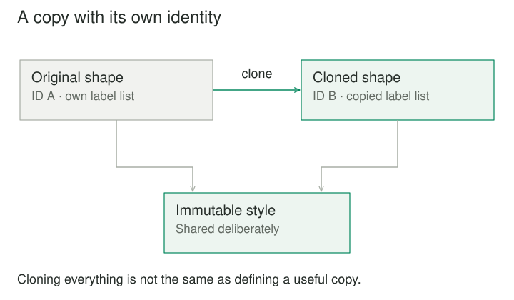

## Purpose and problem

A diagram editor can duplicate rectangles, connectors, text labels, and plugin-defined shapes. The first implementation checks the selected shape's type and manually reconstructs it. Every new shape requires another branch, and reconstruction sometimes forgets properties such as corner style or custom metadata.

## Core idea

Prototype lets the existing object supply the basis for a new one. The editor asks the selected object to clone itself, or uses an agreed copying mechanism, instead of knowing how every concrete shape is constructed. The resulting object starts from a representative configuration and can then be changed independently.



## How it works

The pattern is about creation through an existing exemplar. A prototype might be a selected object, a stored template, or a registry entry chosen by name. Clients depend on a duplication contract instead of concrete constructors.

This can reduce coupling to concrete types and preserve elaborate setup that would be tedious to repeat. It does not mean copying is automatically cheaper than construction. A large object graph may be expensive to duplicate, while a fresh constructor may be fast. Performance must be measured separately from the convenience of expressing creation through a template.

The most important design work is defining what a copy means. Should identifiers change? Should nested values be shared? Should observers and caches be copied? Does a clone remain connected to the same external resource? A prototype operation needs answers that fit the domain.

## Worked example

### Duplicating a shape without duplicating its identity

Suppose a selected card contains a title, colors, dimensions, an editable list of annotations, and a persistent identifier. A clone preserves the appearance and content but receives a new identifier. Its annotation list is independently mutable, so adding a note to the duplicate does not edit the original.

An immutable font description can be shared safely. A cached screen location may need to be discarded because the duplicate is placed elsewhere. A subscription to selection changes should generally be established through the editor's registration process rather than blindly copied.

The client does not need to know these details. Each shape implementation honors the cloning contract and returns a usable new shape. A plugin can therefore participate without adding reconstruction code to the editor.

This is more precise than asking for a universal deep copy. Deep-copying everything might duplicate data intended to remain shared, fail on external handles, or mishandle cycles. Domain-aware copying can preserve shared immutable assets while separating the mutable state that defines the new object.

### A small implementation

A shape owns its copying rule. The editor can duplicate it without knowing its constructor details. A new identity is assigned, editable labels are copied, and the immutable style value is deliberately shared.

```python
from dataclasses import dataclass, field
from uuid import uuid4


@dataclass(frozen=True)
class Style:
    fill: str


@dataclass
class Shape:
    style: Style
    labels: list[str]
    identity: str = field(default_factory=lambda: str(uuid4()))

    def clone(self):
        return Shape(self.style, self.labels.copy())


original = Shape(Style("green"), ["Entrance"])
duplicate = original.clone()
duplicate.labels.append("Copy")
print(original.labels, duplicate.labels)
# ['Entrance'] ['Entrance', 'Copy']
```

The duplicate has an independent label list and a different identity, while its immutable style can safely remain the same object. A generic shallow copy would share the labels. A blanket deep copy could duplicate data that should remain shared. The clone contract makes those decisions explicit.

### Templates in a configuration tool

A deployment configuration editor offers starting templates such as a small local worker and a high-throughput worker. Each includes resource limits, environment defaults, monitoring settings, and nested task configuration. A user chooses a template, clones it, and adjusts the copy.

The template registry stores ready-to-copy configurations. Client code needs the template name and copying interface, not a detailed constructor for every deployment type. New templates can be added without rewriting the editor's creation flow.

The copy must avoid retaining secrets, runtime status, or provider-assigned identifiers unless that is explicitly intended. A prototype used for authoring should represent a configuration template, not an active deployment with a live connection and execution history.

Template changes also raise a product question. Existing clones usually remain independent; changing the prototype does not automatically migrate them. If the desired behavior is live inheritance from a base configuration, Prototype alone does not describe that relationship. The system needs explicit references, versioning, or a merge policy.

## When to use it

- A configured template is easier to copy than reconstruct.
- Concrete types should supply their own duplication behavior.

Consider a simpler design when object identity represents an external resource that cannot meaningfully be copied, or when copying would silently preserve shared mutable state.

## Tradeoffs and common mistakes

A shallow copy duplicates the outer object while retaining references to nested objects. This is suitable when the nested values are immutable or intentionally shared. It is dangerous when users expect nested editing to be independent.

A deep copy recursively duplicates reachable content according to its copying rules. It can preserve cycles with suitable bookkeeping, but still cannot determine the domain meaning of every relationship. An object may reference a catalog item that should stay shared and a draft section that should become independent. Both are nested, but their intended treatment differs.

That is why Prototype benefits from a written semantic contract. For an editor, duplication may mean new identity, copied authoring state, no runtime subscriptions, and shared immutable assets. For a simulation, it may mean an exact state snapshot with different rules for random-number state and resources.

## Related patterns

Prototype is useful when exemplar-based creation matches how people work, or when clients should avoid concrete construction knowledge. It is less useful for small plain values whose constructors already express all relevant state. A constructor or explicit conversion function can be easier to review.

[[builder|Builder]] assembles a result through steps; Prototype starts from a completed representative. [[abstract-factory|Abstract Factory]] can provide prototypes from a family or hide cloning behind creation methods. [[flyweight|Flyweight]] deliberately shares state among many objects. Prototype often aims for independent mutable identity, so confusing the two can cause unwanted coupling.

## Sources

Prototype is one of the 23 patterns in Gamma, Helm, Johnson, and Vlissides, [*Design Patterns: Elements of Reusable Object-Oriented Software*](https://www.informit.com/store/design-patterns-elements-of-reusable-object-oriented-9780201633610). The examples, code, and illustrations here are original educational explanations.
