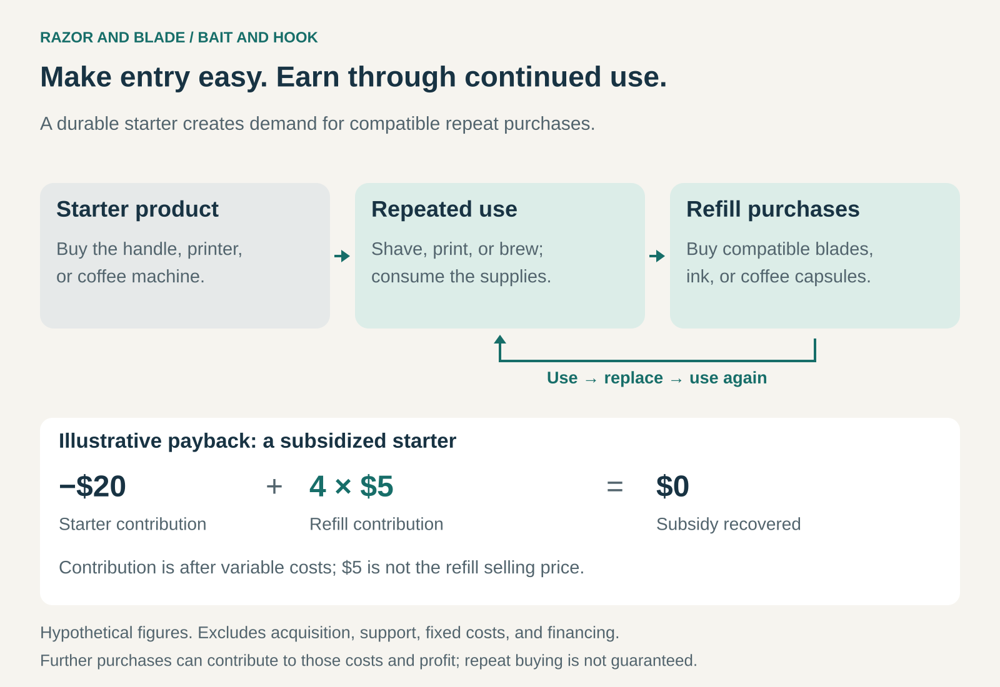

## What it is for

Use Razor and Blade when a durable product creates continuing demand for consumables, replacements, or other purchases needed to keep using it.

A customer buys a razor once and replaces its cartridges repeatedly. A printer lasts for years but consumes ink throughout its life. A coffee machine turns a succession of capsules into drinks.

The business treats the first purchase as the beginning of a longer commercial relationship. Making that first purchase attractive can help establish a customer base whose continued use generates repeat revenue.

The central question becomes: **what will customers buy after they own the product—and how much of that business will we retain?**

## The core idea

The pattern connects two parts of an offering:

- **The razor:** a durable starter product that enables use.
- **The blades:** complementary products customers purchase repeatedly as they continue using it.

The starter may be inexpensive, discounted, or sold below cost. Repeat purchases then provide the contribution needed to recover that initial investment and sustain the business.

Selling the starter at a loss is one version of the model. It can also earn a profit while consumables provide an important continuing income stream.

What distinguishes the pattern is the economic connection between the two purchases. The starter establishes demand for compatible follow-on products, and the business prices and manages them together.

## Why it works

A substantial initial price can prevent customers from adopting a product. Reducing that price lowers the commitment required to get started.

Once customers own the starter, continued use creates demand for supplies. Customers also become familiar with the system, know which replacements fit, and may prefer the convenience of buying a trusted refill.

The model can collect more revenue from heavier users. Someone who prints frequently buys more ink; someone who rarely prints buys less. Revenue therefore follows usage, although purchases happen in batches.

The business benefits only when customers keep using the product and continue buying supplies that generate revenue for it. A large number of devices sold is an opportunity for future business, rather than a guarantee.

## Famous examples

### Gillette: a reusable handle and replacement cartridges

Gillette’s cartridge systems separate the durable handle from the shaving heads customers replace. Its Fusion5 offering, for example, supports compatible replacement cartridges and offers both individual purchases and scheduled refill deliveries. Compatibility follows particular product families rather than extending across every Gillette razor. [Gillette’s Fusion5 refill system](https://gillette.com/en-us/products/razors-trimmers-and-blades/fusion5-razor-refills)

The handle establishes the connection to a refill system. Customers can replace the worn component while retaining the rest of the product, and Gillette has repeated opportunities to sell cartridges.

The familiar origin story needs qualification. Historical research by Randal Picker found that Gillette’s early business did not follow the simple account of giving away cheap razors and recovering the money through expensive blades during its original patent period. The modern pattern is useful without treating that story as its literal invention. [The Razors-and-Blades Myth(s)](https://chicagounbound.uchicago.edu/uclrev/vol78/iss1/12/)

### HP: printers create continuing demand for supplies

HP sells printing hardware alongside ink, toner, and other consumables used in that hardware. In its 2025 financial year, supplies generated approximately $10.9 billion of its $16.7 billion in Printing revenue. HP also identified the installed base of printers and their usage as factors affecting supplies sales. [HP’s 2025 annual report](https://www.sec.gov/Archives/edgar/data/47217/000004721725000071/hpq-20251031.htm)

This illustrates why the commercial value of a printer extends beyond its purchase price. Its subsequent use creates demand for supplies.

It also exposes the model’s vulnerability. Lower printing activity reduces that demand, while competing supplies can divert purchases. HP’s report identifies both generic alternatives and customers moving toward refillable tank printers as challenges.

Different printer models can have different economics; the example does not imply that every HP printer is sold below cost.

### Nespresso: a machine establishes a capsule relationship

Nespresso connects coffee machines with compatible capsules. A particularly explicit version appears in its German machine subscription: customers can obtain a machine for €1 while committing to monthly payments for an initial twelve months. Those payments become account credit usable for Nespresso products. [Nespresso Germany’s machine subscription](https://www.contact.nespresso.com/faq-3/de/en)

The reduced entry price comes with a continuing spending commitment. This combines Razor and Blade with Subscription.

Compatibility still requires care. Nespresso’s Original and Vertuo systems use different capsules. Moreover, other businesses sell capsules compatible with Original machines, so owning an Original machine does not ensure that every subsequent coffee purchase goes to Nespresso. [Nespresso’s system guidance](https://www.nespresso.com/uk/eu/order/capsules/original), [Caffè Nero’s compatible capsules](https://onlineshop.caffenero.com/capsules/classico-coffee-capsules/)

### The economics behind the starter price

Consider a hypothetical starter that sells for $20 and costs $40 to supply. Its initial contribution is negative $20.

Suppose each subsequent refill purchase contributes $5 after its variable costs. Four purchases recover the starter subsidy.

That is only one point in the calculation. Customer acquisition, support, fixed costs, and financing still need to be covered. Some customers may stop after one refill, buy competing supplies, or leave the product unused.

The business therefore needs to understand how often customers use the product, how long they remain active, what proportion of their refill purchases it captures, and how much each purchase contributes.

Cash flow matters too. The starter’s costs arrive early; refill income may take months or years to follow. Rapid growth can require substantial funding before the expected returns arrive.

### Compatibility and the customer relationship

Compatibility helps connect the first sale to later purchases. It can arise from physical dimensions, technical standards, software, or a coordinated product design.

A distinctive interface can make replacements easy to identify and help maintain consistent performance. It can also limit alternatives and increase the cost of changing systems.

A durable customer relationship needs a reason to keep buying beyond the difficulty of leaving. Reliable supplies, convenient availability, good results, and a reasonable overall cost can make continued purchasing attractive.

Customers experience the whole system. An affordable starter can lose its appeal if replacements are unexpectedly expensive, difficult to obtain, or discontinued too soon.

## Useful when

The pattern is especially useful when the starter lasts substantially longer than its consumables, customers use it repeatedly, and supplies can be replenished conveniently.

It becomes more attractive when the business can retain a meaningful share of refill purchases and estimate ongoing usage with reasonable confidence.

It is harder to sustain when customers use the product rarely, alternatives are easy to substitute, or the starter subsidy is large relative to the contribution likely to follow.

## Common mistakes and limits

**Counting sales instead of active use.** Devices sitting in cupboards generate little demand for supplies. Adoption needs to become continuing use.

**Confusing refill revenue with profit.** Manufacturing, distribution, retailer margins, service, and returns can absorb much of the selling price.

**Assuming repeat purchases belong to the original supplier.** Compatible alternatives, refill services, and changing habits can redirect spending.

**Subsidizing the wrong customers.** A low starter price may attract occasional users whose purchases never repay the subsidy.

**Ignoring the customer’s total cost.** Buyers may compare several years of supplies alongside the initial price. A competitor can respond with a higher-priced starter and cheaper ongoing use.

## Related patterns

- [[subscription|Subscription:]] can schedule replenishment or support a discounted starter through a spending commitment.
- [[lock-in|Lock-In:]] explains how compatibility and switching costs can help retain follow-on purchases.
- [[core-plus-add-ons|Core plus Add-Ons:]] also connects a core product with further purchases; Razor and Blade emphasizes recurring purchases needed for continued use.
- [[freemium|Freemium:]] lowers the barrier to adoption through a useful free tier. Razor and Blade connects adoption to ongoing purchases of complementary products.
