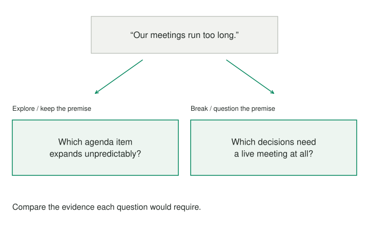

Reframing does not always mean abandoning the current account. Sometimes it is broadly right but incomplete: a closer look inside its boundary reveals a neglected factor. At other times, the boundary itself keeps the problem stuck.

## Core idea

Explore or Break distinguishes those two moves so that “more analysis” is not mistaken for a new frame.

Exploration changes the detail inside a question; breaking changes a premise of the question. Distinguishing them makes the next inquiry more deliberate.

## When to use it

The cue for exploring is unexplained variation: some users succeed, some cases fail, or the problem clusters in one step. The cue for breaking is repeated failure of sensible interventions within the current frame, or a goal that nobody can explain beyond “that is what we have always measured.” When uncertain, try one modest exploration and one genuinely different frame, then compare what evidence each would require.

## How it works

To **explore**, keep the basic goal and ask which cases, times, users, or steps differ. “People are not adopting the product” might become “New users cannot find one useful feature after signup.” Adoption remains the goal; the investigation becomes more precise. A learning example works similarly: “I struggle with mathematics” might become “I can follow worked examples but cannot choose a method for a new problem.” That is a deeper account within the same broad frame.

To **break**, question a premise that defines the current goal or problem. “How do we get more people to adopt this feature?” might become “Does the user need this feature, or can the underlying task disappear?” The answer could make adoption irrelevant. “How do I study longer every night?” might become “What evidence would show that the learning method, rather than study duration, is the constraint?” The new question changes what success means.

When uncertain, compare one modest exploration with one genuinely different frame. Choose a next observation that could distinguish their usefulness.

## Worked examples



Consider a team concerned about meetings. Exploring “Our meetings run too long” could identify a particular agenda section that expands unpredictably. Breaking it could ask why decisions must be made synchronously at all. Both are useful; neither is automatically more profound.

Suppose the team notices that routine status reports consume most of the meeting, leaving decisions until the final minutes. An exploration keeps the meeting as the setting and asks which reports need discussion. The team might collect brief updates beforehand, then use the agenda to identify exceptions and unresolved questions. The change addresses a specific source of delay while preserving the live conversation.

A different frame asks, “Which decisions require us to be together at the same time?” That opens another arrangement: written updates and comments for routine coordination, with a shorter live session for issues that need negotiation. It changes the premise that all coordination belongs in one meeting.

The team could try either arrangement for a limited period and ask whether decisions are clearer, whether important concerns surface, and whose participation becomes harder. A shorter meeting that moves unresolved work into private messages may be no improvement. The comparison should reveal which account better serves the actual coordination need.

## Pitfalls and limits

A common mistake is to call a narrower description a radical reframe. “The feature is hard to find” may be a valuable discovery, but it still assumes feature adoption is the right objective. The opposite mistake is to break the frame theatrically when the present goal is clear and a missing detail is all that matters. [[reframing-look-outside-frame]] is a useful exploration of context; [[reframing-rethink-goal]] is a common way to break a frame. [[reframing-validate-frame]] can tell whether either move helps in practice.

## Related patterns

[[reframing-look-outside-frame]] explores omitted context. [[reframing-rethink-goal]] questions the target that defines the current frame.

## Sources and attribution

Inspired by Thomas Wedell-Wedellsborg's *What's Your Problem?* This is an original Patternverse procedure, not reproduced book text or an official implementation.

## Executable Pattern Markdown

```text
:language 1
:title "Explore or Break the Frame"
:input frame text
:output candidate_frame

type Move = explore | break | uncertain
classifier move -> Move {
    :case explore "The current frame is useful but likely omits nearby context or variation."
    :case break "The frame itself appears to lock in a goal, cause, or solution."
    :fallback uncertain
}
move = frame ?~ move
?match move {
  :case explore {
    finding = !use reframing.look-outside-frame {
        :with frame
    }
    candidate_frame = finding.candidate_frame
    -> end
  }
  :case break {
    finding = !use reframing.rethink-goal {
        :with frame
    }
    candidate_frame = finding.candidate_frame
    -> end
  }
  :case uncertain {
    direction = !choose {
        :option explore "Explore what may be missing"
        :option break "Question the frame itself"
        Which direction seems more useful for {{frame}}?
    }
    ?match direction {
      :case explore {
        finding = !use reframing.look-outside-frame {
            :with frame
        }
        candidate_frame = finding.candidate_frame
        -> end
      }
      :else {
        finding = !use reframing.rethink-goal {
            :with frame
        }
        candidate_frame = finding.candidate_frame
        -> end
      }
    }
  }
}
```
