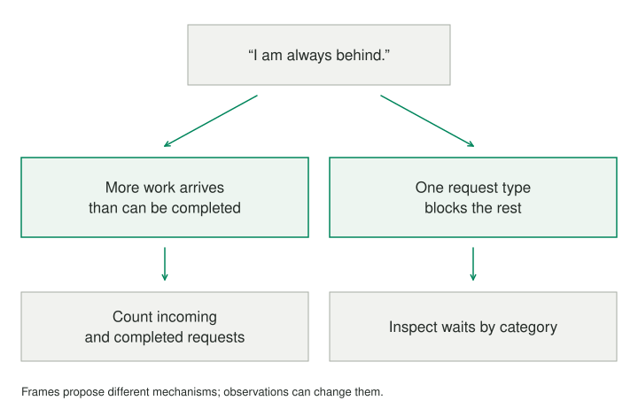

A difficult problem often feels like a demand for a better answer.

## Core idea

Rapid Reframe asks whether the question itself is helping. A frame is the short account of what is wrong, who or what is involved, and what improvement would count. It directs attention before any solution is proposed. If the frame is “I am not productive enough,” calendars and discipline become obvious remedies. If the frame is “more work arrives than one person can finish,” capacity, priority, and expectations become visible instead.

The short cycle connects a changed question to a different observation. That keeps alternative accounts useful and open to correction.

## When to use it

Use Rapid Reframe when discussion circles around the same failed remedies, when someone arrives with a strongly worded diagnosis, or when several plausible causes compete.

## How it works

The move is deliberately brief. State the concern in provisional language, inspect the frame for a consequential assumption, and generate a few alternatives that differ in *theory*, not just wording. Then choose one worth checking. The aim is neither to declare the “real” problem nor to produce the longest possible list. Several frames may explain different parts of the situation. A useful frame changes what you would look for next.

## Worked examples



> **Problem:** “I’m always behind at work.”  
> **First interpretation:** “I need to become more productive.”

A quick review might notice that “behind” has no clear reference point. Behind a fixed commitment, an expanding queue, or other people’s expectations? Several genuinely different frames become possible:

- Work enters the queue faster than it can be completed.
- “Caught up” means an empty queue that this role never has.
- One class of request repeatedly blocks the rest.
- Urgent interruptions displace work that matters more.
- The role contains incompatible promises about speed and quality.

These are not five productivity tips. Each proposes a different mechanism. A one-week tally of incoming and completed requests could test the first; a look at the backlog by category could test the third. The person might select two hypotheses, learn which has support, and reframe again. An attractive reframe without evidence remains a hypothesis.

The same move works outside work. “We keep arguing about chores” could be about unequal labor, but also about invisible planning work or different standards for when a task is finished. “Nobody uses our dashboard” could be a discoverability issue, a mismatch with the decision users need to make, or evidence that the dashboard solves a task already handled elsewhere. In each case, a new frame opens a different investigation; it does not yet prescribe the fix.

## Pitfalls and limits

It is less useful when the problem is already narrow and well evidenced—then execution or validation may be more valuable. Stop after a small set of meaningful alternatives. Endless reframing can become a sophisticated form of postponement.

## Related patterns

[[reframing-frame-problem]] helps articulate the first provisional statement; [[reframing-review-frame]] finds a promising place to question it. [[reframing-generate-real-options]] distinguishes conceptually different candidates, and [[reframing-validate-frame]] returns the exercise to the world.

[[reframing-review-frame]] · [[reframing-generate-real-options]] · [[reframing-validate-frame]]

## Sources and attribution

Inspired by Thomas Wedell-Wedellsborg's *What's Your Problem?* This is an original Patternverse procedure, not reproduced book text or an official implementation.

## Executable Pattern Markdown

```text
:language 1
:title "Rapid Reframe"
:output selected_frame
:output validation_plan

type Strategy = outside | goal | tradeoff | general
classifier strategy -> Strategy {
    :case outside "The frame may omit context, time, systemic influences, or overlooked resources."
    :case goal "The immediate goal or its causal logic may deserve reconsideration."
    :case tradeoff "An either-or choice is central to the frame."
    :fallback general
}
problem = !ask {
    What problem feels stuck? A short, provisional description is enough.
}
framed = !use reframing.frame-problem {
    :with problem
}
reviewed = !use reframing.review-frame {
    :with frame = framed.frame
}
strategy = framed.frame ?~ strategy
?match strategy {
  :case outside {
    lens = !use reframing.look-outside-frame {
        :with frame = framed.frame
    }
    additional = lens.candidate_frame
  }
  :case goal {
    lens = !use reframing.rethink-goal {
        :with frame = framed.frame
    }
    additional = lens.candidate_frame
  }
  :case tradeoff {
    lens = !use reframing.break-tradeoff {
        :with frame = framed.frame
    }
    additional = lens.candidate_frame
  }
  :case general {
    additional = framed.frame
  }
}
observations = concat(reviewed.candidate_frame, concat(" Another possibility: ", additional))
alternatives = !use reframing.generate-real-options {
    :with frame = framed.frame
    :with observations
}
selected_frame = alternatives.selected_frame
validation = !use reframing.validate-frame {
    :with frame = selected_frame.label
}
validation_plan = validation.validation_plan
!show {
    You selected one frame to test: {{selected_frame.label}}

    {{validation_plan}}

    What you learn can change the frame again. There is no need to generate more possibilities right now.
}
-> end
```
