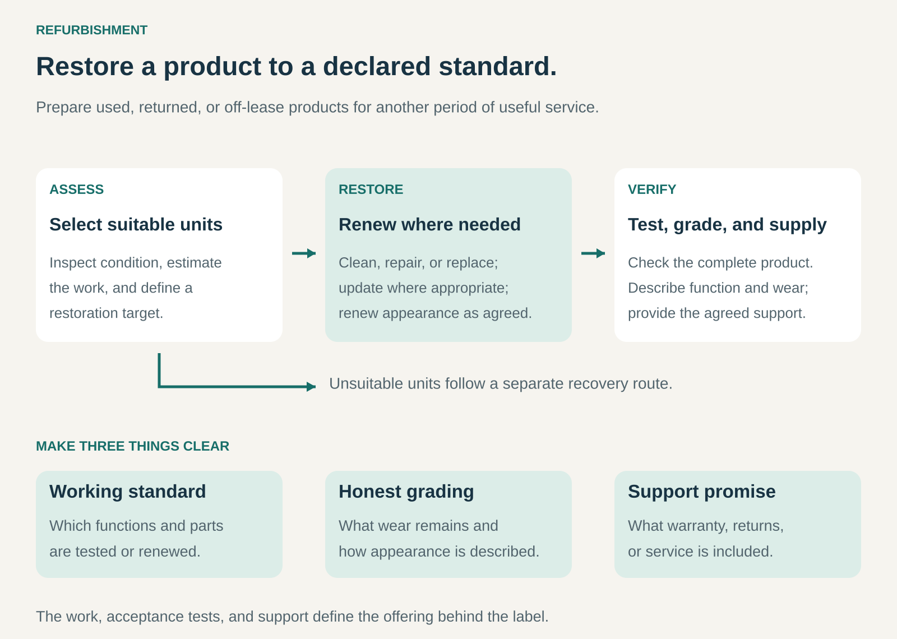

## What it is for

Refurbishment restores used, returned, or previously leased products to a defined condition so they can provide another period of useful service.

It is useful when a product retains substantial value, but wear, faults, missing components, or uncertainty about its condition make further use difficult.

A business creates value by assessing the product, completing appropriate restoration work, and verifying the result. It can then sell the refurbished product, return it to its owner, or redeploy it within a rental or service fleet.

## The core idea

**Turn a product with an uncertain or deteriorated condition into a verified offering with a clearly described standard.**

The work can include cleaning, testing, repairs, component replacement, software preparation, cosmetic renewal, and final inspection.

The scope varies. Some products need limited intervention; others require extensive work. Refurbishment does not universally mean that every component is new or that all signs of use disappear.

Commercial arrangements include:

- **Refurbish and resell:** acquire products, restore them, and earn a margin on their sale.
- **Refurbish for a customer:** charge to restore a product the customer already owns.
- **Refurbish for another business:** process returned products on behalf of a manufacturer, retailer, or leasing company.
- **Refurbish and redeploy:** restore products for another rental or service cycle.

The defining activity is restoring and verifying condition. Resale is one possible route for the resulting product.

## How it works

The process connects five elements.

**Selection.** Incoming products are identified and inspected. The business estimates the work required, likely remaining usefulness, and whether restoration is commercially sensible.

**A restoration target.** The provider defines the required functionality, acceptable wear, component condition, configuration, and supporting documentation.

**Appropriate intervention.** Cleaning, repair, replacement, adjustment, or updates bring the product toward that target. Some components can remain in service; others need renewal.

**Verification and grading.** Final checks assess the complete product against the agreed criteria. Cosmetic condition is described separately where it differs from functional performance.

**A supported route back into use.** Packaging, accessories, installation, warranty, returns, and service arrangements complete the offering.

Products that cannot meet the target need another route, such as parts recovery, return to the supplier, or recycling. Their costs remain part of the operation’s economics.

## Why it works

A product can retain much of its useful structure while a smaller set of problems prevents its next use.

Replacing selected components and verifying the assembled product can preserve value that would otherwise be lost. A functioning enclosure, frame, display, or other substantial component may not need to be manufactured again.

Refurbishment also addresses uncertainty. A prospective buyer may struggle to judge an unfamiliar used product. A documented process, clear condition description, and credible support promise make the offering easier to evaluate.

Repeated product types can improve efficiency. Familiar inspection routines, component inventories, work instructions, and test procedures help turn variable incoming stock into more consistent outputs.

The opportunity depends on the gap between restoration cost and the value of the resulting product. Technical feasibility alone does not establish an attractive business.

## Famous examples

### Apple Certified Refurbished — restoration backed by a manufacturer’s program

Apple’s Certified Refurbished program includes functional testing, cleaning, inspection, and genuine replacement parts where needed. Products are supplied with accessories and operating systems, repackaged, and backed by a one-year limited warranty. [Apple’s refurbishment promise](https://www.apple.com/shop/refurbished/about).

The example demonstrates how refurbishment combines physical work with a defined commercial offering. The customer receives a product that has passed a stated process, together with documentation and support from the manufacturer.

The precise restoration steps depend on the product. A requirement specified for one device category should not be assumed to apply to every refurbished Apple product—or to other refurbishers.

### Dell Refurbished — preparing off-lease computers for another owner

Dell Refurbished offers computers returned by corporate leasing customers. Its process includes selecting suitable units, testing components, repairing or replacing components that fail its requirements, wiping previous users’ data, restoring settings, and assigning a cosmetic grade. [Dell’s refurbishment process](https://www.dellrefurbished.com/buy-refurbished-computer).

Its grading distinguishes appearance from function: products with different cosmetic grades can provide the same functionality and performance. [Dell Refurbished FAQ](https://www.dellrefurbished.com/faq).

This illustrates how a leasing operation can provide a recurring source of products for refurbishment. The restoration process prepares equipment for a different customer while making remaining wear visible rather than treating every unit as identical.

### Philips Circular Edition — restoring complex equipment

Philips offers Circular Edition refurbished medical imaging systems. Its stated process includes cleaning and disinfection, performance and safety checks, cosmetic renewal, and component work appropriate to the system.

Philips also distinguishes this offering from its Select Edition serviced systems, which have a different preparation scope. Circular Edition systems come with a same-as-new warranty under the program. [Philips’ circular equipment portfolio](https://www.usa.philips.com/healthcare/advantage/refurbished-systems).

The example shows refurbishment applied to complex, valuable equipment. Selection, technical procedures, configuration, testing, and continuing support are integral to the offering. The condition promise rests on the specific program rather than the word “refurbished” alone.

## The economics

The acquisition discount must cover the complete restoration and selling process.

Consider an illustrative laptop bought for refurbishment and resale:

| Per laptop sold                            |  Amount |
| ------------------------------------------ | ------: |
| Realized selling price                     |    $400 |
| Acquisition cost                           |   −$180 |
| Replacement parts                          |    −$55 |
| Restoration labor                          |    −$45 |
| Diagnostics, testing, and data preparation |    −$20 |
| Shipping and payment costs                 |    −$30 |
| Expected warranty and return costs         |    −$25 |
| Allocated cost of rejected units           |    −$15 |
| **Remaining contribution**                 | **$30** |

These hypothetical figures leave $30 before shared overhead, equipment, financing, and tax.

An unexpected additional $45 repair would turn that contribution into a $15 loss. Accurate intake assessment and limits on work therefore matter alongside technical skill.

For customer-owned products, the calculation uses the service fee rather than a resale price and acquisition cost. For an internal fleet, the benefit may come from avoiding replacement expenditure and enabling another revenue-producing period of use.

## Useful when

- Products retain substantial value after their initial use or return.
- Common faults and wear can be addressed at manageable cost.
- Suitable parts, information, tools, and skills are available.
- A meaningful restoration standard can be defined and tested.
- Customers value a verified condition and support arrangement.
- Supply volume supports efficient processing without excessive inventory.

The pattern is particularly attractive for durable products with identifiable models and established demand.

## Common mistakes and limits

**Using the label without defining the work.** Buyers need to understand what was inspected, restored, tested, and promised.

**Confusing appearance with performance.** A clean exterior does not establish functionality. Visible wear does not necessarily indicate poor operation.

**Restoring every incoming unit.** Some products cost more to restore than their likely value supports. Early assessment helps avoid committing further resources.

**Underestimating remaining wear.** Correcting an immediate fault may leave other components close to failure. The restoration scope needs to fit the promised condition.

**Ignoring rejected stock and repeat work.** Failed inspections, parts recovery, unsuccessful repairs, returns, and warranty claims all consume resources.

**Renewing beyond what customers value.** Cosmetic improvements or upgrades can increase cost without producing a corresponding increase in price or usefulness.

**Overlooking supportability.** Parts, software, documentation, and service access influence how useful the product will remain after refurbishment.

**Assuming environmental benefit from restoration alone.** The result also depends on processing, transport, operating efficiency, and what purchase or disposal the refurbished product actually replaces.

## Related patterns

- [[repair-and-maintenance|Repair and Maintenance:]] supplies many of the technical activities used during refurbishment; refurbishment organizes them around a defined restoration target.
- [[resale|Resale / Recommerce:]] provides a commercial route for refurbished products, while also including products sold without extensive restoration.
- [[remanufacturing|Remanufacturing:]] generally involves a more comprehensive industrial restoration process with specified performance requirements; terminology and scope vary by industry.
- [[product-as-a-service|Product as a Service:]] can use refurbishment between customer deployments to support repeated use of provider-owned products.
