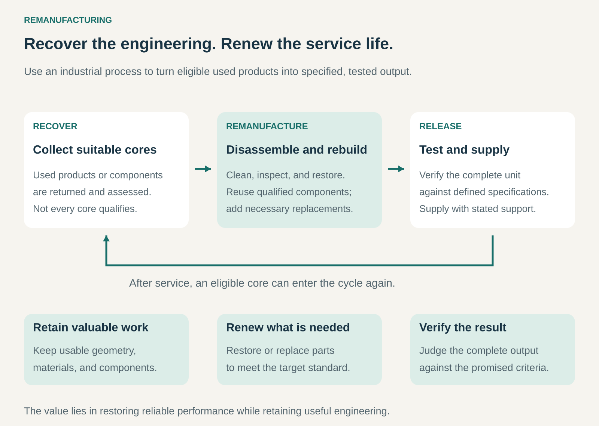

## What it is for

A worn-out product can still contain expensive, precisely engineered components with years of useful life remaining. Replacing the entire product means paying again for materials, machining, and assembly that may still be perfectly serviceable.

Remanufacturing turns that remaining value into another marketable product. A business takes back used equipment or components, restores them through a controlled industrial process, and supplies them against defined performance and quality standards.

It is useful when customers need reliable replacements at a lower cost, and when recovering existing engineering costs less than producing everything again.

## The core idea

**Recover the useful engineering, renew what has deteriorated, and verify the complete result.**

The input is often called a _core_: a used engine, alternator, printer, or other product that contains components suitable for recovery.

The core is an input to production. It is disassembled, cleaned, inspected, restored, and reassembled using a combination of qualified reused components and necessary replacements. The finished product must meet the program’s specified requirements.

The Remanufacturing Industries Council describes remanufacturing as a controlled, reproducible industrial process that returns a previously used product to a condition equivalent to, or better than, its condition when new in quality and performance. That describes the restoration target; it does not mean every component becomes newly manufactured. [Remanufacturing Industries Council: Reman 101](https://remancouncil.org/reman-101/)

The distinction from neighboring patterns lies in the scope and promise:

- **Repair** addresses faults and restores functionality.
- **Refurbishment** prepares a used product for further use against a declared condition standard.
- **Remanufacturing** uses a repeatable industrial process to deliver a specified product standard.
- **Material recycling** recovers substances after much of the product’s existing structure has been lost.

Industry terminology overlaps. The process, acceptance criteria, and support commitments reveal more than the label alone.

## How it works

The business connects two supply chains: customers buying replacement products and customers returning used ones.

**Recover suitable cores.** Returns can come through dealers, service contracts, fleet replacement programs, purchases from independent collectors, or exchange arrangements. Identification and condition checks determine which cores can enter the process.

**Disassemble and assess.** Cleaning and inspection reveal wear, cracks, corrosion, contamination, and dimensional changes that may be hidden in an assembled product. Components are accepted, restored, replaced, or rejected according to defined criteria.

**Restore and rebuild.** Recoverable parts may be machined, resurfaced, recoated, or otherwise restored. Components designated for mandatory replacement are renewed. Approved engineering updates may also be incorporated.

**Test and release.** The complete product is checked against its release specifications. Traceability, documentation, and an explicit warranty or service commitment make the offering credible.

Many businesses operate an exchange pool. A customer receives an available remanufactured unit and returns the old one, which becomes an input for a later order. The customer therefore need not wait for their particular unit to complete the factory process.

A core deposit or credit helps close this loop. Its return conditions matter: a missing, incompatible, or severely damaged core may have a different credit value.

## Why it works

Manufacturing creates value in several layers. Raw material becomes a casting, the casting becomes a precisely machined housing, and that housing becomes part of a tested assembly.

If the housing remains suitable, remanufacturing can retain those earlier layers of work. The business spends money restoring the finished product’s capabilities while preserving qualified components.

The second mechanism is repeatability. A workshop encountering unrelated repairs has to diagnose a different problem each time. A remanufacturing operation handling recurring product families can develop dedicated tooling, inspection limits, replacement rules, and test procedures.

The third mechanism is customer confidence. Used equipment carries uncertainty about its history and remaining life. A defined production process and verified output reduce that uncertainty.

The strongest businesses combine economical recovery with a dependable product promise. Cheap cores alone do not create an attractive offer.

## Famous examples

### Caterpillar — an exchange system for valuable machinery components

Cat Reman recovers used engines and components, restores suitable parts, and reassembles products to match Caterpillar’s original-equipment performance specifications.

The commercial loop is central. Customers purchase remanufactured replacements and return used components through the core system. Deposits and core credits encourage those returns, while inspection determines the applicable credit.

For equipment owners, an available exchange component can provide a replacement without waiting for their own component to be restored. For Caterpillar, the returned core supplies material for another production cycle.

This example shows that remanufacturing depends on organizing returns as well as factory work. The recovery network helps make repeat production possible. Warranty terms vary by model and application. [Cat Reman process](https://www.cat.com/en_US/products/new/parts/reman/the-remanufacturing-process.html), [Caterpillar’s exchange model](https://www.caterpillar.com/en/company/sustainability/remanufacturing/benefits.html)

### Bosch eXchange — standardized automotive component recovery

Bosch’s remanufactured starters and alternators undergo an industrial process in which components are inspected, specified critical parts are replaced, and the completed units receive performance and functional testing against original-equipment standards.

A car owner may need a dependable replacement alternator without choosing the most expensive new-part option. Workshops can offer an exchange unit backed by a defined production process.

Bosch also supports core returns through CoremanNet. The return channel supplies future production, while the workshop installs the replacement.

A useful qualification: the broader eXchange range can include new products to support availability. An exchange product is therefore not automatically a remanufactured product; the particular offering matters. [Bosch eXchange starters and alternators](https://www.boschaftermarket.com/xrm/media/images/services/programs/bosch_exchange/en_8/bosch_exchange_starters_alternators_brochure.pdf)

### Canon — using operating history to recover office equipment

Canon remanufactures used multifunction printers, including imageRUNNER ADVANCE devices sold under its Refreshed brand in Japan and ES brand in Europe.

The process uses operating information such as years in service, breakdown history, and pages printed to help determine component reuse. Suitable parts are cleaned and retained; worn or deteriorated parts are replaced.

Canon describes production and inspection processes comparable to those used for devices assembled entirely from new parts, with remanufactured devices guaranteed to provide the same level of quality.

This example highlights the value of product information. Two printers of the same age can have very different histories. Usage data helps the manufacturer make more informed recovery decisions. [Canon: remanufacturing multifunction devices](https://global.canon/en/sustainability/environment/resource-efficiency/remanufacturing/)

## The economics

Consider a hypothetical operation that acquires 100 used industrial components. After inspection and processing, 90 become saleable remanufactured units.

| Item                                                                             |      Amount |
| -------------------------------------------------------------------------------- | ----------: |
| Sales: 90 units × €1,800                                                         |    €162,000 |
| Acquisition of all 100 cores                                                     |    −€30,000 |
| Collection and initial sorting                                                   |     −€6,000 |
| Restoration labor and replacement parts                                          |    −€70,000 |
| Final testing                                                                    |     −€8,000 |
| Selling, outbound delivery, and expected warranty costs                          |    −€18,000 |
| Net handling and disposal costs for rejected material                            |     −€2,000 |
| **Contribution before other overhead, equipment investment, financing, and tax** | **€28,000** |

These are illustrative figures, not an industry benchmark.

The calculation includes the acquisition cost of unsuccessful cores. Ignoring those units would make the operation look more profitable than it is.

An unexpected €30,000 of additional parts and rework would turn the contribution into a €2,000 loss, even with the same sales.

Core deposits also require careful treatment. A refundable deposit brings in cash but creates a potential repayment obligation. It should not be treated as product margin merely because the customer has paid it.

Working capital can be substantial: money sits in returned cores, inspected components, production, and finished exchange stock before a sale occurs.

## Useful when

- **Products retain substantial engineered value.** Housings, frames, assemblies, or other durable components remain recoverable.
- **There is a large installed base.** Enough compatible products enter the return stream to support repeatable operations.
- **Demand outlasts the first service life.** Customers still need the product’s capabilities.
- **Returns can be organized.** Dealers, contracts, deposits, or retained ownership provide access to cores.
- **Performance can be verified.** Reliable inspection and testing support a credible release standard.
- **Customers value availability and lifecycle cost.** An exchange replacement can be commercially attractive alongside new products.

## Common mistakes and limits

**Treating every return as usable inventory.** Recovery rates vary. Damage, missing parts, contamination, and incompatible versions can destroy the expected margin.

**Confusing restoration with modernization.** Meeting the requirements of an older product does not automatically provide the efficiency, security, or capabilities of a current design. Updates must be specified.

**Underestimating return logistics.** Heavy cores cost money to collect, identify, transport, and store. A distant or fragmented return stream can erase production savings.

**Assuming repeated recovery is unlimited.** Fatigue, corrosion, dimensional limits, and previous restoration work can eventually make components unsuitable.

**Selling a strong promise without the testing to support it.** Reliable output requires validated processes, traceability, and realistic warranty provisions.

**Assuming environmental savings are automatic.** The result depends on what the remanufactured product replaces, processing and transport requirements, and performance during use. Retaining more material does not by itself establish the full environmental benefit.

## Related patterns

- [[refurbishment|Refurbishment:]] Restores used products to a declared condition; the scope may overlap, but the industrial process and output promise distinguish remanufacturing.
- [[guaranteed-buyback|Guaranteed Buyback:]] Can secure future returns, although remanufacturing programs also use deposits, trade-ins, and other collection arrangements.
- [[product-as-a-service|Product as a Service:]] Retained ownership can give the provider access to equipment and usage records across successive service lives.
- [[waste-to-value|Waste-to-Value / Trash-to-Cash:]] The broader recovery pattern; remanufacturing specifically preserves and restores useful product engineering.
