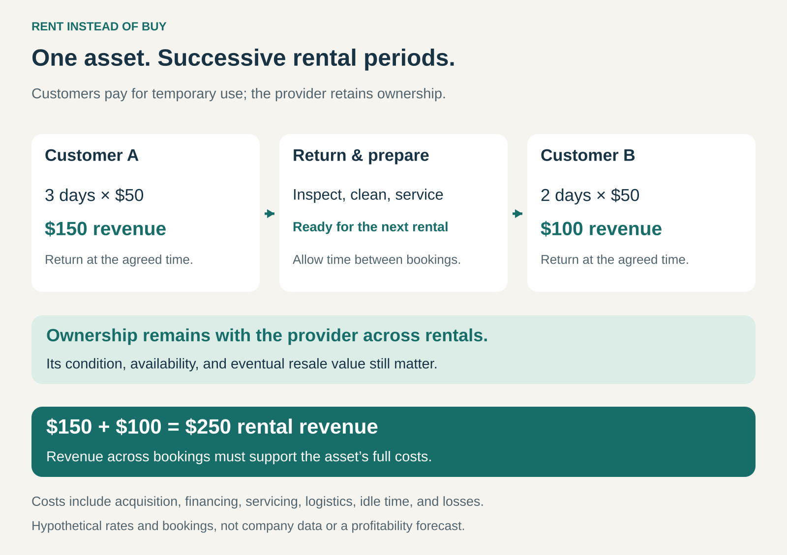

## What it is for

Give customers temporary use of an asset for an agreed fee, while ownership remains elsewhere. Renting helps customers meet a short-lived need without purchasing, storing, and eventually selling the equipment themselves.

A homeowner needs a machine for one weekend. A traveler needs a car for five days. A contractor needs additional equipment while a particular project is underway.

The need is real, but its duration does not justify permanent ownership.

A rental business supplies the asset for that period, takes it back, and prepares it for another customer.

## The core idea

Sell a period of use rather than the asset itself.

The agreement identifies the equipment or asset category, rental period, price, permitted use, and return conditions. The customer normally controls the asset during the rental and returns it afterward.

This is a specific implementation of **Access over Ownership**. The broader pattern also includes digital catalogs and shared memberships. Renting centers on temporary use of an asset with a defined handover and return.

A rental can last hours, days, weeks, or longer. Its defining feature is the temporary transfer of use, rather than its duration.

Payment does not gradually create ownership unless the agreement explicitly includes a purchase arrangement.

## How the rental cycle works

In this hypothetical example, one asset serves two successive customers.

The first rents it for three days at $50 per day, generating $150. After inspection, cleaning, and any necessary servicing, a second customer rents it for two days, generating another $100.

The provider collects $250 across those bookings while retaining ownership.

That amount is revenue before costs. The business must fund the asset, prepare it between customers, manage unavailable periods, and eventually repair, replace, or sell it.

The operational cycle is therefore central to the model:

**Reserve → hand over → use → return → inspect and prepare → rent again.**

## Why it works

Renting matches the customer’s commitment to the duration of the need.

Someone can complete an occasional project without paying for years of unused capacity. A business can add equipment for a temporary workload without permanently expanding its fleet.

The provider creates value by serving many such needs from a managed inventory. It brings together assets, local availability, maintenance, reservations, and handover procedures.

The customer may also gain access to equipment that would be difficult to justify buying for occasional use.

These advantages depend on reliability. The appropriate asset must be available, functional, and obtainable when needed. A low rental rate provides little benefit if a project stops while the customer waits for equipment.

Renting therefore sells dependable temporary possession as much as it sells time.

## Famous examples

### Hertz: a vehicle for a journey

Hertz supplies vehicles through reservations with agreed collection and return arrangements. Its rental guidance explains that return dates and times appear on the booking documents, that late returns may create additional charges, and that returning elsewhere depends on the vehicle and route. [Hertz’s rental guide](https://www.hertz.com/rentacar/misc/simpleIndex.jsp?targetPage=rentalGuide.jsp).

The customer obtains a vehicle for a journey without acquiring a car at the destination.

The example also shows why the return is part of the product. Location, timing, vehicle condition, and preparation affect the provider’s ability to serve the next reservation.

Fleet availability and the movement of vehicles between locations are commercial concerns alongside the rental price.

### The Home Depot: equipment for a project

The Home Depot offers tool rentals in four-hour, daily, weekly, and monthly periods. Its US guidance describes a range from smaller tools to larger machinery and directs customers to local availability and pricing. [The Home Depot’s tool rental guidance](https://www.homedepot.com/c/Tool_Rental_FAQ).

The arrangement lets someone obtain equipment for a particular job without keeping it afterward.

For the business, a rental center adds another way to serve customers whose projects do not justify an equipment purchase.

Temporary use still comes with responsibilities. The same guidance sets out requirements concerning proper use, care, returns, and damage. Avoiding ownership does not mean avoiding responsibility for the rented item.

### United Rentals: capacity for construction and industrial work

United Rentals offers equipment across categories including earthmoving, aerial work platforms, and material handling. Its booking guidance presents daily, weekly, and monthly rates, with “monthly” defined there as 28 days, alongside delivery and collection options. [United Rentals’ equipment marketplace](https://www.unitedrentals.com/marketplace/equipment).

A contractor can obtain equipment for a project stage or temporary workload instead of buying every machine required across all possible jobs.

The provider needs a fleet suited to the demand in each location, together with transport, servicing, and scheduling.

This illustrates a central distinction: customers can reduce their exposure to idle equipment, while the rental business takes on the task of managing that exposure across its customer base.

## The economics

For the customer, the useful comparison is the full cost of renting against the realistic cost of ownership over the relevant period.

Rental costs can include the time charge, delivery, collection, consumables, additional usage, and other agreed fees.

Ownership involves the purchase price less eventual resale proceeds, alongside financing, maintenance, storage, and administration.

Repeated rentals can eventually cost more than owning suitable equipment. Occasional use can make ownership expensive relative to the benefit received.

For the provider, profitability depends on the asset’s working life. Rental income and eventual resale proceeds must support acquisition, financing, maintenance, logistics, overhead, and losses.

Two measures matter together: **what an asset earns while rented and how much of its available time it earns anything at all.**

High demand can improve utilization, but accepting bookings without adequate preparation time or backup capacity can undermine service reliability.

## Useful when

This pattern is especially useful when:

- **The need has a clear duration:** a trip, event, project, or temporary workload.
- **Use is occasional:** ownership would leave the asset idle for long periods.
- **Equipment is expensive or specialized:** temporary use makes the capability practical.
- **Requirements vary:** customers need different equipment for different jobs.
- **A provider can manage repeated use efficiently:** inspection, maintenance, logistics, and booking processes support dependable service.

Buying can become more attractive when use is continuous, equipment requires extensive customization, or immediate availability is essential.

## Common mistakes and limits

**Comparing only the headline rate.** Delivery, collection, consumables, additional time, and other charges can materially change the total.

**Assuming rental periods follow ordinary calendar units.** A “day,” “week,” or “month” needs a contractual definition. Included usage and return deadlines also matter.

**Ignoring delays in the customer’s project.** An asset may continue incurring rental charges while waiting for materials, approvals, or other work to finish.

**Underestimating preparation time.** Inspection and servicing are part of making the next rental possible. Scheduling every asset continuously can create fragile operations.

**Treating maintenance as entirely the provider’s problem.** Customers may still need to perform routine checks, use the asset correctly, and report faults promptly.

**Keeping unsuitable assets too long.** A fleet can generate bookings while becoming increasingly costly to maintain. Replacement and disposal decisions belong within the rental model.

## Related patterns

- [[access-over-ownership|Access over Ownership:]] the broader pattern; renting is one concrete way to provide temporary usage rights.
- [[pay-per-use|Pay per Use:]] can charge for actual consumption. Rental commonly charges for an agreed possession period, which may include idle time.
- [[subscription|Subscription:]] can organize recurring rentals or provide continuing rental benefits, while individual rentals can also stand alone.
- [[outright-sale|Outright Sale:]] transfers ownership. A rental provider may eventually sell used assets as a separate transaction.
