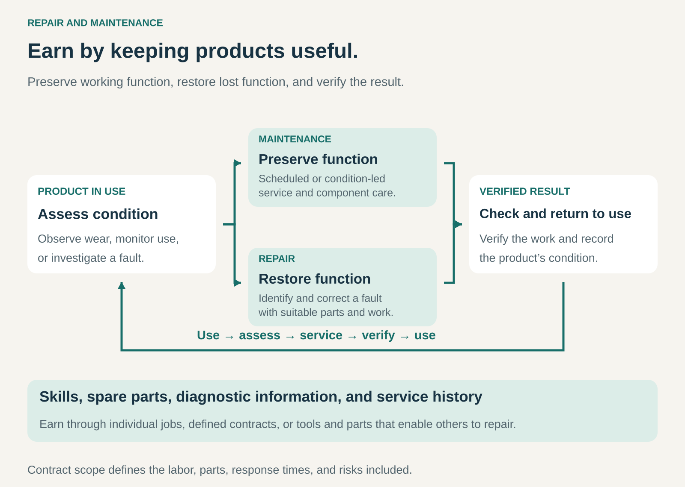

## What it is for

Repair and Maintenance creates value by keeping products and equipment useful for longer.

It is useful when wear, damage, or faults can be addressed more economically than replacing the entire product—and when reliable operation matters to the customer.

A business can provide the work directly, maintain equipment under contract, or supply the parts, tools, and knowledge that enable others to do it. The customer gains continued use; the provider earns from the capabilities needed to preserve or restore that use.

## The core idea

**Earn revenue by preserving working function, restoring lost function, or enabling someone else to do so.**

The two activities are complementary:

- **Maintenance** preserves condition and performance through inspection, servicing, adjustment, and appropriate component replacement.
- **Repair** investigates and corrects a fault or damage that has impaired function.

Maintenance can follow time or usage schedules, observed condition, or information from monitoring systems. Repair responds to a particular problem, whether discovered during an inspection or reported after a failure.

Commercial arrangements include individual jobs, labor and parts charges, defined maintenance contracts, and sales of repair tools and replacement components. Some services are included in a product purchase or warranty, with their cost supported by the wider business.

The customer can retain ownership throughout. The offering is continued usefulness and the work that supports it.

## How it works

The process connects five elements.

**Assessment.** The provider identifies the product, its condition, service history, and reported symptoms. Good diagnosis helps distinguish the underlying problem from its visible effects.

**A suitable intervention.** The work might involve cleaning, adjustment, servicing, replacing a worn component, or correcting a fault. Its scope should fit the equipment’s condition and the customer’s needs.

**Access to capabilities.** Technicians need suitable skills, information, tools, and parts. Availability often determines whether a straightforward job can be completed promptly.

**Verification.** Completing the work is followed by checks that the relevant function has been restored or maintained. Records establish what was done and what remains unresolved.

**Continued support.** Service history, follow-up, parts availability, and future maintenance arrangements support another period of use.

The work may happen at the customer’s location, in a workshop, through remote support, or through a combination of these routes.

## Why it works

A product can lose function because one component wears out while much of the remaining system still has useful life.

Repair preserves that remaining value. Maintenance can identify deterioration, manage wear, and reduce selected risks before they lead to disruption.

Customers may also value avoiding the inconvenience of replacement: selecting another product, arranging installation, transferring information, retraining users, or interrupting operations.

Specialist providers can develop advantages through repeated experience. Familiar faults, well-stocked parts, effective diagnostic tools, and efficient scheduling can improve both turnaround and cost.

These benefits depend on the product and the intervention. Maintenance cannot prevent every failure, and continued repair eventually becomes less attractive when remaining life, performance, or parts availability no longer justifies the work.

## Famous examples

### KONE — maintaining an installed base of equipment

KONE provides maintenance and repair for elevators, escalators, and other building equipment, including equipment from other manufacturers.

Its U.S. maintenance packages illustrate how contract scope changes the commercial arrangement. Different packages include different combinations of preventive work, service calls, spare parts, and major repairs. [KONE’s maintenance packages](https://www.kone.com/en-us/maintenance-service/elevator-maintenance.html).

Its repair offering covers planned component replacements and fault repairs, supported by technicians, service records, and a spare-parts network. [KONE’s repair services](https://www.kone.com/en-us/maintenance-service/repairs.html).

This illustrates a continuing service business built around equipment already in use. Customer value depends on appropriate maintenance and effective repairs, while provider economics depend on workload, coverage, response commitments, and delivery efficiency.

### Apple — a repair network supporting products after purchase

Apple provides repair services through its own locations, mail-in arrangements, and Apple Authorized Service Providers. Its iPhone service offering includes repairs and battery replacement, with inspection used to determine the final service estimate.

The payment arrangement depends on the situation and applicable coverage. Out-of-warranty service can involve a repair charge; service under an AppleCare plan follows the relevant plan terms. [Apple’s iPhone service and repair options](https://support.apple.com/iphone/repair).

The example shows repair as an organized service system. Customer intake, diagnosis, parts, technicians, logistics, and communication all contribute to the experience. The business needs more than the technical ability to replace a component: it must make the complete service understandable and accessible.

### iFixit — enabling repair through parts, tools, and knowledge

iFixit combines free repair instructions and troubleshooting resources with sales of replacement parts and tools.

Its FAQ explicitly distinguishes its role from a repair company performing jobs for customers. It explains that parts sales help fund the infrastructure and development behind its freely available information. [iFixit’s business model and services](https://www.ifixit.com/Info/FAQ).

The company also works with manufacturers on repair documentation, parts distribution, and repairability assessments. [iFixit’s partnerships](https://www.ifixit.com/Info/Our_Partnerships).

This demonstrates another way to participate in the pattern. The customer or an independent technician performs the repair, while iFixit earns from the resources that make successful repair possible.

## The economics

Individual repairs depend on diagnosis, labor time, parts, and the likelihood of additional work. Maintenance contracts add another challenge: predictable revenue must cover an uncertain service workload.

Consider an illustrative annual contract portfolio covering 50 machines:

| Annual activity                          |      Amount |
| ---------------------------------------- | ----------: |
| Fifty contracts at $1,200                |     $60,000 |
| Scheduled maintenance labor and travel   |    −$20,000 |
| Unscheduled repair labor and travel      |    −$10,000 |
| Included replacement parts               |    −$12,000 |
| Monitoring, scheduling, and coordination |     −$8,000 |
| **Remaining contribution**               | **$10,000** |

These hypothetical figures assume the listed work and parts are included in the contracts. They exclude remaining business overhead, financing, and tax.

If unscheduled repair labor and travel double to $20,000, the remaining contribution falls to zero—even before any corresponding increase in parts costs.

Contract pricing therefore depends on equipment condition, usage, service history, coverage, and response requirements. Recurring revenue does not by itself make delivery costs predictable.

## Useful when

- Products retain substantial value despite wear or a localized fault.
- Parts, information, and skills are available.
- Continued operation matters to the customer.
- Service can be delivered at a cost the customer finds worthwhile.
- Repeated equipment types support efficient diagnosis and parts stocking.
- Maintenance requirements and contract responsibilities can be defined clearly.

The pattern is particularly attractive where durable equipment remains in service long enough to support continuing customer relationships.

## Common mistakes and limits

**Replacing parts without adequate diagnosis.** Addressing symptoms can leave the underlying fault unresolved and create repeat visits.

**Underpricing the complete job.** Travel, intake, diagnosis, communication, ordering, testing, and follow-up consume resources alongside hands-on work.

**Assuming a contract covers everything.** Labor, parts, callouts, response times, exclusions, and major replacements need understandable boundaries.

**Neglecting parts availability.** A capable technician cannot complete a repair promptly without suitable components. Stocking decisions also tie up cash.

**Counting every intervention as valuable.** Unnecessary work increases cost and can erode trust. The customer needs a proportionate intervention with a credible benefit.

**Overpromising prevention or uptime.** Monitoring and maintenance can reduce particular risks, but neither eliminates uncertainty.

**Continuing repair beyond a sensible point.** Repeated faults, limited remaining life, changing requirements, or unavailable parts may make replacement or modernization more appropriate.

**Assuming longer use always gives the best environmental result.** The comparison also depends on operating efficiency, replacement alternatives, transport, and the resources required for continued service.

## Related patterns

- [[managed-service|Managed Service:]] places ongoing responsibility for defined activities with a provider; maintenance can be one part of that responsibility.
- [[guaranteed-availability|Guaranteed Availability:]] adds a contractual commitment concerning availability, beyond simply performing maintenance or repairs.
- [[product-as-a-service|Product as a Service:]] can combine access to a product with continuing maintenance and repair.
- [[resale|Resale / Recommerce:]] uses inspection and repair to prepare products for another owner; Repair and Maintenance also supports continued use by the existing owner.
