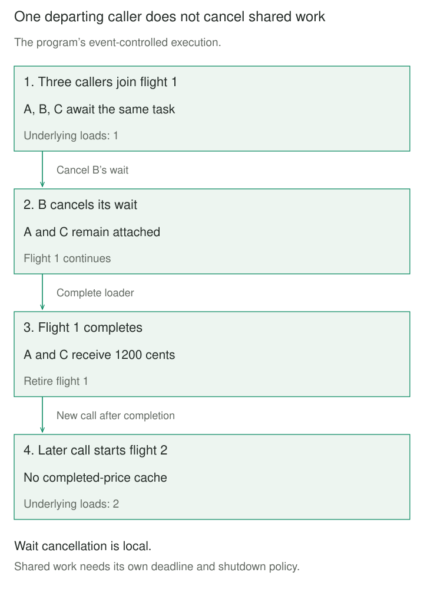

## Purpose and problem

A popular product’s cached price expires. Several page requests miss together, and each starts the same database read. The reads produce equivalent answers, but multiply source load precisely when traffic is highest. A cache can be effective most of the day while still causing these bursts.

The service wants one useful load to satisfy overlapping readers. It must also decide which requests really are equivalent, who owns the shared operation, and what happens when one caller disconnects or the source fails.

## Core idea

**Request Coalescing keeps a registry of work currently in progress, indexed by complete operation identity.** The first caller starts a load; overlapping callers join that flight and receive its outcome. Once it finishes, the registry entry retires. A later caller starts new work unless a separate cache supplies its answer.

Think **same key, same active work, separate callers**. Go’s `singleflight` package documents duplicate-call suppression within a `Group`. Varnish calls its waiting-list mechanism request coalescing; Fastly calls the HTTP-cache arrangement request collapsing. These are the basis for the searchable names Singleflight and Request Collapsing here, with implementation-specific behavior preserved.

Unlike batching, coalescing suppresses equivalent executions rather than packing different operations into one call. It can operate without a cache.


## How it works

### Make equivalence and scope explicit

The key must capture everything affecting whether an answer may be shared: operation, resource, tenant or authorization partition, representation, currency, and relevant version. Authorize each caller before lookup. Do not silently read request-specific credentials or context outside the key and let another caller inherit their result.

Choose one coordinator scope deliberately. An object on one event loop, a process-wide group, a proxy node, and a distributed coordinator have different boundaries. Ten independent instances can still issue ten loads for a hot key. A new coordinator per request shares nothing.

Register the flight before another caller can start equivalent work. Synchronization must protect that decision, not serialize the whole source read. Different keys should progress independently. After completion, remove only the entry still associated with that flight, so an old completion cannot erase a replacement.

### Give shared work its own lifecycle

Callers own their waits; the service owns the shared load. One caller’s timeout need not cancel work still useful to others. Conversely, a service deadline may terminate the underlying load and fail every waiter. Cancellation of waiting is not proof that a remote operation stopped.

Successes and ordinary failures can be shared. Always retire failed work so a later attempt can recover. Immediate synchronized retries can create another burst; retry budgets and backoff remain separate concerns. Forcing an active key to be forgotten can also permit overlapping executions rather than safely canceling the first one.

Bound active keys, waiters, and source concurrency according to capacity. A slow popular key can retain many callers; a flood of unique keys offers no duplicate suppression. Share immutable results or define copying and ownership for mutable values. Coalescing writes requires genuine semantic equivalence; matching URLs alone cannot merge two distinct purchases.

## Worked example

### Overlapping price reads and one departing caller

Before the change, three readers each run the price loader. Afterward, three coroutine callers share one loader. B cancels its wait; A and C still receive the price. A later read loads again, demonstrating that the registry is not a result cache.

Save as `coalescing.py` and run `python3 coalescing.py` with Python 3.11+. Use one instance on one event loop with the default deferred task factory. Keys are trusted immutable, hashable operation identities. The async loader must use that identity and must not recursively await the same flight.

The example key identifies tenant A, SKU 7, USD, and price version 3 within this price-loader instance. The result is immutable integer **USD cents**. Events control overlap; `sleep(0)` yields scheduling rather than simulating a duration.

```python
import asyncio


class Coalescer:
    def __init__(self, load):
        self.load = load
        self.flights = {}
        self.closed = False

    def _retire(self, key, task):
        if self.flights.get(key) is task:
            del self.flights[key]
        if not task.cancelled():
            task.exception()  # Observe errors even if all waiters left.

    async def get(self, key):
        if self.closed:
            raise RuntimeError("coalescer closed")
        task = self.flights.get(key)
        if task is None or task.done():
            task = asyncio.create_task(self.load(key))
            self.flights[key] = task
            task.add_done_callback(lambda done: self._retire(key, done))
        return await asyncio.shield(task)

    async def close(self):
        self.closed = True
        await asyncio.gather(
            *(asyncio.shield(task) for task in self.flights.values()),
            return_exceptions=True,
        )


async def demo():
    started, release = asyncio.Event(), asyncio.Event()
    loads = 0
    key = ("tenant-A", "SKU-7", "USD", 3)
    prices = {key: 1200}

    async def load(key):
        nonlocal loads
        loads += 1
        started.set()
        await release.wait()
        return prices[key]

    group = Coalescer(load)
    try:
        a = asyncio.create_task(group.get(key))
        await started.wait()
        b = asyncio.create_task(group.get(key))
        c = asyncio.create_task(group.get(key))
        await asyncio.sleep(0)  # Let both followers join.
        b.cancel()
        try:
            await b
        except asyncio.CancelledError:
            print("B cancelled its wait")
        release.set()
        print("shared", await a, await c, "loads", loads)
        print("later", await group.get(key), "loads", loads)
    finally:
        release.set()
        await group.close()


if __name__ == "__main__":
    asyncio.run(demo())
```

The output is `B cancelled its wait`, `shared 1200 1200 loads 1`, and `later 1200 loads 2`. The second line reports two prices in cents and one underlying execution. Cancellation still reaches B; `shield` prevents it propagating into the shared task. Shielding would not prevent cancellation initiated against that task itself.

Lookup and registration contain no suspension under the stated scheduling assumptions. The registry strongly references active tasks. Completion observes errors, and waiting callers still receive those errors. The identity check protects replacement entries; the `task.done()` check prevents a completed result being reused while its cleanup callback awaits scheduling.



This code has no network, cache, authorization implementation, size limits, loader deadline, or distributed coordination. It continues work even after every waiter leaves. `close` rejects new calls and drains owned tasks; a stuck loader can therefore delay shutdown. Production owners must add capacity, deadline, shutdown, and error-observation policies appropriate to their service.

### HTTP proxies must check whether sharing is valid

A proxy can queue requests behind an origin fetch for a cache identity. Fastly documents that a cacheable response can satisfy waiting requests, while a private or uncacheable response cannot simply be given to everyone. Pass behavior and waiting-list handling then matter. Generic function-result sharing and HTTP cache collapsing have related mechanisms but different response-eligibility contracts.

## When to use it

Use coalescing when equivalent reads overlap, source work is expensive, and callers can accept the same observed outcome. Cache fills, token refreshes within a compatible credential scope, and repeated metadata reads are recognizable cases.

Keep direct calls when overlap is rare or work is cheap. Keep distinct operations separate when each must execute, callers need independent snapshots, or sharing crosses an authorization boundary.

## Tradeoffs and common mistakes

Coalescing trades repeated work for shared waiting and failure concentration. One slow load can delay many readers. Measure active flights, waiters per key, sharing ratio, source concurrency, wait duration, and shared failures.

Common mistakes include incomplete keys, retaining failed entries forever, canceling shared work when one waiter departs, and assuming local suppression coordinates every server. Combining coalescing with cache fills still requires invalidation and stale-write reasoning: a shared old read remains old. Avoid same-key recursive dependencies that wait on their own result.

## Related patterns

[[cache-aside|Cache-Aside]] controls cache lookup, fill, and invalidation. Coalescing can coordinate overlapping miss loads within its chosen scope.

[[memoization|Memoization]] reuses completed results. Coalescing shares an active execution and can retire it immediately after completion.

[[batching|Batching]] groups compatible operations to share execution overhead. Coalescing instead recognizes operations whose execution can be shared entirely.

[[timeout|Timeout]] bounds a caller’s wait or a service operation according to its scope. A waiter deadline and the shared loader’s deadline need not be the same.

## Sources

- [Go: singleflight](https://pkg.go.dev/golang.org/x/sync/singleflight) — keyed duplicate-call suppression, group scope, shared outcomes, and forgetting active keys.
- [Varnish: Under the hood, waiting lists](https://docs.varnish-software.com/book/what-is-varnish/under-the-hood/) — busy objects and request coalescing.
- [Fastly: Request collapsing](https://www.fastly.com/documentation/guides/concepts/cache/request-collapsing/) — queued origin fetches and private/uncacheable response handling.
- [Python: Coroutines and tasks](https://docs.python.org/3/library/asyncio-task.html) — task scheduling, shielding, strong references, cancellation, and gathering.

The price-read scenario, event-controlled program, cancellation experiment, and diagrams are original teaching material.
